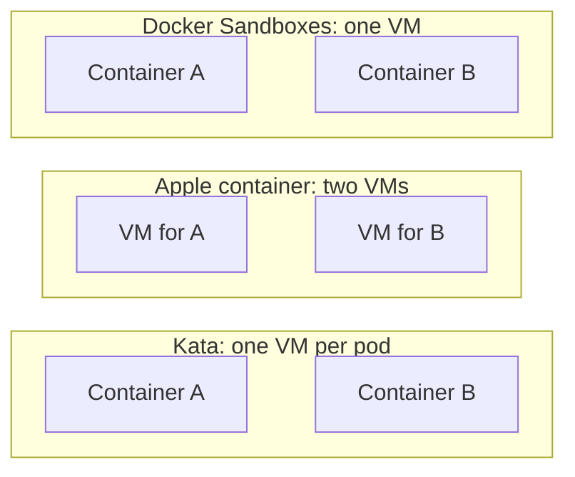
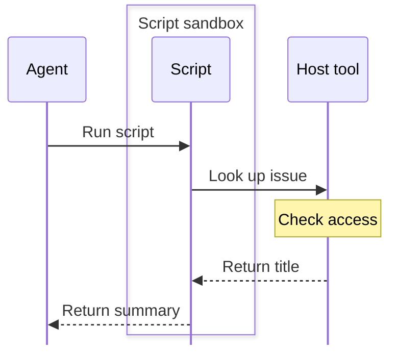

# Agent sandbox architectures

*Survey updated November 22, 2026. This chapter compares documented architecture, not measured performance or security guarantees.*

This survey compares how specific projects isolate coding agents and the code they generate.

## Execution boundaries

Start with [Sandbox isolation boundaries](sandbox-isolation-boundaries.md) for the six types of isolation. In this survey, a **virtual machine monitor (VMM)** is the component that manages a VM and the devices it can see. It is not the same as a complete sandbox product.

## Hardware-backed Linux environments

| Project | What it provides | Boundary and scope |
| --- | --- | --- |
| [Docker Sandboxes (`sbx`)](https://docs.docker.com/ai/sandboxes/architecture/) | Ready-to-use coding-agent environment | Each local sandbox runs in a microVM with its own Docker daemon. The agent can build and run containers without access to the host Docker socket. Host workspace mounts and the outbound proxy are separate trust decisions. [Local installation](https://docs.docker.com/ai/sandboxes/install/) documents macOS, Windows, and Linux requirements. |
| [libkrun](https://github.com/containers/libkrun) | Embeddable VMM library with a Rust and C API | Uses KVM on Linux and Hypervisor Framework on Apple silicon. The caller decides which host files and devices to expose. [Gondolin](https://github.com/earendil-works/gondolin/blob/main/docs/backends.md) is a sandbox layer that can use libkrun or QEMU as its VMM. |
| [Cloud Hypervisor](https://github.com/cloud-hypervisor/cloud-hypervisor) | General-purpose cloud VMM | Runs on KVM or MSHV and supports Linux and Windows guests. It is a backend, not a complete agent sandbox with workspace and credential policies. |
| [Firecracker](https://github.com/firecracker-microvm/firecracker) | Minimal VMM for microVMs | Uses KVM on Linux in the usual deployment. Upstream also documents an [AWS Nitro Sandboxes backend](https://github.com/firecracker-microvm/firecracker/tree/main/docs/nitro-sandboxes) that uses AWS Nitro instead of host KVM. |
| [Kata Containers](https://github.com/kata-containers/kata-containers/blob/main/docs/design/architecture/README.md) | VM-backed container runtime | In Kubernetes, a pod runs in a guest VM; containers in that pod can share the guest kernel. Kata [supports multiple VMMs](https://github.com/kata-containers/kata-containers/blob/main/docs/hypervisors.md), including QEMU, Cloud Hypervisor, and Firecracker. Kata and Firecracker are different layers, not direct alternatives. |
| [Microsoft NVX](https://github.com/microsoft/nvx/blob/42f413d226290e31ea288686d6f3dbfd20c45733/README.md) | OpenVMM-based microVM stack and guest runtime | Documents Linux hosts with KVM or MSHV and Windows hosts with Windows Hypervisor Platform. The guest runtime targets [one workload sandbox per Linux microVM](https://github.com/microsoft/nvx/blob/42f413d226290e31ea288686d6f3dbfd20c45733/doc/design/4-guest-runtime-architecture.md). |
| [Apple `container`](https://github.com/apple/container/blob/main/docs/technical-overview.md) | Local OCI container tooling for Apple silicon | Runs a lightweight Linux VM **per container** via Apple's Virtualization framework. It takes container images as input, but the isolation boundary is a VM, not a user-space kernel. |

### Which workloads share a guest kernel?

The [isolation unit](glossary/isolation-unit.md) is the set of workloads that share one instance of a boundary. Compare where two example containers, A and B, run in each implementation.

A and B share a guest kernel in the Docker and Kata examples. In the Apple example they run in separate VMs. If two workloads must be isolated from each other at the VM boundary, check whether the runtime places them in the same guest.

## Containers and processes without a guest Linux kernel

- [Google gVisor](https://gvisor.dev/docs/architecture_guide/intro/) provides the OCI runtime `runsc`. Its **Sentry**, a kernel implemented in user space, handles Linux system calls from the workload. Even on gVisor's KVM platform, the Sentry provides the Linux system interface; it is not a separate Linux guest kernel like Kata's. Test compatibility and performance with real workloads rather than assuming that every Linux interface behaves identically.
- [Anthropic Sandbox Runtime](https://github.com/anthropic-experimental/sandbox-runtime) can constrain native processes without a guest VM. It uses bubblewrap on Linux and Seatbelt on macOS, with proxy-based network restrictions. This is a different fit from gVisor: the workload still uses the host OS kernel, subject to that OS's restrictions.

## Code Mode: isolating tool scripts instead of shells

In **Code Mode**, the model writes a program that calls tools and combines their results. The outer application decides which tools are available and what those tools may do. The sandbox that runs this program does not automatically confine the host tool handlers or the rest of the agent.

Follow one issue lookup before comparing the implementations:

The host tool handler checks whether the caller may read the issue. The sandbox limits which tools the script can call; it does not authorize each tool request.

| Implementation | Execution boundary | What makes it different? |
| --- | --- | --- |
| [Pi `codemode`](https://github.com/earendil-works/pi/blob/9c4652688590abb836b40ebd1e4725ecf9a7c7d1/packages/codemode/README.md) | QuickJS compiled to Wasm (`quickjs-wasi`) | The Pi revision reviewed here runs JavaScript and provides injected tools. Scripts have no direct Node API, filesystem, or network access. The use of `quickjs-wasi` does not mean the sandbox grants access to a general WASI filesystem. |
| [Earendil `djs`](https://github.com/earendil-works/djs/blob/c34b2a5974db47d9caafe7083a67ce4408d7333d/README.md) | A JavaScript/TypeScript engine written in Rust and built primarily for Wasm | Designed for deterministic execution with controlled inputs and for suspending and resuming scripts. The project describes it as a QuickJS replacement and ships a Pi adapter. The Pi revision above still [depends on `quickjs-wasi`](https://github.com/earendil-works/pi/blob/9c4652688590abb836b40ebd1e4725ecf9a7c7d1/packages/codemode/package.json); check the installed release before assuming a migration. |
| [OpenCode Code Mode](https://github.com/anomalyco/opencode/blob/5310e42203af41c3452ee44b24fc7d0c52aaa3cc/packages/codemode/README.md) | Restricted JavaScript-like interpreter, not a Wasm sandbox | Uses [Psychoscript](https://github.com/anomalyco/psychoscript) to interpret a supported subset of JavaScript. Host-provided tools are the route to files, networks, and APIs. |
| [Cloudflare Dynamic Workers](https://blog.cloudflare.com/dynamic-workers/) | V8 isolate | Runs dynamically loaded code in the Workers runtime. The caller can block outbound requests and pass specific bindings. [Cloudflare's Linux container sandboxes](https://developers.cloudflare.com/sandbox/) are a different option: each instance is a microVM. |
| [Wasmtime](https://docs.wasmtime.dev/security.html) | General-purpose Wasm runtime | Fits workloads distributed as Wasm modules rather than arbitrary Linux binaries. The embedding application controls which imports and host capabilities are available. |

A script with an unrestricted `bash` tool or a broad write-capable API is not low privilege merely because its interpreter has no direct I/O. Authorize each tool call at the host boundary. If a tool needs to execute native code, that tool can dispatch it to a separate Linux sandbox.

## What is changing in 2026

1. **Provisioning is shifting from booting to restoring.** [E2B Runtime](https://github.com/e2b-dev/infra) restores pre-booted Firecracker templates and supports pausing and resuming sandboxes. [Vercel Sandbox](https://vercel.com/docs/sandbox) also uses Firecracker and exposes snapshots. [Amazon Bedrock AgentCore Runtime V2](https://aws.amazon.com/about-aws/whats-new/2026/11/new-agentcore-runtime-default/) became the default for new runtimes on November 12, 2026, and restores microVM sessions from prepared snapshots. Compare cold boot, snapshot restore, and time to the first usable command separately. Check whether a snapshot contains disk state, memory, or both, and whether it can contain credentials.
2. **Control planes are separating from execution backends.** [Kubernetes Agent Sandbox](https://agent-sandbox.sigs.k8s.io/docs/) adds a declarative lifecycle API, templates, claims, and warm pools. It can use gVisor or Kata, but the selected runtime determines the boundary. [NVIDIA OpenShell](https://github.com/NVIDIA/OpenShell) illustrates the policy layer: a gateway manages sandbox access and can supply credentials only to approved outbound destinations. Compare these features separately from the execution boundary.
3. **Hardware-backed isolation is not limited to host KVM.** On November 9, 2026, [AWS announced Nitro Sandboxes for EKS, ECS, and EC2](https://aws.amazon.com/about-aws/whats-new/2026/11/nitro-sandboxes-eks-ecs-ec2/). EKS pods or ECS tasks configured to use Nitro Sandboxes get their own Nitro-managed VMs. On EC2, Firecracker can manage the guest without using KVM in the parent instance.
4. **One agent can use more than one boundary.** Cloudflare documents an isolate for code that calls a few methods and a Linux microVM for code that needs a full environment. The same split also works on a local or self-hosted stack: run tool scripts in Wasm or a restricted interpreter, and send builds or tests to a Linux sandbox only when needed.

## How to evaluate a candidate

1. **Choose the unit of isolation.** Decide whether sessions, tenants, pods, or individual tool calls must be separate. Check cleanup and what persists across restarts, snapshot restores, and forks.
2. **List what crosses the boundary.** Record every host mount, socket, network route, credential, and tool API. Prefer a read-only or copied workspace when direct edits are not required. Limit outbound traffic and keep reusable credentials out of the sandbox when a policy broker can supply them per request.
3. **Measure a real task.** Record time to the first usable command, peak memory, disk use, and compatibility with the package manager, build, or tests that matter. Test both an empty cache and a prepared image. Use harmless test files and endpoints to verify that intended access works and denied access fails.

Use [Choosing a sandbox](practice/design/choosing-a-sandbox.md) to turn the checklist into a design decision. Then run the local examples in [Measuring a sandbox](practice/verification/measuring-a-sandbox.md) and [Verifying access rules](practice/verification/verifying-access-rules.md).
