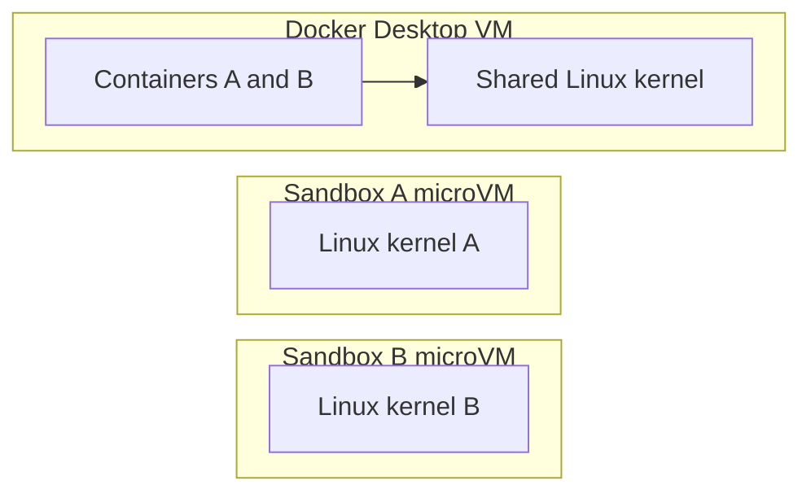
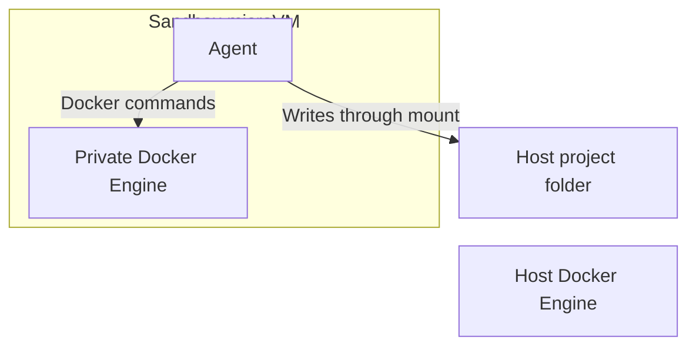
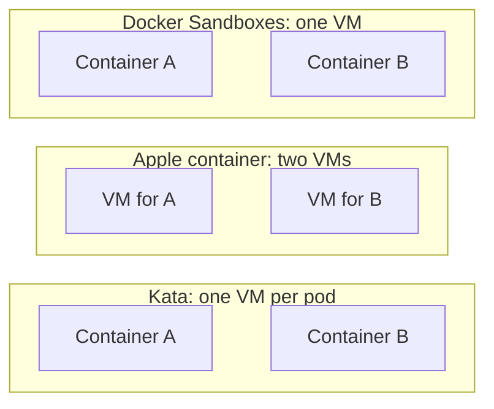
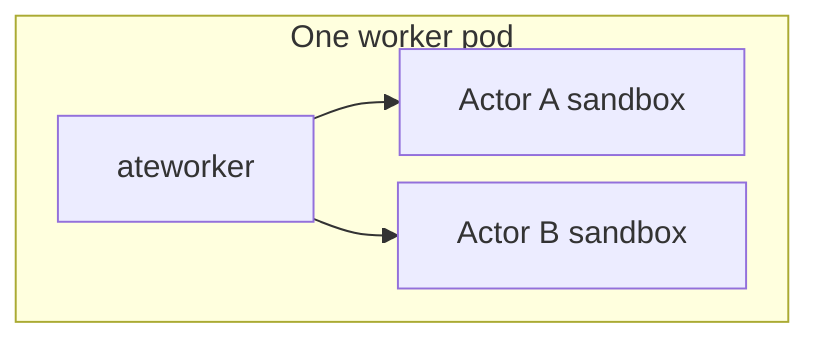
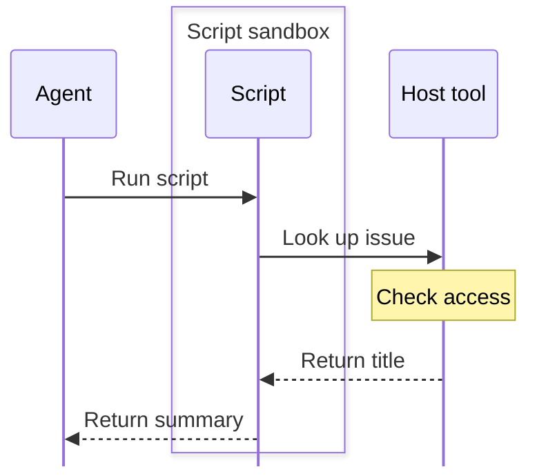

# Agent sandbox architectures

*Survey updated November 22, 2026. This chapter compares documented architecture, not measured performance or security guarantees.*

This survey compares how specific projects isolate coding [agents](glossary/agent.md) and the code they generate.

## Execution boundaries

An [isolation boundary](glossary/isolation-boundary.md) limits what a program can reach. A [policy](glossary/policy.md) says what should be allowed to cross that boundary. Start with [Sandbox isolation boundaries](sandbox-isolation-boundaries.md) for the six types of isolation.

A [virtual machine monitor (VMM)](glossary/virtual-machine-monitor.md) manages a [virtual machine (VM)](glossary/virtual-machine.md) and the devices it can see. It is not a complete [sandbox](glossary/sandbox.md) product: a separate [control plane](glossary/control-plane.md) can decide when to start the VM and which resources to give it.

## Hardware-backed Linux environments

| Project | What it provides | Boundary and scope |
| --- | --- | --- |
| [Docker Sandboxes (`sbx`)](https://docs.docker.com/ai/sandboxes/architecture/) | Ready-to-use coding-agent environment | Each local sandbox runs in a [microVM](glossary/microvm.md) with its own [Docker Engine](https://docs.docker.com/engine/). See the [Docker Sandboxes case study](#docker-sandboxes) for what the VM does and does not isolate. [Local installation](https://docs.docker.com/ai/sandboxes/install/) documents macOS, Windows, and Linux requirements. |
| [libkrun](https://github.com/containers/libkrun) | Embeddable VMM library with a Rust and C API | Uses [KVM](glossary/kernel-based-virtual-machine.md) on Linux and [Hypervisor Framework](https://developer.apple.com/documentation/hypervisor) on Apple silicon. The caller decides which host files and devices to expose. [Gondolin](https://github.com/earendil-works/gondolin/blob/main/docs/backends.md) is a sandbox layer that can use libkrun or QEMU as its VMM. |
| [Cloud Hypervisor](https://github.com/cloud-hypervisor/cloud-hypervisor) | General-purpose cloud VMM | Runs on KVM or [MSHV](glossary/microsoft-hypervisor.md) and supports Linux and Windows [guests](glossary/guest.md). It is a backend, not a complete agent sandbox with workspace and [credential](glossary/credential.md) policies. |
| [Firecracker](https://github.com/firecracker-microvm/firecracker) | Minimal VMM for microVMs | Uses KVM on Linux in the usual deployment. Upstream also documents an [AWS Nitro Sandboxes backend](https://github.com/firecracker-microvm/firecracker/tree/main/docs/nitro-sandboxes) that uses AWS Nitro instead of host KVM. |
| [Kata Containers](https://github.com/kata-containers/kata-containers/blob/main/docs/design/architecture/README.md) | VM-backed [container runtime](glossary/container-runtime.md) | In [Kubernetes](https://kubernetes.io/docs/concepts/overview/), a [pod](glossary/pod.md) runs in a guest VM; containers in that pod can share the guest [kernel](glossary/kernel.md). Kata [supports multiple VMMs](https://github.com/kata-containers/kata-containers/blob/main/docs/hypervisors.md), including QEMU, Cloud Hypervisor, and Firecracker. Kata and Firecracker are different layers, not direct alternatives. |
| [Microsoft NVX](https://github.com/microsoft/nvx/blob/42f413d226290e31ea288686d6f3dbfd20c45733/README.md) | OpenVMM-based microVM stack and guest runtime | Documents Linux hosts with KVM or MSHV and Windows hosts with [Windows Hypervisor Platform](glossary/windows-hypervisor-platform.md). The guest runtime targets [one workload sandbox per Linux microVM](https://github.com/microsoft/nvx/blob/42f413d226290e31ea288686d6f3dbfd20c45733/doc/design/4-guest-runtime-architecture.md). |
| [Apple `container`](https://github.com/apple/container/blob/main/docs/technical-overview.md) | Local [OCI](glossary/open-container-initiative.md) container tooling for Apple silicon | Runs a lightweight Linux VM **per container** via Apple's [Virtualization framework](https://developer.apple.com/documentation/virtualization). It takes [container images](glossary/container-image.md) as input, but the isolation boundary is a VM, not a user-space kernel. |

### Docker Sandboxes: one VM per sandbox {#docker-sandboxes}

Each local Docker Sandbox gets its own Linux [guest kernel](glossary/guest.md), but the agent can still edit any [host](glossary/host.md) [workspace](glossary/workspace.md) that you share with write access. That's the distinction behind Kaan Yagci's [*Wait, Docker Sandboxes Aren’t Containers?*](https://x.com/yagcidev/article/2120166357060768143): a sandbox separates the execution environment, not every resource the agent can reach.

Docker Sandboxes does not require [Docker Desktop or Docker Engine on the host](https://docs.docker.com/ai/sandboxes/install/). On macOS and Windows, [Docker Desktop runs Linux containers in a Linux VM](https://docs.docker.com/desktop/features/vmm/). Those [containers](glossary/container.md) still share that VM's [kernel](glossary/kernel.md). With [Docker Sandboxes](https://docs.docker.com/ai/sandboxes/security/isolation/#hypervisor-isolation), the VM boundary is around each sandbox, not each container it starts.

The agent's Docker commands go to the [engine inside the sandbox](https://docs.docker.com/ai/sandboxes/security/isolation/#docker-engine-isolation), which can build images and run containers without access to the host Docker socket. File writes follow a different path: with a writable [mount](glossary/mount.md), they go straight to the host project folder.

The private engine is not a [network policy](practice/data-and-access/network-policy.md). For example, the agent could still reach a production Docker Engine if its [Docker context](https://docs.docker.com/engine/manage-resources/contexts/) points there, the network allows the connection, and it can authenticate. Comparing the output of `docker context ls` inside and outside the sandbox checks client configuration, not whether production access is blocked.

For [local workspaces](https://docs.docker.com/ai/sandboxes/security/isolation/#workspace-isolation), `sbx run` uses the current directory as a writable workspace if you don't provide a path. Removing the sandbox does not undo edits to that directory. Use [`--clone`](https://docs.docker.com/ai/sandboxes/security/isolation/#clone-mode) to let the agent edit a private copy for review. The VM can still read the original checkout, including untracked files such as `.env`. If the agent doesn't need any project files, create a sandbox without a host workspace.

#### When to choose Docker Sandboxes {#when-to-choose-docker-sandboxes}

Choose local Docker Sandboxes when an agent needs both a local project and its own Docker Engine. For example, let the agent fix a backend bug, build an image, start a database with [Docker Compose](https://docs.docker.com/compose/), and run integration tests. The containers run inside the sandbox VM, not in your usual Docker environment.

- **Embed a sandbox in your own application:** [Gondolin](https://github.com/earendil-works/gondolin#feature-highlights) also gives the workload a Linux microVM. Choose it when you want to define file access and outbound HTTP policy in JavaScript rather than run a coding agent through `sbx`.
- **Start sandboxes on demand from a service:** Compare [E2B Runtime](https://github.com/e2b-dev/infra) with the [Docker Sandboxes cloud API and SDK](https://docs.docker.com/ai/sandboxes-api/). Both provide programmatic provisioning. [Docker cloud sandboxes](https://docs.docker.com/ai/sandboxes/cloud/local-vs-cloud/) don't mount folders from the computer that starts them. Check the timeout and what happens at expiry before leaving a job unattended.

### Which workloads share a guest kernel?

The [isolation unit](glossary/isolation-unit.md) is the set of workloads that share one instance of a boundary. Compare where two example containers, A and B, run in each implementation.

A and B share a guest kernel in the Docker and Kata examples. In the Apple example they run in separate VMs. If two workloads must be isolated from each other at the VM boundary, check whether the runtime places them in the same guest.

## Containers and processes without a guest Linux kernel

- [Google gVisor](https://gvisor.dev/docs/architecture_guide/intro/) provides the OCI runtime `runsc`. Its **Sentry**, a [user-space kernel](glossary/user-space-kernel.md), handles Linux [system calls](glossary/system-call.md) from the [workload](glossary/workload.md). Even on gVisor's KVM platform, the Sentry provides the Linux system interface; it is not a separate Linux guest kernel like Kata's. Test compatibility and performance with real workloads rather than assuming that every Linux interface behaves identically.
- [Anthropic Sandbox Runtime](https://github.com/anthropic-experimental/sandbox-runtime) can constrain native processes without a guest VM. It uses [Bubblewrap](https://github.com/containers/bubblewrap) on Linux and Seatbelt on macOS, with proxy-based network restrictions. This is an [operating-system process sandbox](glossary/operating-system-process-sandbox.md): unlike with gVisor, the workload still uses the host OS kernel directly, subject to that OS's restrictions.

## Agent Substrate: one sandbox per actor on Kubernetes {#agent-substrate}

[Agent Substrate](https://github.com/agent-substrate/substrate/blob/f5428049ac0b81458eb12e81fa5a6b65cd39a2ad/docs/concepts/architecture.md) is a **stateful sandbox platform on Kubernetes**. Kubernetes keeps worker pods ready. Substrate assigns each running *Actor* to a worker and gives it its own sandbox: **gVisor** or a **Kata Containers microVM backed by Cloud Hypervisor**. The standard counter demo uses gVisor; in a deployment, the pool configuration determines the class. An Actor is an instance of a workload, not necessarily an AI agent. It can keep its identity and saved state without keeping a pod or sandbox running. This case study describes upstream revision `f5428049`.

### The worker pod is not the isolation unit {#agent-substrate-isolation}

A [warm pool](glossary/warm-pool.md) of pre-started worker pods provides capacity. One worker can host several Actors **at the same time**, each in a separate sandbox. Each sandbox can contain several containers for the same Actor. Do not assign mutually untrusted workloads to containers within one Actor. The [upstream security model](https://github.com/agent-substrate/substrate/blob/f5428049ac0b81458eb12e81fa5a6b65cd39a2ad/docs/security/security.md#defensible-multi-tenancy) treats the Actor, not its individual containers, as the boundary.

Each `WorkerPool` uses one [sandbox class](https://github.com/agent-substrate/substrate/blob/f5428049ac0b81458eb12e81fa5a6b65cd39a2ad/docs/reference/sandbox-classes.md#summary-of-differences). A cluster can offer both classes in separate pools. Both run workloads packaged as OCI container images; the image format does not determine how the code is isolated. A plain Linux container is not a supported Actor sandbox.

| Class | What separates Actors | What to check before choosing |
| --- | --- | --- |
| `gvisor` | Each Actor gets a gVisor `runsc` sandbox. Its Sentry implements Linux system calls in user space; it does not boot a Linux guest kernel. | Runs on standard Linux nodes. Test the Linux interfaces your workload needs. Resource limits apply at Actor level; the runtime ignores per-container limits. |
| `microvm` | Each Actor gets its own Linux guest. Cloud Hypervisor provides the VM, and the Kata guest components run the containers inside it. | Needs nodes with `/dev/kvm`. Allow capacity for guest RAM and VM overhead. This class enforces per-container limits inside the guest, but those limits do not give each container its own VM. |

### Who schedules, restores, and routes an Actor? {#agent-substrate-request-path}

Kubernetes and Substrate make different placement decisions. `atecontroller` turns the Kubernetes `WorkerPool` resource into a Deployment, and Kubernetes schedules those pods onto nodes. Substrate's own `ate-api-server` schedules **Actors onto existing workers**. It stores `ActorTemplate`, Actor, and Worker records in PostgreSQL, not as Kubernetes objects. An `ActorTemplate` supplies the image, resources, and snapshot settings; a Kubernetes `SandboxConfig` supplies the runtime versions for its class. See the [resource model](https://github.com/agent-substrate/substrate/blob/f5428049ac0b81458eb12e81fa5a6b65cd39a2ad/docs/concepts/architecture.md#api-resource-models).

1. **Create.** Substrate registers the Actor without reserving a running sandbox. It normally starts from the template's prepared *golden snapshot*, if one is available when the Actor is created. Without a starting snapshot, it starts from the ActorTemplate's images. See [the golden snapshot workflow](https://github.com/agent-substrate/substrate/blob/f5428049ac0b81458eb12e81fa5a6b65cd39a2ad/docs/reference/api-guide.md#the-golden-snapshot).
2. **Wake and route.** On an incoming HTTP request, `atenet-router` asks the control plane to find the Actor by its atespace and name. An *atespace* groups Substrate resources for access control; it is not a Kubernetes namespace. If the Actor is suspended, the control plane assigns eligible worker capacity. The node supervisor `atelet` tells `ateworker` inside that pod to restore or boot the sandbox. When ready, the router forwards the request through the worker's authenticated `atunnel` connection. See the [request path and lifecycle](https://github.com/agent-substrate/substrate/blob/f5428049ac0b81458eb12e81fa5a6b65cd39a2ad/docs/concepts/architecture.md#actor-lifecycle).
3. **Suspend and reuse.** The application or agent harness calls `SuspendActor` when it wants to release the Actor's compute capacity. Do not assume the router suspends an Actor when a request finishes. The runtime captures a snapshot and releases the Actor's slot. A later request can restore the same Actor on another compatible worker. Under burst load, the router can [hold requests briefly and retry](https://github.com/agent-substrate/substrate/blob/f5428049ac0b81458eb12e81fa5a6b65cd39a2ad/docs/concepts/request-parking.md#behavior); if capacity does not free up, it can still return HTTP `503`.

### What survives suspension? {#agent-substrate-snapshots}

The [snapshot settings](https://github.com/agent-substrate/substrate/blob/f5428049ac0b81458eb12e81fa5a6b65cd39a2ad/docs/concepts/architecture.md#state-management--persistence) control what can survive. The template's `preferredFidelity` is an upper limit, not a promise that every restore keeps memory.

| Snapshot level | What it preserves | What happens on resume |
| --- | --- | --- |
| `VOLUMES` | Data in snapshot-capable `DurableDir` volumes. | Starts new processes with that data available. |
| `ROOTFS` | Volume data and changes to the containers' writable root filesystems. | Starts new processes with those file changes in place. |
| `MEMORY` (default preference) | Volume data, root filesystem changes, and running process state and memory. | Can resume the saved processes on a worker with a compatible runtime. |

The [counter demo](https://github.com/agent-substrate/substrate/blob/f5428049ac0b81458eb12e81fa5a6b65cd39a2ad/demos/counter/README.md#how-to-use) shows the difference between restoring a process and restarting from an image: after a memory snapshot, the in-memory count and two file-based counts all continue from 1 to 2. This does not mean that every snapshot can move anywhere. A restore stays in the original sandbox class. If no compatible worker has capacity for a memory restore, a durable snapshot can [fall back to `ROOTFS` and start new processes](https://github.com/agent-substrate/substrate/blob/f5428049ac0b81458eb12e81fa5a6b65cd39a2ad/docs/reference/sandbox-classes.md#snapshots-volumes-rootfs-and-memory).

By default, suspension returns when the **node-local** checkpoint is ready. A background transfer makes it durable in object storage (Google Cloud Storage or S3). If the node fails before the upload completes, the latest checkpoint can be lost. A synchronous suspend waits for upload; it is a better fit when the application must know that state is off the node before releasing it. The [eviction guide](https://github.com/agent-substrate/substrate/blob/f5428049ac0b81458eb12e81fa5a6b65cd39a2ad/docs/reference/api-guide.md#eviction) explains why a harness must plan for eviction instead of relying on automatic checkpointing at pod shutdown.

### Network access and credentials {#agent-substrate-access}

The [security model](https://github.com/agent-substrate/substrate/blob/f5428049ac0b81458eb12e81fa5a6b65cd39a2ad/docs/security/security.md#security-boundaries) gives each Actor a private network. Inbound traffic comes through the authenticated router, not directly from another Actor. Outbound traffic is denied by default. The DNS relay and `atenet-egress` enforce what an Actor can reach. The outside application still has to decide **which end user can invoke which Actor**.

For [credential injection](https://github.com/agent-substrate/substrate/blob/f5428049ac0b81458eb12e81fa5a6b65cd39a2ad/docs/guides/egress-credential-injection.md#how-it-works), the Actor sends a placeholder in a request header. If the rule permits the request and names that header, the gateway obtains a credential or a signed token that identifies the Actor, replaces the placeholder, and sends the request upstream. For HTTPS header replacement, the gateway must terminate TLS and the Actor must trust the gateway's certificate authority. The Actor does not need the credential to make the call, so the injection step does not put the secret in its memory or snapshot. This does not protect secrets that an application puts into the sandbox or that an upstream service sends back in its response. A broad rule can still authorize unwanted calls.

The platform still trusts infrastructure outside the sandbox, including the worker manager, gateways, and snapshot storage. The upstream [status table](https://github.com/agent-substrate/substrate/blob/f5428049ac0b81458eb12e81fa5a6b65cd39a2ad/docs/security/security.md#defensible-multi-tenancy) lists worker privilege reduction and cleanup guarantees as work in progress. An atespace is not a substitute for a separate sandbox or a network policy.

### When to choose Agent Substrate {#agent-substrate-when-to-choose}

Consider it when you already operate Kubernetes and need many long-lived agent identities or workspaces, but only a fraction need compute at once. For example, an agent that waits hours for user input can release its slot and resume the same workspace on demand. An agent fleet that runs continuously gains less from suspend and resume. This is infrastructure for running agent code, not a framework for choosing tools or managing conversations.

The design trades idle compute for snapshot storage, transfer, and restore work. Measure the time from the incoming request to the first usable response with your workload: compare an already-running Actor, a node-local restore, and a remote restore. Include a burst that fills the pool, and check both latency and `503` rates. Do not use a control-plane number as end-to-end latency: upstream's [ResumePaused benchmark](https://github.com/agent-substrate/substrate/blob/f5428049ac0b81458eb12e81fa5a6b65cd39a2ad/docs/guides/benchmarking.md#resumepaused-benchmark) deliberately excludes the router and real sandbox restore.

## Code Mode: isolating tool scripts instead of shells

In [Code Mode](glossary/code-mode.md), the model writes a program that calls [tools](glossary/tool.md) and combines their results. The outer application decides which tools are available and what those tools may do. The sandbox that runs this program does not automatically confine the [host tool handlers](glossary/host-function.md) or the rest of the agent.

Follow one issue lookup before comparing the implementations:

The host tool handler checks whether the caller may read the issue. The sandbox limits which tools the script can call; it does not [authorize](glossary/authorization.md) each tool request.

| Implementation | Execution boundary | What makes it different? |
| --- | --- | --- |
| [Pi `codemode`](https://github.com/earendil-works/pi/blob/9c4652688590abb836b40ebd1e4725ecf9a7c7d1/packages/codemode/README.md) | QuickJS compiled to [Wasm](glossary/webassembly.md) (`quickjs-wasi`) | The Pi revision reviewed here runs JavaScript and provides injected tools. Scripts have no direct Node API, filesystem, or network access. The use of `quickjs-wasi` does not mean the sandbox grants access to a general [WASI](glossary/webassembly-system-interface.md) filesystem. |
| [Earendil `djs`](https://github.com/earendil-works/djs/blob/c34b2a5974db47d9caafe7083a67ce4408d7333d/README.md) | A JavaScript/TypeScript engine written in Rust and built primarily for Wasm | Designed for deterministic execution with controlled inputs and for suspending and resuming scripts. The project describes it as a QuickJS replacement and ships a Pi adapter. The Pi revision above still [depends on `quickjs-wasi`](https://github.com/earendil-works/pi/blob/9c4652688590abb836b40ebd1e4725ecf9a7c7d1/packages/codemode/package.json); check the installed release before assuming a migration. |
| [OpenCode Code Mode](https://github.com/anomalyco/opencode/blob/5310e42203af41c3452ee44b24fc7d0c52aaa3cc/packages/codemode/README.md) | [Restricted interpreter](glossary/restricted-interpreter.md) for JavaScript-like scripts, not a Wasm sandbox | Uses [Psychoscript](https://github.com/anomalyco/psychoscript) to interpret a supported subset of JavaScript. The host can grant external access through tools or extension functions such as `fetch`. |
| [Cloudflare Dynamic Workers](https://blog.cloudflare.com/dynamic-workers/) | V8 [engine isolate](glossary/engine-isolate.md) | Runs dynamically loaded code in the Workers runtime. The caller can block outbound requests and pass specific bindings. [Cloudflare's Linux container sandboxes](https://developers.cloudflare.com/sandbox/) are a different option: each instance is a microVM. |
| [Wasmtime](https://docs.wasmtime.dev/security.html) | General-purpose Wasm runtime | Fits workloads distributed as Wasm modules rather than arbitrary Linux binaries. The embedding application controls which imports and host capabilities are available. |

A script with an unrestricted `bash` tool or a broad write-capable API is not low privilege merely because its interpreter has no direct I/O. Authorize each tool call at the host boundary. If a tool needs to execute native code, that tool can dispatch it to a separate Linux sandbox.

## What is changing in 2026

1. **Provisioning is shifting from booting to restoring.** [E2B Runtime](https://github.com/e2b-dev/infra) restores pre-booted Firecracker templates and supports pausing and resuming sandboxes. [Vercel Sandbox](https://vercel.com/docs/sandbox) also uses Firecracker and exposes [snapshots](glossary/snapshot.md). [Amazon Bedrock AgentCore Runtime V2](https://aws.amazon.com/about-aws/whats-new/2026/11/new-agentcore-runtime-default/) became the default for new runtimes on November 12, 2026, and restores microVM sessions from prepared snapshots. Distinguish a [cold boot](glossary/cold-boot.md) from a snapshot restore. Measure the wait for a first usable command on each launch path. Check whether a snapshot contains disk state, memory, or both, and whether it can contain credentials.
2. **Control planes are separating from execution backends.** [Kubernetes Agent Sandbox](https://agent-sandbox.sigs.k8s.io/docs/) adds a declarative lifecycle API, templates, claims, and [warm pools](glossary/warm-pool.md). It can use gVisor or Kata, but the selected runtime determines the boundary. [NVIDIA OpenShell](https://github.com/NVIDIA/OpenShell) illustrates the policy layer: a gateway manages sandbox access and can supply credentials only to approved outbound destinations. Compare these features separately from the execution boundary.
3. **Hardware-backed isolation is not limited to host KVM.** On November 9, 2026, [AWS announced Nitro Sandboxes for EKS, ECS, and EC2](https://aws.amazon.com/about-aws/whats-new/2026/11/nitro-sandboxes-eks-ecs-ec2/). EKS pods or ECS tasks configured to use Nitro Sandboxes get their own Nitro-managed VMs. On EC2, Firecracker can manage the guest without using KVM in the parent instance.
4. **One agent can use more than one boundary.** Cloudflare documents an isolate for code that calls a few methods and a Linux microVM for code that needs a full environment. The same split also works on a local or self-hosted stack: run tool scripts in Wasm or a restricted interpreter, and send builds or tests to a Linux sandbox only when needed.

## How to evaluate a candidate

1. **Choose the unit of isolation.** Decide whether [sessions](glossary/sandbox-session.md), [tenants](glossary/tenant.md), pods, or individual tool calls must be separate. Check cleanup and what persists across restarts, snapshot restores, and forks.
2. **List what crosses the boundary.** Record every host mount, socket, network route, credential, and tool API. Prefer a read-only or copied workspace when direct edits are not required. Limit outbound traffic and keep reusable credentials out of the sandbox when a policy broker can supply them per request.
3. **Check each required access rule.** Use harmless test data. Show the allowed action succeeds and the denied action fails because of the rule, not because the resource was already missing. See [Verifying access rules](practice/verification/verifying-access-rules.md) for a local example.
4. **Measure the same task in each candidate that meets the requirements.** Record time to first output and time to completion separately. Include queueing and result transfer when they matter. Report resource use, compatibility, and the cache state rather than assuming two launch paths do the same work. See [Measuring a sandbox](practice/verification/measuring-a-sandbox.md) for a local timing example.

Use [Choosing a sandbox](practice/design/choosing-a-sandbox.md) to turn the checklist into a design decision. The two labs check one Bubblewrap configuration. They are not evidence for any surveyed product or deployed configuration.
