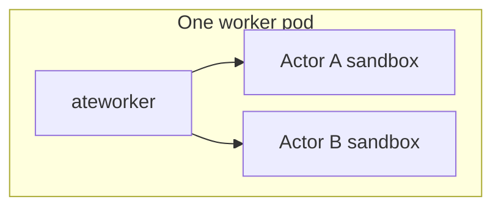

# Agent Substrate

**Agent Substrate runs many long-lived workloads on fewer Kubernetes worker pods.** It is most useful when work arrives in bursts: a workload can give up its compute capacity while idle and resume from saved state when the next request arrives.

## What is Agent Substrate? {#what-is-agent-substrate}

[Agent Substrate](https://github.com/agent-substrate/substrate/blob/f5428049ac0b81458eb12e81fa5a6b65cd39a2ad/docs/concepts/architecture.md) is a [sandbox](glossary/sandbox.md) platform on [Kubernetes](https://kubernetes.io/docs/concepts/overview/), not an agent framework or a sandbox runtime by itself. An *Actor* is one named instance of a [workload](glossary/workload.md), such as a coding [agent](glossary/agent.md) or an HTTP service. Kubernetes keeps worker [pods](glossary/pod.md) ready; Substrate assigns each running Actor capacity on a worker and gives it its own sandbox. One worker can run several Actors at once without putting them in the same sandbox.

The worker pool selects **[gVisor](https://gvisor.dev/docs/architecture_guide/intro/)** or a **[Kata Containers](https://github.com/kata-containers/kata-containers/blob/main/docs/design/architecture/README.md) [microVM](glossary/microvm.md)** backed by [Cloud Hypervisor](https://github.com/cloud-hypervisor/cloud-hypervisor). When the application suspends an Actor, Substrate captures a [snapshot](glossary/snapshot.md) and frees the Actor's slot. A later request can bring back that same Actor, possibly on another compatible worker. What comes back depends on what the snapshot captured. This page describes revision `f5428049`.

## How is it different from other projects? {#agent-substrate-comparison}

The key difference is **what the platform keeps alive**. The Actor's identity and saved state stay separate from the worker pod. A warm pool alone does not provide this behavior, and restoring a microVM from a snapshot is not unique to Substrate.

| Question | Agent Substrate | [Kubernetes Agent Sandbox: Warm Pool (v1.0.12)](https://github.com/kubernetes-sigs/agent-sandbox/blob/v1.0.12/examples/warmpool-quickstart/README.md) | [E2B Runtime (47c9255)](https://github.com/e2b-dev/runtime/blob/47c92550945704a8b2ac4ab5f20f1c3096141d08/README.md) | [Local Docker Sandboxes](https://docs.docker.com/ai/sandboxes/architecture/) |
| --- | --- | --- | --- | --- |
| What does the caller work with? | A named Actor scheduled onto an existing Kubernetes worker. | A `SandboxClaim` that adopts a prepared Sandbox. | A sandbox with one Firecracker microVM. | A local sandbox with one VM and its own Docker daemon. |
| What is prepared or restored? | Worker capacity is ready; Substrate restores Actor state into a separate gVisor or microVM sandbox. | The pool prepares Sandbox instances in advance from a template. | Creation restores a pre-booted VM template; a paused sandbox can resume from its own snapshot. | Each sandbox gets its own local VM, Docker daemon state, and image cache. |

Kubernetes Agent Sandbox is the closest comparison for the warm-pool workflow. E2B is the closest for pause and restore, and can also wake on incoming traffic. Substrate combines both ideas: it assigns a long-lived Actor to reusable Kubernetes worker capacity and supports two runtime classes.

## When is Agent Substrate a good fit? {#agent-substrate-when-to-choose}

**Choose it when you already run Kubernetes, need to keep many agent sessions or [workspaces](glossary/workspace.md), and expect only some to be busy at once.** For example, a coding agent may prepare a patch, then wait hours for a person to review it. Its harness can suspend the Actor during the wait. When the review arrives, an incoming request can restore the files and, with a compatible memory snapshot, resume the saved processes as well.

It is a weaker fit for a local sandbox on one developer's machine, jobs that can discard their state, or workloads that are busy almost all the time. In those cases, snapshots and an additional scheduling layer may add work without freeing much capacity.

The design trades idle compute for snapshot storage, transfer, and restore work. Measure the time from the incoming request to the first usable response with your workload: compare an already-running Actor, a node-local restore, and a remote restore. Include a burst that fills the pool, and check both latency and `503` rates. Do not use a control-plane number as end-to-end latency: upstream's [ResumePaused benchmark](https://github.com/agent-substrate/substrate/blob/f5428049ac0b81458eb12e81fa5a6b65cd39a2ad/docs/guides/benchmarking.md#resumepaused-benchmark) deliberately excludes the router and real sandbox restore.

## Implementation details {#agent-substrate-implementation}

### The worker pod is not the isolation unit {#agent-substrate-isolation}

A [warm pool](glossary/warm-pool.md) of pre-started worker pods provides capacity. One worker can host several Actors **at the same time**, each in a separate sandbox. Each sandbox can contain several containers for the same Actor. Do not assign mutually untrusted workloads to containers within one Actor. The [upstream security model](https://github.com/agent-substrate/substrate/blob/f5428049ac0b81458eb12e81fa5a6b65cd39a2ad/docs/security/security.md#defensible-multi-tenancy) treats the Actor, not its individual containers, as the boundary.

Each `WorkerPool` uses one [sandbox class](https://github.com/agent-substrate/substrate/blob/f5428049ac0b81458eb12e81fa5a6b65cd39a2ad/docs/reference/sandbox-classes.md#summary-of-differences). A cluster can offer both classes in separate pools. Both run workloads packaged as [OCI](glossary/open-container-initiative.md) [container images](glossary/container-image.md); the image format does not determine how the code is isolated. A plain Linux container is not a supported Actor sandbox.

| Class | What separates Actors | What to check before choosing |
| --- | --- | --- |
| `gvisor` | Each Actor gets a gVisor `runsc` sandbox. Its Sentry implements Linux [system calls](glossary/system-call.md) as a [user-space kernel](glossary/user-space-kernel.md); it does not boot a Linux [guest kernel](glossary/guest.md). | Runs on standard Linux nodes. Test the Linux interfaces your workload needs. Resource limits apply at Actor level; the runtime ignores per-container limits. |
| `microvm` | Each Actor gets its own Linux guest. Cloud Hypervisor provides the VM, and the Kata guest components run the containers inside it. | Needs nodes with `/dev/kvm`. Allow capacity for guest RAM and VM overhead. This class enforces per-container limits inside the guest, but those limits do not give each container its own VM. |

### Who schedules, restores, and routes an Actor? {#agent-substrate-request-path}

Kubernetes and Substrate make different placement decisions. `atecontroller` turns the Kubernetes `WorkerPool` resource into a Deployment, and Kubernetes schedules those pods onto nodes. Substrate's own [control plane](glossary/control-plane.md), `ate-api-server`, schedules **Actors onto existing workers**. It stores `ActorTemplate`, Actor, and Worker records in PostgreSQL, not as Kubernetes objects. An `ActorTemplate` supplies the image, resources, and snapshot settings; a Kubernetes `SandboxConfig` supplies the runtime versions for its class. See the [resource model](https://github.com/agent-substrate/substrate/blob/f5428049ac0b81458eb12e81fa5a6b65cd39a2ad/docs/concepts/architecture.md#api-resource-models).

1. **Create.** Substrate registers the Actor without reserving a running sandbox. It normally starts from the template's prepared *golden snapshot*, if one is available when the Actor is created. Without a starting snapshot, it starts from the ActorTemplate's images. See [the golden snapshot workflow](https://github.com/agent-substrate/substrate/blob/f5428049ac0b81458eb12e81fa5a6b65cd39a2ad/docs/reference/api-guide.md#the-golden-snapshot).
2. **Wake and route.** On an incoming HTTP request, `atenet-router` asks the control plane to find the Actor by its atespace and name. An *atespace* groups Substrate resources for access control; it is not a Kubernetes namespace. If the Actor is suspended, the control plane assigns eligible worker capacity. The node supervisor `atelet` tells `ateworker` inside that pod to restore or boot the sandbox. When ready, the router forwards the request through the worker's authenticated `atunnel` connection. See the [request path and lifecycle](https://github.com/agent-substrate/substrate/blob/f5428049ac0b81458eb12e81fa5a6b65cd39a2ad/docs/concepts/architecture.md#actor-lifecycle).
3. **Suspend and reuse.** The application or agent harness calls `SuspendActor` when it wants to release the Actor's compute capacity. Do not assume the router suspends an Actor when a request finishes. The runtime captures a snapshot and releases the Actor's slot. A later request can restore the same Actor on another compatible worker. Under burst load, the router can [hold requests briefly and retry](https://github.com/agent-substrate/substrate/blob/f5428049ac0b81458eb12e81fa5a6b65cd39a2ad/docs/concepts/request-parking.md#behavior); if capacity does not free up, it can still return HTTP `503`.

### What survives suspension? {#agent-substrate-snapshots}

The [snapshot settings](https://github.com/agent-substrate/substrate/blob/f5428049ac0b81458eb12e81fa5a6b65cd39a2ad/docs/concepts/architecture.md#state-management--persistence) control what can survive. The template's `preferredFidelity` is an upper limit, not a promise that every restore keeps memory.

| Snapshot level | What it preserves | What happens on resume |
| --- | --- | --- |
| `VOLUMES` | Data in snapshot-capable `DurableDir` volumes. | Starts new processes with that data available. |
| `ROOTFS` | Volume data and changes to the containers' writable root filesystems. | Starts new processes with those file changes in place. |
| `MEMORY` (default preference) | Volume data, root filesystem changes, and running process state and memory. | Can resume the saved processes on a worker with a compatible runtime. |

The [counter demo](https://github.com/agent-substrate/substrate/blob/f5428049ac0b81458eb12e81fa5a6b65cd39a2ad/demos/counter/README.md#how-to-use) shows the difference between restoring a process and restarting from an image: after a memory snapshot, the in-memory count and two file-based counts all continue from 1 to 2. This does not mean that every snapshot can move anywhere. A restore stays in the original sandbox class. If no compatible worker has capacity for a memory restore, a durable snapshot can [fall back to `ROOTFS` and start new processes](https://github.com/agent-substrate/substrate/blob/f5428049ac0b81458eb12e81fa5a6b65cd39a2ad/docs/reference/sandbox-classes.md#snapshots-volumes-rootfs-and-memory).

By default, suspension returns when the **node-local** checkpoint is ready. A background transfer makes it durable in object storage (Google Cloud Storage or S3). If the node fails before the upload completes, the latest checkpoint can be lost. A synchronous suspend waits for upload; it is a better fit when the application must know that state is off the node before releasing it. The [eviction guide](https://github.com/agent-substrate/substrate/blob/f5428049ac0b81458eb12e81fa5a6b65cd39a2ad/docs/reference/api-guide.md#eviction) explains why a harness must plan for eviction instead of relying on automatic checkpointing at pod shutdown.

### Network access and credentials {#agent-substrate-access}

The [security model](https://github.com/agent-substrate/substrate/blob/f5428049ac0b81458eb12e81fa5a6b65cd39a2ad/docs/security/security.md#security-boundaries) gives each Actor a private network. Inbound traffic comes through the authenticated router, not directly from another Actor. Outbound traffic is denied by default. The DNS relay and `atenet-egress` enforce what an Actor can reach. The outside application still has to decide **which end user can invoke which Actor**.

For [credential injection](glossary/credential-injection.md) (see the [upstream guide](https://github.com/agent-substrate/substrate/blob/f5428049ac0b81458eb12e81fa5a6b65cd39a2ad/docs/guides/egress-credential-injection.md#how-it-works)), the Actor sends a placeholder in a request header. If the rule permits the request and names that header, the gateway obtains a credential or a signed token that identifies the Actor, replaces the placeholder, and sends the request upstream. For HTTPS header replacement, the gateway must terminate TLS and the Actor must trust the gateway's certificate authority. The Actor does not need the credential to make the call, so the injection step does not put the secret in its memory or snapshot. This does not protect secrets that an application puts into the sandbox or that an upstream service sends back in its response. A broad rule can still authorize unwanted calls.

The platform still trusts infrastructure outside the sandbox, including the worker manager, gateways, and snapshot storage. The upstream [status table](https://github.com/agent-substrate/substrate/blob/f5428049ac0b81458eb12e81fa5a6b65cd39a2ad/docs/security/security.md#defensible-multi-tenancy) lists worker privilege reduction and cleanup guarantees as work in progress. An atespace is not a substitute for a separate sandbox or a [network policy](practice/data-and-access/network-policy.md).

See [Agent sandbox architectures](agent-sandbox-architectures.md#agent-substrate) to compare Substrate with other sandbox platforms.
