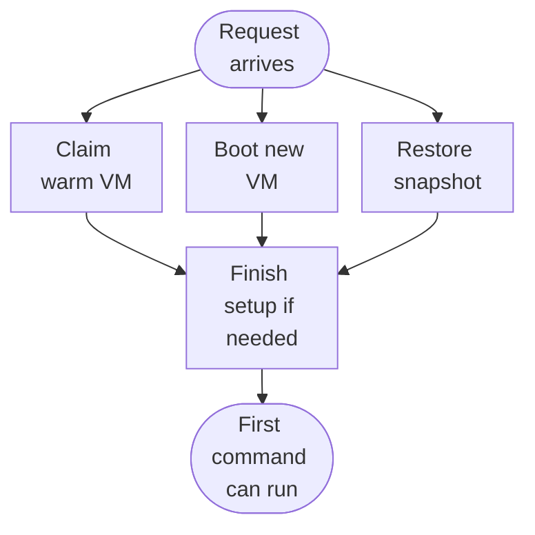

# Cold start

A cold start is the work needed to bring up a [sandbox](sandbox.md) or another execution environment when none is ready to use. It describes what happens when work arrives, not how the environment starts. It can involve a [cold boot](cold-boot.md), a [snapshot](snapshot.md) restore, or starting a language [runtime](runtime.md).

## Example

A test runner gets a request when its [warm pool](warm-pool.md) is empty. It restores a saved Linux VM, attaches the project's workspace, and waits for the sandbox to accept commands. The request sees a cold start even though the VM did not boot its operating system from scratch.

## Measure time to usable work

Cold-start latency is the wait until the environment can do useful work. For a command sandbox, measure from the request to the point when the sandbox can run the first command. Also record individual steps, such as reading an image, booting or restoring a VM, and preparing request-specific data. A fast boot or restore does not show how long the whole request waits.

Boot and restore can both be part of a cold start. Claiming a running VM from a warm pool moves boot or restore ahead of the request, but the VM can still need setup, such as attaching the project's workspace.

Compare requests that require setup with requests that get a prepared sandbox. State which files or images were already cached so readers can tell what the measurements include. See [Agent sandbox architectures](../agent-sandbox-architectures.md#what-is-changing-in-2026) for examples of different provisioning paths.

[Back to Glossary](index.md)
