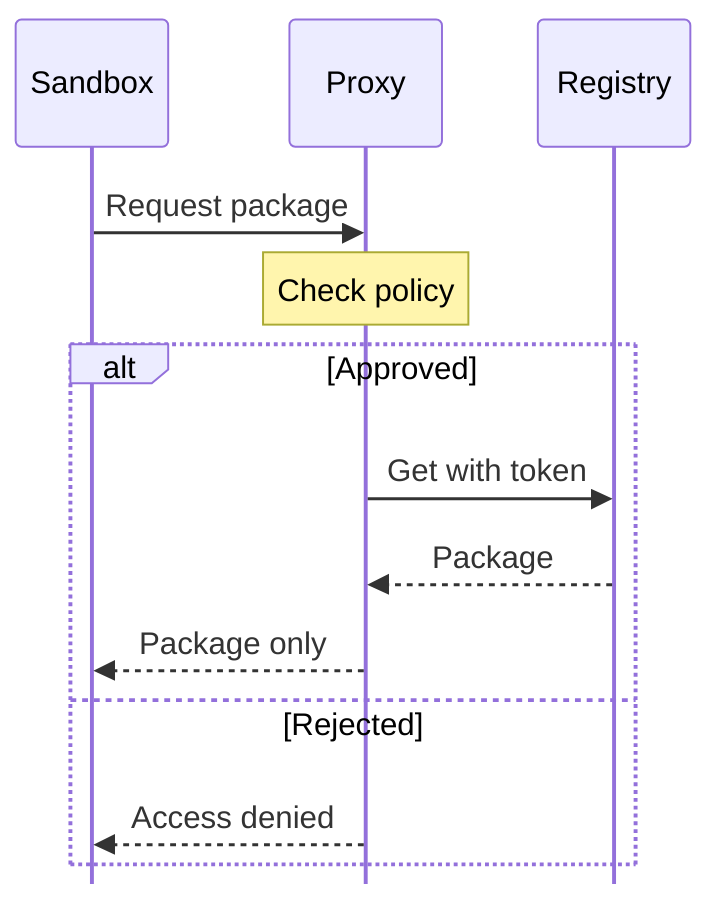

# Credential injection

Credential injection means adding a [credential](credential.md) to a request on behalf of a sandboxed program. A proxy, a service that forwards requests, can check a request and add the credential before sending it to the destination service. The program does not get the credential directly. Both the proxy and the destination service must be trusted to keep it from the program.

## Example

A sandboxed build needs to download one private package. The build asks the proxy for that package. The proxy checks the destination, the package, and that the request is a download. It uses a read-only token for that package and returns the downloaded data, not the token, to the build.

## Where the credential is added

The proxy applies the [policy](policy.md) before adding the credential to the request it sends onward. For example, it can add a bearer token to the web request's [Authorization header](https://www.rfc-editor.org/rfc/rfc6750.html#section-2.1), a field the destination service reads. Putting the real token into a setting the workload can read is different: the workload gets the token itself.

The token appears only on the proxy's request to the registry. A rejected request never reaches the registry.

[OpenShell v0.1.9](https://github.com/NVIDIA/OpenShell/blob/v0.1.9/docs/how-it-works/providers/overview.mdx#how-credential-injection-works) documents one approach. Code receives placeholders, and the proxy can replace them on approved HTTP requests. A tunnel that hides the request from the proxy cannot support that rewrite.

## What the proxy must protect

The proxy must send the credential only to the intended service on approved requests and keep it out of logs the workload can read. Trust the destination service not to reveal the credential in its response. Hiding the token does not make a broad [egress](egress.md) rule safe: the workload can still ask the proxy to perform whatever actions the policy allows.

[Back to Glossary](index.md)
