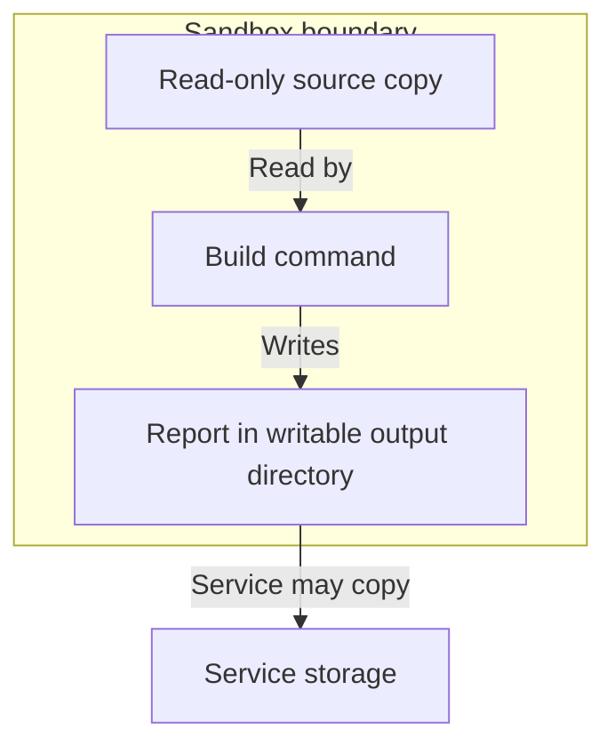

# Sandbox

A sandbox is an environment that limits what the code it runs can access or change. It can hold an entire application or just a small script. How much it protects depends on the mechanism that separates the code, the rules it enforces, and the resources it exposes.

## Example

A service runs build commands in a sandbox with a read-only copy of the source and a writable output directory. The commands can produce a build report without changing the original project. The service can choose to copy the report out without giving the build direct access to the service's storage.

## What makes up a sandbox

The [isolation boundary](isolation-boundary.md) separates the running code from other code or resources. The [policy](policy.md) specifies the files, network destinations, or tools that the code may use. The [isolation unit](isolation-unit.md) tells you which pieces of work share one copy of the boundary. The [control plane](control-plane.md) can start the sandbox and configure its rules. The runtime and other components, such as tool handlers, enforce the rules where access occurs.

A [virtual machine](virtual-machine.md) and a [restricted interpreter](restricted-interpreter.md) can both serve as sandboxes, but they run different kinds of code. Even two sandboxes with the same boundary can grant different access. When comparing them, list what they let in or out, not just what technology they use. See [Sandbox isolation boundaries](../sandbox-isolation-boundaries.md).

[Back to Glossary](../glossary.md)
