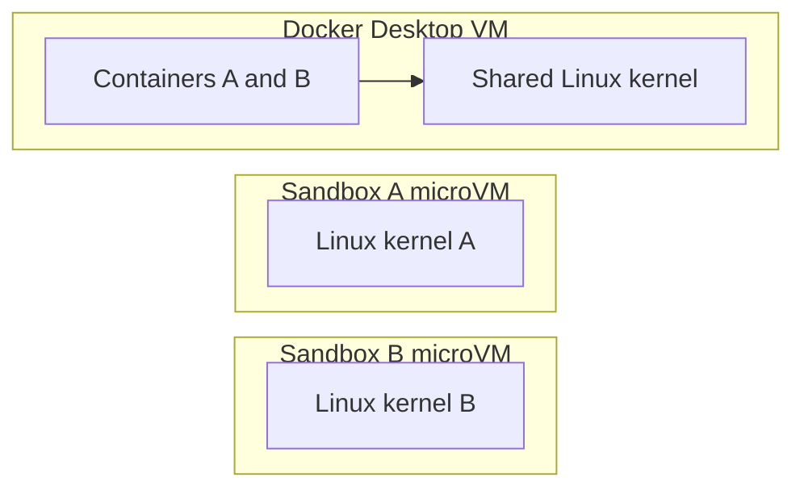
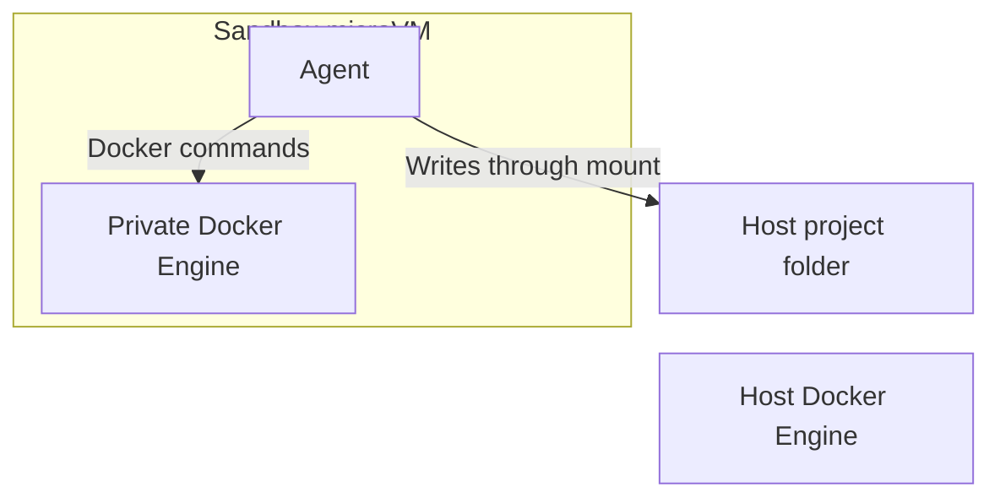
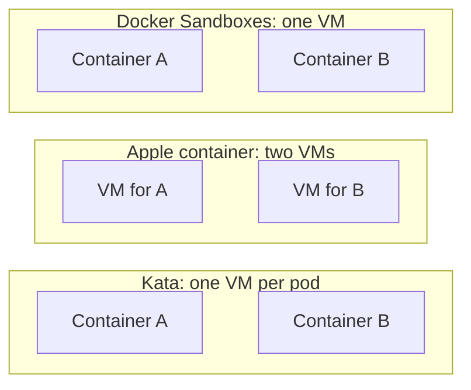
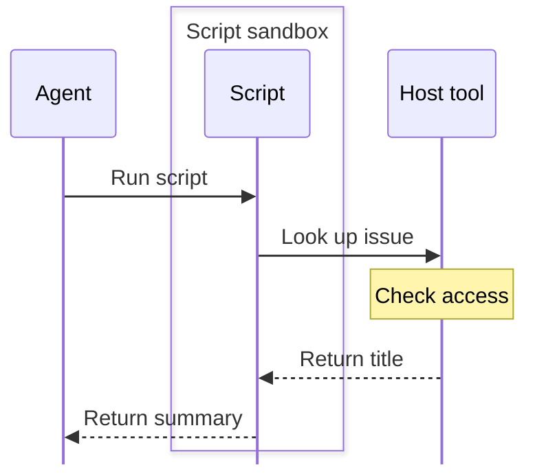

# Agent sandbox のアーキテクチャ {#agent-sandbox-architectures}

*調査の更新日：2026年11月22日。この章では、各プロジェクトが文書で説明しているアーキテクチャを比較します。実測した性能やセキュリティ上の保証を比較するものではありません。*

この調査では、各プロジェクトがコーディング [agent](glossary/agent.md) と、その agent が生成するコードをどのように隔離するかを比較します。

## 実行境界 {#execution-boundaries}

[isolation boundary](glossary/isolation-boundary.md) は、プログラムがアクセスできる範囲を制限します。[policy](glossary/policy.md) は、何がその境界を越えてよいかを定めます。六つの隔離方式については、まず [Sandbox の隔離境界](sandbox-isolation-boundaries.md)を参照してください。

[virtual machine monitor (VMM)](glossary/virtual-machine-monitor.md) は、[virtual machine (VM)](glossary/virtual-machine.md) と、その VM から見えるデバイスを管理します。VMM だけで完全な [sandbox](glossary/sandbox.md) 製品になるわけではありません。VM をいつ起動し、どのリソースを割り当てるかは、別の [control plane](glossary/control-plane.md) で決めることができます。

## ハードウェアで隔離する Linux 環境 {#hardware-backed-linux-environments}

| プロジェクト | 提供するもの | 境界と適用範囲 |
| --- | --- | --- |
| [Docker Sandboxes (`sbx`)](https://docs.docker.com/ai/sandboxes/architecture/) | すぐに使えるコーディング agent 環境 | ローカルの各 sandbox は、専用の [Docker Engine](https://docs.docker.com/engine/) を持つ [microVM](glossary/microvm.md) 内で動きます。VM が何を隔離し、何を隔離しないかは、[Docker Sandboxes の事例](#docker-sandboxes)を参照してください。[ローカルへのインストール](https://docs.docker.com/ai/sandboxes/install/)には、macOS、Windows、Linux の要件が記載されています。 |
| [libkrun](https://github.com/containers/libkrun) | Rust と C の API を持つ組み込み用 VMM ライブラリ | Linux では [KVM](glossary/kernel-based-virtual-machine.md)、Apple silicon では [Hypervisor Framework](https://developer.apple.com/documentation/hypervisor) を使います。どの host ファイルやデバイスを公開するかは、呼び出し元が決めます。[Gondolin](https://github.com/earendil-works/gondolin/blob/main/docs/backends.md) は、libkrun または QEMU を VMM として使える sandbox レイヤーです。 |
| [Cloud Hypervisor](https://github.com/cloud-hypervisor/cloud-hypervisor) | クラウド向けの汎用 VMM | KVM または [MSHV](glossary/microsoft-hypervisor.md) 上で動作し、Linux と Windows の [guest](glossary/guest.md) をサポートします。これはバックエンドであり、workspace と [credential](glossary/credential.md) の policy を備えた完全な agent sandbox ではありません。 |
| [Firecracker](https://github.com/firecracker-microvm/firecracker) | microVM 向けの最小構成の VMM | 通常の構成では Linux 上で KVM を使います。開発元の文書には、host の KVM の代わりに AWS Nitro を使う [AWS Nitro Sandboxes バックエンド](https://github.com/firecracker-microvm/firecracker/tree/main/docs/nitro-sandboxes)も記載されています。 |
| [Kata Containers](https://github.com/kata-containers/kata-containers/blob/main/docs/design/architecture/README.md) | VM を使う [container runtime](glossary/container-runtime.md) | [Kubernetes](https://kubernetes.io/docs/concepts/overview/) では、[pod](glossary/pod.md) が guest VM 内で動き、その pod 内の container は guest の [kernel](glossary/kernel.md) を共有できます。Kata は QEMU、Cloud Hypervisor、Firecracker など、[複数の VMM をサポートしています](https://github.com/kata-containers/kata-containers/blob/main/docs/hypervisors.md)。Kata と Firecracker は異なるレイヤーを担うため、互いに直接置き換えられるものではありません。 |
| [Microsoft NVX](https://github.com/microsoft/nvx/blob/42f413d226290e31ea288686d6f3dbfd20c45733/README.md) | OpenVMM ベースの microVM スタックと guest runtime | KVM または MSHV を使う Linux host と、[Windows Hypervisor Platform](glossary/windows-hypervisor-platform.md) を使う Windows host が文書に記載されています。guest runtime は、[Linux microVM ごとに一つの workload sandbox](https://github.com/microsoft/nvx/blob/42f413d226290e31ea288686d6f3dbfd20c45733/doc/design/4-guest-runtime-architecture.md) を動かす構成を想定しています。 |
| [Apple `container`](https://github.com/apple/container/blob/main/docs/technical-overview.md) | Apple silicon 向けのローカル [OCI](glossary/open-container-initiative.md) container ツール | Apple の [Virtualization framework](https://developer.apple.com/documentation/virtualization) を使い、**container ごとに**軽量な Linux VM を動かします。入力は [container image](glossary/container-image.md) ですが、isolation boundary は user-space kernel ではなく VM です。 |

### Docker Sandboxes：sandbox ごとに一つの VM {#docker-sandboxes}

ローカルの Docker Sandboxes では、sandbox ごとに独自の Linux [guest kernel](glossary/guest.md) が動きます。ただし、書き込みを許可して共有した [host](glossary/host.md) の [workspace](glossary/workspace.md) は、agent から編集できます。Kaan Yagci の [*Wait, Docker Sandboxes Aren’t Containers?*](https://x.com/yagcidev/article/2120166357060768143) が取り上げるのもこの違いです。sandbox は実行環境を隔離しますが、agent がアクセスできるリソースをすべて隔離するわけではありません。

Docker Sandboxes を使うために、[host に Docker Desktop や Docker Engine をインストールする必要はありません](https://docs.docker.com/ai/sandboxes/install/)。macOS と Windows では、[Docker Desktop は Linux container を Linux VM 内で実行します](https://docs.docker.com/desktop/features/vmm/)。それらの [container](glossary/container.md) は、その VM の [kernel](glossary/kernel.md) を共有します。[Docker Sandboxes](https://docs.docker.com/ai/sandboxes/security/isolation/#hypervisor-isolation) では、起動する container ごとではなく、sandbox ごとに VM の境界が設けられます。

agent の Docker コマンドは、[sandbox 内の Docker Engine](https://docs.docker.com/ai/sandboxes/security/isolation/#docker-engine-isolation) に送られます。この Engine は、host の Docker ソケットにアクセスせずに image をビルドし、container を実行できます。ファイルの書き込みは別の経路を通ります。書き込み可能な [mount](glossary/mount.md) がある場合、変更は host のプロジェクトフォルダーに直接反映されます。

専用の Docker Engine は、[ネットワークの policy](practice/data-and-access/network-policy.md) の代わりにはなりません。たとえば、agent の [Docker context](https://docs.docker.com/engine/manage-resources/contexts/) が本番環境の Docker Engine を指し、ネットワークが接続を許可し、認証も通るなら、agent はその Engine に接続できます。sandbox の内外で `docker context ls` の出力を比較して確認できるのは、クライアントの設定です。本番環境へのアクセスが遮断されているかどうかは確認できません。

[ローカルの workspace](https://docs.docker.com/ai/sandboxes/security/isolation/#workspace-isolation) では、`sbx run` にパスを指定しないと、カレントディレクトリが書き込み可能な workspace になります。sandbox を削除しても、そのディレクトリへの変更は元に戻りません。[`--clone`](https://docs.docker.com/ai/sandboxes/security/isolation/#clone-mode) を使うと、agent は専用のコピーを編集するので、変更を確認してから元のリポジトリに取り込めます。VM からは、`.env` など Git が追跡していないファイルも含め、元の作業ツリーを引き続き読み取れます。プロジェクトのファイルが不要なら、host の workspace を使わずに sandbox を作成してください。

#### Docker Sandboxes を選ぶ場面 {#when-to-choose-docker-sandboxes}

agent にローカルのプロジェクトと専用の Docker Engine の両方が必要なら、ローカルの Docker Sandboxes が適しています。たとえば、agent にバックエンドのバグを修正させ、イメージをビルドし、[Docker Compose](https://docs.docker.com/compose/) でデータベースを起動して統合テストを実行させます。これらの container は普段使う Docker 環境ではなく、sandbox の VM 内で動きます。

- **自分のアプリケーションに sandbox を組み込む：** [Gondolin](https://github.com/earendil-works/gondolin#feature-highlights) も Linux microVM を提供します。`sbx` で coding agent を起動する代わりに、ファイルアクセスと外向き HTTP 通信の policy を JavaScript で定義したい場合に検討してください。
- **サービスから必要に応じて sandbox を起動する：** [E2B Runtime](https://github.com/e2b-dev/infra) と [Docker Sandboxes のクラウド API と SDK](https://docs.docker.com/ai/sandboxes-api/) を比較してください。どちらもプログラムから sandbox を作成できます。[Docker のクラウド sandbox](https://docs.docker.com/ai/sandboxes/cloud/local-vs-cloud/) は起動元のコンピューターにあるフォルダーを mount しません。ジョブを無人で実行する前に、タイムアウトまでの時間と期限に達したときの動作を確認してください。

### どの workload が guest kernel を共有するか {#which-workloads-share-a-guest-kernel}

[isolation unit](glossary/isolation-unit.md) は、一つの境界のインスタンスを共有する workload の集まりです。例として、二つの container A と B が各実装のどこで動くかを比べます。

Docker と Kata の例では、A と B は guest kernel を共有します。Apple の例では、別々の VM で動きます。二つの workload を VM 境界で互いに隔離する必要がある場合は、runtime が両方を同じ guest に配置するかどうかを確認してください。

## Guest Linux kernel を使わない container と process {#containers-and-processes-without-a-guest-linux-kernel}

- [Google gVisor](https://gvisor.dev/docs/architecture_guide/intro/) は、OCI runtime の `runsc` を提供します。[user-space kernel](glossary/user-space-kernel.md) である **Sentry** が Linux [system call](glossary/system-call.md) を処理します。この呼び出しは [workload](glossary/workload.md) が行います。gVisor の KVM プラットフォームでも、Linux のシステムインターフェースを提供するのは Sentry です。Kata のように独立した Linux guest kernel があるわけではありません。すべての Linux インターフェースが同じように動くと想定せず、実際の workload で互換性と性能を確認してください。
- [Anthropic Sandbox Runtime](https://github.com/anthropic-experimental/sandbox-runtime) は、guest VM を使わずにネイティブ process を制限できます。Linux では [Bubblewrap](https://github.com/containers/bubblewrap)、macOS では Seatbelt を使い、ネットワークはプロキシで制限します。これは [operating-system process sandbox](glossary/operating-system-process-sandbox.md) です。gVisor とは異なり、workload は host OS の制限を受けながら、その OS の kernel を直接使います。

## Agent Substrate：Kubernetes 上で Actor ごとに sandbox を分ける {#agent-substrate}

[Agent Substrate](agent-substrate.md) は、あらかじめ起動した Kubernetes worker pods の pool で Actor を実行します。1 つの pod で複数の Actor が同時に動いても、それぞれ専用の gVisor sandbox または Cloud Hypervisor 上の Kata Containers microVM を使います。休止した Actor を [snapshot](glossary/snapshot.md) に保存し、リクエストに応じて復元するので、Actor ごとに pod を動かし続ける必要はありません。

## Code Mode：シェルではなく tool スクリプトを隔離する {#code-mode-isolating-tool-scripts-instead-of-shells}

[Code Mode](glossary/code-mode.md) では、モデルが [tool](glossary/tool.md) を呼び出し、その結果を組み合わせるプログラムを書きます。どの tool を利用でき、その tool に何ができるかは、外側のアプリケーションが決めます。このプログラムを実行する sandbox が、[host 側の tool ハンドラー](glossary/host-function.md) や agent の他の部分まで自動的に隔離するわけではありません。

実装を比較する前に、issue を一件調べる流れを見てみましょう。

host 側の tool ハンドラーは、呼び出し元に issue の読み取り権限があるかを確認します。sandbox が制限するのは、スクリプトが呼び出せる tool の範囲です。個々の tool への要求の [authorization](glossary/authorization.md) は行いません。

| 実装 | 実行境界 | 特徴 |
| --- | --- | --- |
| [Pi `codemode`](https://github.com/earendil-works/pi/blob/9c4652688590abb836b40ebd1e4725ecf9a7c7d1/packages/codemode/README.md) | [Wasm](glossary/webassembly.md) にコンパイルした QuickJS（`quickjs-wasi`） | ここで確認した Pi のリビジョンは、JavaScript を実行し、スクリプトに tool を渡します。スクリプトは Node API、ファイルシステム、ネットワークに直接アクセスできません。`quickjs-wasi` を使っていても、sandbox が汎用の [WASI](glossary/webassembly-system-interface.md) ファイルシステムへのアクセスを許可するわけではありません。 |
| [Earendil `djs`](https://github.com/earendil-works/djs/blob/c34b2a5974db47d9caafe7083a67ce4408d7333d/README.md) | Rust で書かれ、主に Wasm 向けにビルドされる JavaScript/TypeScript エンジン | 制御された入力での決定的な実行と、スクリプトの一時停止・再開を想定して設計されています。プロジェクトは QuickJS の代替と説明しており、Pi 用のアダプターも提供しています。上記の Pi のリビジョンはまだ [`quickjs-wasi` に依存しています](https://github.com/earendil-works/pi/blob/9c4652688590abb836b40ebd1e4725ecf9a7c7d1/packages/codemode/package.json)。移行済みと考える前に、インストールされているリリースを確認してください。 |
| [OpenCode Code Mode](https://github.com/anomalyco/opencode/blob/5310e42203af41c3452ee44b24fc7d0c52aaa3cc/packages/codemode/README.md) | JavaScript に似たスクリプト向けの [restricted interpreter](glossary/restricted-interpreter.md)。Wasm sandbox ではありません。 | [Psychoscript](https://github.com/anomalyco/psychoscript) を使って、JavaScript のうち対応する部分を解釈します。host は、tool や `fetch` などの extension function を通じて外部へのアクセスを許可できます。 |
| [Cloudflare Dynamic Workers](https://blog.cloudflare.com/dynamic-workers/) | V8 の [engine isolate](glossary/engine-isolate.md) | 動的に読み込んだコードを Workers runtime で実行します。呼び出し元は外向きの要求を遮断し、指定したバインディングを渡すことができます。[Cloudflare の Linux container sandbox](https://developers.cloudflare.com/sandbox/) は別の選択肢で、各インスタンスが microVM です。 |
| [Wasmtime](https://docs.wasmtime.dev/security.html) | 汎用 Wasm runtime | 任意の Linux バイナリではなく、Wasm モジュールとして配布される workload に適しています。利用できるインポートと host の機能は、runtime を組み込むアプリケーションが制御します。 |

インタープリターが直接 I/O を行えなくても、スクリプトが制限のない `bash` tool や広範囲に書き込める API を使えるなら、そのスクリプトの権限が小さいとはいえません。host の境界で tool の呼び出しを毎回認可してください。tool がネイティブコードを実行する必要がある場合は、その実行を別の Linux sandbox に委ねることができます。

## 2026年に進んでいる変化 {#what-is-changing-in-2026}

1. **環境の準備は、起動から復元へ移りつつあります。** [E2B Runtime](https://github.com/e2b-dev/infra) は、起動済みの Firecracker テンプレートから復元し、sandbox の一時停止と再開に対応します。[Vercel Sandbox](https://vercel.com/docs/sandbox) も Firecracker を使い、snapshot を利用できるようにしています。[Amazon Bedrock AgentCore Runtime V2](https://aws.amazon.com/about-aws/whats-new/2026/11/new-agentcore-runtime-default/) は、2026年11月12日に新規 runtime のデフォルトになり、準備済みの snapshot から microVM のセッションを復元します。[cold boot](glossary/cold-boot.md) と snapshot からの復元は区別してください。起動方式ごとに、最初のコマンドを実行できるようになるまでの待ち時間を計測します。snapshot にディスクの状態とメモリのどちらが含まれるか、または両方が含まれるか、さらに credential が含まれ得るかを確認してください。
2. **Control plane と実行バックエンドの分離が進んでいます。** [Kubernetes Agent Sandbox](https://agent-sandbox.sigs.k8s.io/docs/) は、ライフサイクルを宣言的に管理する API、テンプレート、claim、[warm pool](glossary/warm-pool.md) を追加します。gVisor や Kata を使えますが、境界を決めるのは選択した runtime です。[NVIDIA OpenShell](https://github.com/NVIDIA/OpenShell) は policy レイヤーの一例です。ゲートウェイが sandbox へのアクセスを管理し、承認済みの外部接続先にだけ credential を渡すことができます。これらの機能は、実行境界とは分けて比較してください。
3. **ハードウェアによる隔離は、host の KVM に限りません。** 2026年11月9日、[AWS は EKS、ECS、EC2 向けの Nitro Sandboxes を発表しました](https://aws.amazon.com/about-aws/whats-new/2026/11/nitro-sandboxes-eks-ecs-ec2/)。Nitro Sandboxes を使うように設定した EKS の pod や ECS のタスクには、それぞれ Nitro が管理する専用の VM が割り当てられます。EC2 では、Firecracker は親インスタンス内の KVM を使わずに guest を管理できます。
4. **一つの agent が複数の境界を使えます。** Cloudflare は、少数のメソッドを呼ぶコード向けの isolate と、完全な環境を必要とするコード向けの Linux microVM を文書で説明しています。同じ使い分けは、ローカル環境や自前で運用する環境でも可能です。tool スクリプトは Wasm または restricted interpreter で実行し、ビルドやテストは必要な場合にだけ Linux sandbox に送ります。

## 候補の評価方法 {#how-to-evaluate-a-candidate}

1. **隔離の単位を選びます。** [sandbox session](glossary/sandbox-session.md)、[tenant](glossary/tenant.md)、pod、個々の tool 呼び出しのうち、何を分離する必要があるかを決めます。クリーンアップの動作と、再起動、snapshot からの復元、分岐（fork）の後に何が残るかを確認します。
2. **境界を越えるものを列挙します。** host の mount、ソケット、ネットワーク経路、credential、tool の API をすべて記録します。直接編集する必要がなければ、読み取り専用の workspace またはそのコピーを優先します。外向きの通信を制限し、policy に従う仲介コンポーネントが要求ごとに credential を提供できる場合は、再利用可能な credential を sandbox の外に置きます。
3. **必要なアクセスルールを一つずつ確認します。** 無害なテストデータを使います。許可された操作が成功し、拒否されるべき操作が、リソースが最初からなかったためではなく、ルールによって失敗することを確認します。ローカルでの例は[アクセスルールの検証](practice/verification/verifying-access-rules.md)を参照してください。
4. **要件を満たす各候補で、同じタスクを計測します。** 最初の出力までの時間と完了までの時間を分けて記録します。キュー待ちや結果の転送も、影響がある場合は含めます。二つの起動方式で同じ処理をしていると決めつけず、リソースの使用量、互換性、キャッシュの状態を報告します。ローカルでの時間計測の例は [Sandbox の計測](practice/verification/measuring-a-sandbox.md)を参照してください。

[Sandbox の選び方](practice/design/choosing-a-sandbox.md)を使って、このチェックリストを設計の判断につなげてください。二つの実習で確認するのは、Bubblewrap の一つの構成です。その結果は、この調査で取り上げたどの製品や、実際に導入した構成についても根拠にはなりません。
