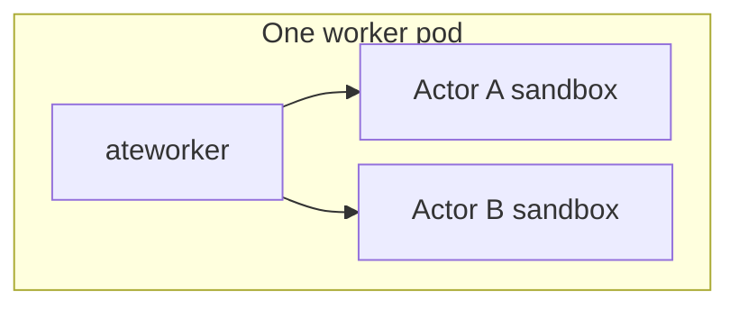

# Agent Substrate

**[Agent Substrate](https://github.com/agent-substrate/substrate/blob/f5428049ac0b81458eb12e81fa5a6b65cd39a2ad/docs/concepts/architecture.md) は、長期間状態を保持する多数の [workload](glossary/workload.md) を、より少ない [Kubernetes](https://kubernetes.io/docs/concepts/overview/) worker [pods](glossary/pod.md) で動かす仕組みです。** 処理が断続的に発生する場合に適しています。workload は待機中に計算資源を手放し、次のリクエストが来たら保存済みの状態から再開できます。

## Agent Substrate とは？ {#what-is-agent-substrate}

Agent Substrate は、Kubernetes 上で動く [sandbox](glossary/sandbox.md) プラットフォームです。agent framework や単体の sandbox [runtime](glossary/runtime.md) ではありません。*Actor* は、coding [agent](glossary/agent.md) や HTTP サービスなど、名前を持つ workload のインスタンスです。Kubernetes は worker pods をあらかじめ用意し、Substrate は実行する Actor ごとに worker の容量と専用の sandbox を割り当てます。同じ worker で複数の Actor が同時に動いても、sandbox は共有しません。

隔離方式は worker pool が選びます。**[gVisor](https://gvisor.dev/docs/architecture_guide/intro/)**、または [Cloud Hypervisor](https://github.com/cloud-hypervisor/cloud-hypervisor) 上の **[Kata Containers](https://github.com/kata-containers/kata-containers/blob/main/docs/design/architecture/README.md) [microVM](glossary/microvm.md)** です。アプリケーションが Actor を休止すると、Substrate は [snapshot](glossary/snapshot.md) を保存して Actor の枠を解放します。後からリクエストが来ると、同じ Actor を、場合によっては別の互換 worker 上で再開できます。どこまで再開できるかは、snapshot に保存した状態によります。このページは revision `f5428049` を対象とします。

## ほかのプロジェクトと何が違うか？ {#agent-substrate-comparison}

主な違いは、**何を維持するか**です。Substrate では、Actor の識別情報と保存状態は worker pod のライフサイクルに依存しません。[warm pool](glossary/warm-pool.md) があるだけでは同じ動作にならず、snapshot から microVM を復元する機能も Substrate 固有ではありません。

| 比較項目 | Agent Substrate | [Kubernetes Agent Sandbox：Warm Pool（v1.0.12）](https://github.com/kubernetes-sigs/agent-sandbox/blob/v1.0.12/examples/warmpool-quickstart/README.md) | [E2B Runtime（47c9255）](https://github.com/e2b-dev/runtime/blob/47c92550945704a8b2ac4ab5f20f1c3096141d08/README.md) | [ローカルの Docker Sandboxes](https://docs.docker.com/ai/sandboxes/architecture/) |
| --- | --- | --- | --- | --- |
| 呼び出し元が扱う単位 | 既存の Kubernetes worker に割り当てられる、名前付きの Actor。 | `SandboxClaim` を使い、用意済みの Sandbox があれば取得する。 | 1 台の [Firecracker](https://github.com/firecracker-microvm/firecracker) microVM を持つ sandbox。 | 1 台の [VM](glossary/virtual-machine.md) と専用の [Docker daemon](https://docs.docker.com/engine/) を持つローカル sandbox。 |
| 何を準備、または復元するか | worker の容量を用意し、Actor の状態を独立した gVisor または microVM sandbox に復元する。 | テンプレートから Sandbox インスタンスを作成し、pool に用意しておく。 | 作成時は起動済みの VM テンプレートから復元し、休止した sandbox は自身の snapshot から再開できる。 | 各 sandbox にローカル VM、独立した Docker daemon の状態、イメージキャッシュを用意する。 |

warm pool の比較では Kubernetes Agent Sandbox が近い例です。休止と再開の比較では E2B が近く、E2B もトラフィックを受けて sandbox を再開できます。Substrate はこれらの考え方を組み合わせ、長期間使う Actor を再利用可能な Kubernetes worker に割り当て、2 種類の runtime class を提供します。

## Agent Substrate はどんな用途に適しているか？ {#agent-substrate-when-to-choose}

**すでに Kubernetes を運用していて、数多くの agent session や [workspace](glossary/workspace.md) を保持する必要がある一方、同時に動くのはその一部である場合に適しています。** たとえば、coding agent がパッチを作成してから、人によるレビューを数時間待つことがあります。待機中は harness が Actor を休止できます。レビュー結果が届くと、リクエストをきっかけにファイルを復元し、互換性のあるメモリ snapshot があれば保存した [processes](glossary/process.md) も再開できます。

開発者のコンピューター 1 台にローカル sandbox が必要なだけの場合、ジョブの状態を捨てられる場合、workload がほぼ常時動く場合にはあまり向きません。snapshot や追加のスケジューリングは必要になる一方で、解放できる計算資源は少ないかもしれません。

この設計は、待機中の計算リソースを節約する代わりに、snapshot の保存、転送、復元が必要になります。実際の workload を使い、要求が届いてから最初の利用可能な応答が返るまでの時間を計測してください。Actor がすでに動いている場合、ノード内から復元する場合、リモートから復元する場合を比べます。要求が集中してプールの空き容量がなくなる場合も試し、遅延と `503` の発生率の両方を確認します。[control plane](glossary/control-plane.md) の測定値を、経路全体の遅延として使わないでください。開発元の [ResumePaused ベンチマーク](https://github.com/agent-substrate/substrate/blob/f5428049ac0b81458eb12e81fa5a6b65cd39a2ad/docs/guides/benchmarking.md#resumepaused-benchmark) は、ルーターと実際の sandbox の復元を意図的に計測対象から外しています。

## 実装の詳細 {#agent-substrate-implementation}

### Worker pod は隔離の単位ではない {#agent-substrate-isolation}

事前に起動した worker pod の集まりである warm pool が、Actor の実行に必要な容量を用意します。一つの worker で複数の Actor を**同時に**実行できますが、Actor ごとに別の sandbox を使います。一つの sandbox には、同じ Actor の複数の [container](glossary/container.md) を含めることができます。互いに信頼できない workload を、同じ Actor 内の別々の container に割り当てないでください。[開発元のセキュリティモデル](https://github.com/agent-substrate/substrate/blob/f5428049ac0b81458eb12e81fa5a6b65cd39a2ad/docs/security/security.md#defensible-multi-tenancy) では、個々の container ではなく Actor を隔離境界としています。

各 `WorkerPool` は一つの [sandbox class](https://github.com/agent-substrate/substrate/blob/f5428049ac0b81458eb12e81fa5a6b65cd39a2ad/docs/reference/sandbox-classes.md#summary-of-differences) を使います。一つのクラスター内で別々のプールを使えば、両方の class を提供できます。どちらも [OCI](glossary/open-container-initiative.md) の [container image](glossary/container-image.md) としてパッケージ化した workload を実行します。イメージの形式でコードの隔離方法が決まるわけではありません。通常の Linux container は Actor の sandbox としてサポートされていません。

| Class | Actor をどう隔離するか | 選ぶ前に確認すること |
| --- | --- | --- |
| `gvisor` | Actor ごとに gVisor の `runsc` sandbox を使います。Sentry は Linux の [system call](glossary/system-call.md) を実装する [user-space kernel](glossary/user-space-kernel.md) です。Linux の [guest kernel](glossary/guest.md) は起動しません。 | 標準的な Linux ノードで動作します。workload に必要な Linux インターフェースをテストしてください。[リソースの上限](glossary/resource-limit.md)は Actor 単位で適用され、runtime は container ごとの上限を無視します。 |
| `microvm` | Actor ごとに専用の Linux guest を使います。Cloud Hypervisor が VM を提供し、Kata の guest コンポーネントがその中で container を実行します。 | ノードに `/dev/kvm` が必要です。guest の RAM と VM 自体のオーバーヘッドを見込んで容量を確保してください。この class では guest 内で container ごとの上限が適用されますが、container ごとに VM が割り当てられるわけではありません。 |

### Actor の配置と復元、要求の転送は誰が行うか {#agent-substrate-request-path}

Kubernetes と Substrate は、配置を決める対象が異なります。`atecontroller` は Kubernetes の `WorkerPool` リソースを [Deployment](https://kubernetes.io/docs/concepts/workloads/controllers/deployment/) に変換し、Kubernetes がその pod をノードに配置します。一方、Substrate の control plane である `ate-api-server` は、**Actor を既存の worker に割り当てます**。`ActorTemplate`、Actor、Worker のレコードは、Kubernetes オブジェクトにはせず、[PostgreSQL](https://www.postgresql.org/about/) に保存します。`ActorTemplate` はイメージ、リソース、snapshot の設定を指定し、Kubernetes の `SandboxConfig` は該当する class の runtime のバージョンを指定します。[リソースモデル](https://github.com/agent-substrate/substrate/blob/f5428049ac0b81458eb12e81fa5a6b65cd39a2ad/docs/concepts/architecture.md#api-resource-models)を参照してください。

1. **作成します。** Substrate は Actor を登録しますが、稼働中の sandbox は確保しません。作成時にテンプレートの準備済みの *golden snapshot* があれば、通常はそこから起動します。起動に使える snapshot がなければ、`ActorTemplate` のイメージから起動します。[golden snapshot のワークフロー](https://github.com/agent-substrate/substrate/blob/f5428049ac0b81458eb12e81fa5a6b65cd39a2ad/docs/reference/api-guide.md#the-golden-snapshot)を参照してください。
2. **再開して要求を転送します。** HTTP リクエストが届くと、`atenet-router` は control plane に atespace と名前で Actor を探すよう求めます。*atespace* はアクセス制御のために Substrate のリソースをまとめる単位で、Kubernetes の namespace ではありません。Actor が一時停止中なら、control plane は条件を満たす worker の空き容量を割り当てます。ノードを管理する `atelet` は、pod 内の `ateworker` に sandbox を復元または起動するよう指示します。準備ができると、ルーターは worker の認証済み `atunnel` 接続を通じて要求を転送します。[要求の経路とライフサイクル](https://github.com/agent-substrate/substrate/blob/f5428049ac0b81458eb12e81fa5a6b65cd39a2ad/docs/concepts/architecture.md#actor-lifecycle)を参照してください。
3. **一時停止して容量を再利用します。** アプリケーションや agent harness は、Actor が使う計算リソースを解放したいときに `SuspendActor` を呼び出します。要求の処理が終わっても、ルーターが Actor を一時停止するとは限りません。runtime は snapshot を取得し、Actor の実行枠を解放します。後から要求が届くと、同じ Actor を互換性のある別の worker で復元できます。要求が一時的に集中すると、ルーターは[要求を短時間保留して再試行](https://github.com/agent-substrate/substrate/blob/f5428049ac0b81458eb12e81fa5a6b65cd39a2ad/docs/concepts/request-parking.md#behavior)できます。それでも空き容量ができなければ、HTTP `503` を返すことがあります。

### 一時停止しても何が残るか {#agent-substrate-snapshots}

[snapshot の設定](https://github.com/agent-substrate/substrate/blob/f5428049ac0b81458eb12e81fa5a6b65cd39a2ad/docs/concepts/architecture.md#state-management--persistence) によって、どの状態が残るかが決まります。テンプレートの `preferredFidelity` は保存するレベルの上限であり、毎回メモリの状態まで復元できるという保証ではありません。

| Snapshot のレベル | 何を保存するか | 再開時に何が起きるか |
| --- | --- | --- |
| `VOLUMES` | snapshot に対応する `DurableDir` ボリュームのデータ。 | そのデータを利用できる状態で新しい process を起動します。 |
| `ROOTFS` | ボリュームのデータと、container の書き込み可能なルートファイルシステムへの変更。 | ファイルへの変更を反映した状態で新しい process を起動します。 |
| `MEMORY`（デフォルトの優先設定） | ボリュームのデータ、ルートファイルシステムへの変更、および実行中の process の状態とメモリ。 | runtime に互換性がある worker で、保存した process を再開できます。 |

[カウンターのデモ](https://github.com/agent-substrate/substrate/blob/f5428049ac0b81458eb12e81fa5a6b65cd39a2ad/demos/counter/README.md#how-to-use)では、process の復元とイメージからの再起動の違いを確認できます。メモリを含む snapshot から復元すると、メモリ上のカウントと、ファイルに記録した二つのカウントは、いずれも 1 から 2 に進みます。ただし、どの snapshot も任意の場所で復元できるわけではありません。復元には元の sandbox class を使います。メモリを復元できる互換性のある worker に空き容量がなければ、永続化済みの snapshot なら、[復元レベルを `ROOTFS` に下げて新しい process を起動](https://github.com/agent-substrate/substrate/blob/f5428049ac0b81458eb12e81fa5a6b65cd39a2ad/docs/reference/sandbox-classes.md#snapshots-volumes-rootfs-and-memory)できます。

デフォルトでは、**ノード内**のチェックポイントができた時点で、一時停止の呼び出しは完了します。バックグラウンドでオブジェクトストレージ（Google Cloud Storage または S3）に転送して永続化します。アップロードが完了する前にノードが故障すると、最新のチェックポイントが失われることがあります。呼び出しが完了した時点で snapshot がノードの外に保存されている必要があるなら、Actor の実行中に[同期モードの `SuspendActor`](https://github.com/agent-substrate/substrate/blob/f5428049ac0b81458eb12e81fa5a6b65cd39a2ad/docs/reference/api-guide.md#suspendactor) を使います。すでに一時停止した Actor に再度 `SuspendActor` を呼び出すと、同期モードでも Actor を変更せずに返し、処理中のアップロードを待ちません。最新の snapshot に頼る前に、`status.snapshots` でその `durableSnapshot.state` が `SNAPSHOT_STORAGE_STATE_COMPLETED` になっていることを確認してください。[Eviction（pod の退避）のガイド](https://github.com/agent-substrate/substrate/blob/f5428049ac0b81458eb12e81fa5a6b65cd39a2ad/docs/reference/api-guide.md#eviction)では、harness が pod の終了時に自動でチェックポイントが作成されることに頼らず、eviction に備える必要がある理由を説明しています。

### ネットワークアクセスと credentials {#agent-substrate-access}

[セキュリティモデル](https://github.com/agent-substrate/substrate/blob/f5428049ac0b81458eb12e81fa5a6b65cd39a2ad/docs/security/security.md#security-boundaries) では、Actor ごとに専用のネットワークを割り当てます。内向きの通信は認証を行うルーターを経由します。他の Actor から直接通信を受け取ることはありません。外向きの通信はデフォルトで拒否します。DNS リレーと `atenet-egress` が、Actor の接続先を制限します。**どのエンドユーザーがどの Actor を呼び出せるか**は、引き続き外側のアプリケーションで決める必要があります。

[Credential injection](glossary/credential-injection.md) を使うとき（[開発元のガイド](https://github.com/agent-substrate/substrate/blob/f5428049ac0b81458eb12e81fa5a6b65cd39a2ad/docs/guides/egress-credential-injection.md#how-it-works)を参照）、Actor はリクエストヘッダーにプレースホルダーを入れて送ります。ルールが要求を許可し、そのヘッダーを指定していれば、ゲートウェイは credential、または Actor を識別する署名付きトークンを取得します。ゲートウェイはプレースホルダーをその値に置き換え、宛先サービスへ要求を送ります。HTTPS のヘッダーを書き換えるには、ゲートウェイが TLS を終端し、Actor がゲートウェイの認証局を信頼する必要があります。Actor は credential を持たずに要求できるため、この処理によって秘密情報が Actor のメモリや snapshot に入ることはありません。ただし、アプリケーションが sandbox に入れた秘密情報や、宛先サービスが応答で返した秘密情報は保護されません。ルールの許可範囲が広すぎれば、意図しない要求も許可されることがあります。

プラットフォームは、worker の管理コンポーネント、ゲートウェイ、snapshot のストレージなど、sandbox の外側のインフラを引き続き信頼します。開発元の [対応状況の表](https://github.com/agent-substrate/substrate/blob/f5428049ac0b81458eb12e81fa5a6b65cd39a2ad/docs/security/security.md#defensible-multi-tenancy) では、worker の権限の縮小と、クリーンアップの保証は対応中です。atespace は、別の sandbox や [ネットワークの policy](practice/data-and-access/network-policy.md) の代わりにはなりません。

Substrate と他の sandbox プラットフォームの比較は、[Agent sandbox のアーキテクチャ](agent-sandbox-architectures.md#agent-substrate)を参照してください。
