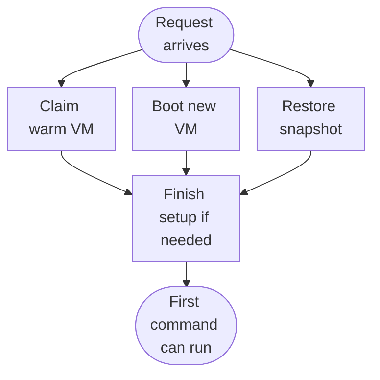

# Cold start

Cold start とは、すぐに使える環境がないときに、[sandbox](sandbox.md) などの実行環境を立ち上げるために必要な作業です。この用語は、環境の起動方法ではなく、作業の要求が届いたときに何が起きるかを表します。[cold boot](cold-boot.md)、[snapshot](snapshot.md) からの復元、言語の [runtime](runtime.md) の起動などが含まれます。

## 例

テストランナーが要求を受け取った時点では、[warm pool](warm-pool.md) は空です。テストランナーは保存済みの Linux VM を復元し、プロジェクトの Workspace を接続し、Sandbox がコマンドを受け付けられるまで待ちます。VM はオペレーティングシステムを最初から起動していませんが、この要求は Cold start を経験します。

## 作業を開始できるまでの時間の測定

Cold start の待ち時間とは、環境が実際に作業を行えるようになるまでの時間です。コマンドを実行する Sandbox なら、要求の到着から最初のコマンドを実行できるまでを測定します。イメージの読み込み、VM の起動または復元、要求固有のデータの準備など、個々の手順に要した時間も記録します。起動や復元が速いだけでは、要求全体でどれだけ待つかは分かりません。

起動と復元はどちらも Cold start の一部になり得ます。Warm pool から実行中の VM を確保する場合、起動や復元は要求の前に済みますが、プロジェクトの Workspace の接続などの準備がまだ必要なことがあります。

準備が必要な要求と、準備済みの Sandbox を受け取る要求を比較します。どのファイルやイメージがすでにキャッシュされていたかを明記し、測定に何が含まれるかが読者に分かるようにします。環境の準備方法の違いについては、[Agent 用 Sandbox のアーキテクチャ](../agent-sandbox-architectures.md#what-is-changing-in-2026)の例を参照してください。

[用語集に戻る](../glossary.md)
