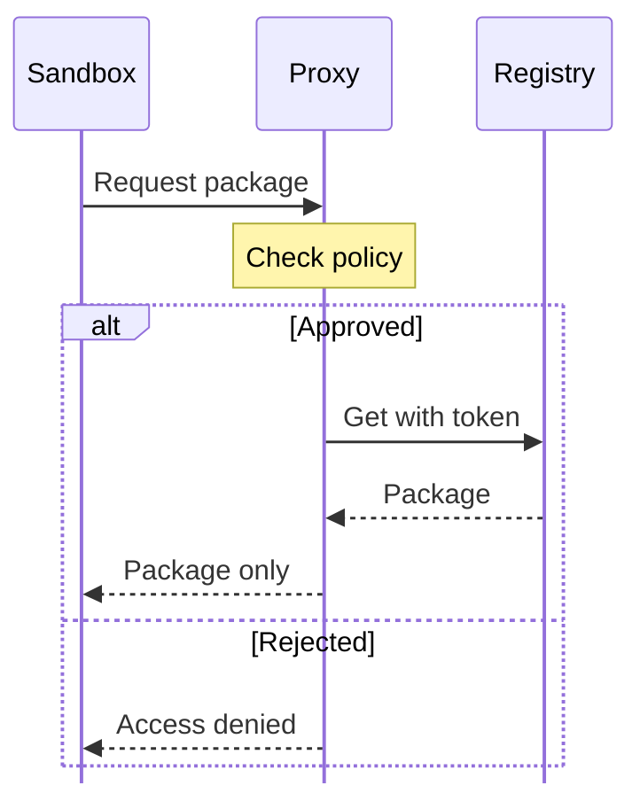

# Credential injection

Credential injection は、Sandbox 内のプログラムに代わって、要求に [credential](credential.md) を付けることです。要求を転送するサービスであるプロキシは、要求を確認し、Credential を追加してから宛先サービスに送信できます。プログラムは Credential を直接受け取りません。プロキシと宛先サービスの両方が、Credential をプログラムに渡さないと信頼できる必要があります。

## 例

Sandbox 内のビルドで、非公開のパッケージを一つダウンロードする必要があります。ビルドはそのパッケージをプロキシに要求します。プロキシは、宛先、パッケージ、および要求がダウンロードであることを確認します。そのパッケージ用の読み取り専用トークンを使い、トークンではなくダウンロードしたデータをビルドに返します。

## Credential を付ける場所

プロキシは [policy](policy.md) を適用してから、転送する要求に Credential を付けます。たとえば、宛先サービスが読み取る Web リクエストのフィールドである [Authorization header](https://www.rfc-editor.org/rfc/rfc6750.html#section-2.1) に bearer token を追加できます。Workload が読める設定に本物のトークンを入れる方法はこれとは異なり、Workload がトークンそのものを受け取ります。

トークンが現れるのは、プロキシからレジストリーへの要求だけです。拒否された要求はレジストリーに届きません。

[OpenShell v0.1.9](https://github.com/NVIDIA/OpenShell/blob/v0.1.9/docs/how-it-works/providers/overview.mdx#how-credential-injection-works) は一つの方法を説明しています。コードにはプレースホルダーを渡し、承認済みの HTTP リクエストではプロキシがそれを置き換えられます。トンネルによってプロキシから要求の内容が見えない場合、その書き換えはできません。

## プロキシで保護するもの

プロキシは承認済みの要求でのみ、意図したサービスだけに Credential を送信し、Workload が読めるログに残さないようにする必要があります。宛先サービスが応答に Credential を含めないと信頼できる必要があります。トークンを隠すだけでは、広い [egress](egress.md) ルールが安全になるわけではありません。Workload は、Policy が許すあらゆる操作をプロキシに要求できます。

[用語集に戻る](../glossary.md)
