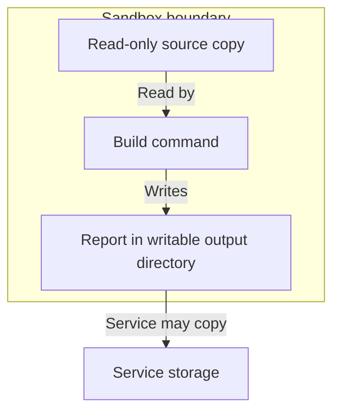

# Sandbox

sandbox は、実行するコードがアクセスまたは変更できるものを制限する環境です。アプリケーション全体を入れることも、小さなスクリプトだけを入れることもできます。どこまで保護できるかは、コードを分離する仕組み、強制する規則、公開するリソースによって決まります。

## 例

あるサービスは、ソースの読み取り専用コピーと書き込み可能な出力ディレクトリを備えた sandbox でビルドコマンドを実行します。コマンドは元のプロジェクトを変えずにビルドレポートを生成できます。サービスは、ビルドにストレージへの直接アクセスを与えずに、レポートを外にコピーできます。

## sandbox を構成するもの

[isolation boundary](isolation-boundary.md) は、実行中のコードを他のコードやリソースから分離します。[policy](policy.md) は、コードが使えるファイル、ネットワークの接続先、tool を指定します。[isolation unit](isolation-unit.md) は、どの作業が同じ境界を共有するかを示します。[control plane](control-plane.md) は sandbox を起動して規則を設定できます。runtime や tool handler などのコンポーネントは、アクセスが発生する箇所で規則を適用します。

[virtual machine](virtual-machine.md) も [restricted interpreter](restricted-interpreter.md) も sandbox として使えますが、実行できるコードの種類は異なります。同じ境界を持つ sandbox でも、許可するアクセスは異なる場合があります。比較するときは、使っている技術だけでなく、境界を越えて何を出し入れできるかを列挙してください。「[Sandbox isolation boundaries](../sandbox-isolation-boundaries.md)」を参照してください。

[用語集に戻る](../glossary.md)
