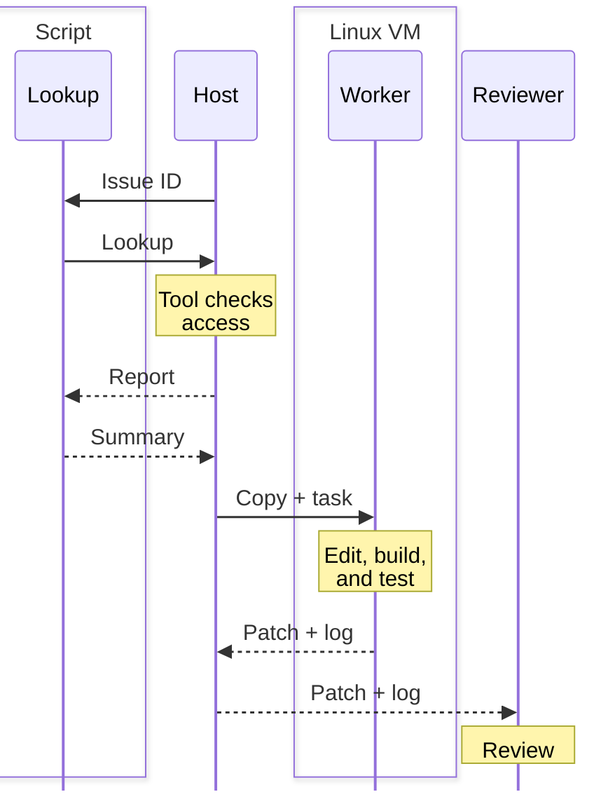

# Issue からパッチまで {#from-issue-to-patch}

[sandbox](../../glossary/sandbox.md) の中で動くコードに公開権限を与えなくても、パッチを外に取り出すことはできます。この例では、スクリプトが一件の issue を調べ、別の Linux worker がソースのコピーを編集してテストし、最後に人が返された二つのテキストファイルをレビューします。どちらのプログラムも元のリポジトリは変更できません。

これは制限の例を示す架空のサービスであり、検証済みのデプロイではありません。別の運用環境については、[設計の比較](choosing-a-sandbox.md)を参照してください。ここでは、ホスト型サービスでの一回の実行を追います。Lamp と Cedar は別々の [tenants](../../glossary/tenant.md) です。同じサービスを使いますが、互いのデータが見えてはいけません。

## 一件の issue と二つの境界 {#one-issue-two-boundaries}

プロジェクト Lamp の issue `LAMP-17` には、二つの個数を足すと合計が正しくならないと報告されています。たとえば、2 個と 3 個を足せば、合計は 5 個になるはずです。この不具合は、小さな C プログラムで再現できます。スクリプトには issue を検索する [tool](../../glossary/tool.md) が、worker にはコンパイラーと書き込み可能な一時ディレクトリが必要です。どちらも、相手のリソースにアクセスする必要はありません。

[host](../../glossary/host.md) は、コードがアクセスできる範囲を強制する仕組みである [isolation boundaries](../../glossary/isolation-boundary.md) を二つ使います。検索スクリプトには [restricted interpreter](../../glossary/restricted-interpreter.md) を、worker には Linux [virtual machine (VM)](../../glossary/virtual-machine.md) を使います。host の [control plane](../../glossary/control-plane.md) は実行を管理しますが、worker のファイルの読み取りを途中で捕捉するわけではありません。worker が動き出す前に、VM から見える範囲を設定します。



## 各段階で何が渡されますか？ {#what-moves-at-each-step}

1. **要求 → host。** 権限を持つ Lamp の依頼者は、`LAMP-17` と承認済みの Lamp のソースリビジョンを指定します。control plane は呼び出し元の身元と、その実行を開始する [authorization](../../glossary/authorization.md) を確認します。Lamp、issue、リビジョンをその実行にひも付け、どちらのプログラムにも選ばせません。要求が拒否された場合、worker は起動しません。
2. **Issue のレコード → スクリプト → host。** host は issue の ID を検索スクリプトに渡します。interpreter が公開するのは `get_issue` だけです。host のハンドラーは、[呼び出しを確認](tool-authorization.md)して実行に許可された範囲内であることを確かめ、ローカルの fixture（あらかじめ用意したサンプルデータ）を読み取り、タイトルと報告本文だけを返します。スクリプトは短い作業要約を返します。報告本文も要約もデータであり、アクセス権を広げられる命令ではありません。
3. **作業内容とソースのコピー → worker。** control plane は新しい VM を起動します。workspace サービスは、作業要約と、承認済みのリビジョンのソースとテストを、使い捨ての [`/work` workspace](../data-and-access/workspaces-and-artifacts.md) にコピーします。worker はインストール済みのコンパイラーを使い、コピーを編集してテストします。worker には、[外部へのネットワーク経路](../data-and-access/network-policy.md)も、issue を操作する tool も、issue やレビューの保存先やリポジトリにアクセスする [credentials](../../glossary/credential.md) もありません。
4. **二つのテキストファイル → レビュー。** ビルドが完了し、テストに合格したと実行結果が報告されると、worker は停止します。VM の外にある収集コンポーネントは、停止した worker の workspace から `change.patch` と `test.log` だけを受け取ります。実行 ID とベースとなるリビジョンは、worker ではなく control plane から取得します。レビューの保存先は、読み取りのたびに、[指定された Lamp のレビュアーに読み取りを許可](../data-and-access/multi-tenant-isolation.md)し、受け取った [artifacts](../../glossary/artifact.md) を 7 日間保持します。これらのファイルは信頼できません。ログは元のテストが実行された証拠にはならず、パッチが自動で適用されてはいけません。
5. **実行終了 → 後片付け。** 成功、失敗、キャンセル、タイムアウトのいずれの場合も、control plane は実行へのアクセスを遮断し、runtime と workspace サービスが VM とその一時データを破棄したことを確認します。破棄を確認できないリソースは再利用の対象から外します。[レビューの保存先では、保持するコピーに有効期限があります](../data-and-access/workspaces-and-artifacts.md#decide-what-leaves-work)。worker を削除しても、それらのコピーは削除されません。[リソースの制限](../operations/resource-limits.md)では、実行がいつ停止し、失敗時に何が返るかを説明します。

## Lamp のアクセスルール {#lamp-access-rules}

以下はこの実行に与える権限であり、VM や interpreter が既定で与える権限ではありません。

| 主体 | 許可すること | 許可しないこと |
| --- | --- | --- |
| 権限を持つ Lamp の依頼者 | 許可された実行を開始し、その状態と、開示しても安全な理由コードを確認できます。 | 別途レビュアーに指定されていない限り、レビュー用ファイルは読み取れません。 |
| 検索スクリプト | Lamp の `LAMP-17` に対して `get_issue` を呼び出し、host に作業要約を返せます。 | シェル、ファイルやネットワークへの直接アクセス、ほかの issue へのアクセス、書き込み用の tool は利用できません。 |
| Linux worker | インストール済みのツールとライブラリを読み取れます。自身の使い捨て workspace では、読み取り、書き込み、ビルド、テストができます。 | 元のチェックアウト、host のファイル、Cedar の workspace、VM 外のネットワークの接続先、issue 用の tool、サービスの credentials は利用できません。 |
| 収集コンポーネント | 実行にひも付けられた workspace から指定の二つのファイルを読み取り、検証済みのテキストをその実行のレビュー項目に書き込めます。 | パッチの適用、返されたファイルの実行、worker が指定した出力先の受け入れはできません。 |
| 指定された Lamp のレビュアー | 期限が来るまで、この実行のパッチとテストログを読み取れます。 | このワークフローを通じて公開したり、Cedar の artifacts を読み取ったりはできません。実行 ID だけではアクセス権は得られません。 |

[control plane と runtime](../operations/control-planes.md#who-owns-what) の役割は異なります。VM は worker が利用できるリソースを公開されたものに限定しますが、呼び出し元が特定の issue やパッチを読み取ってよいかを判断できるのは、tool のハンドラーとレビューの保存先だけです。このワークフローでは、どのコンポーネントにも公開権限はありません。公開を担う場合は、この実行の外に別の役割を設けます。

## 設計判断の記録を記入する {#fill-in-your-decision-record}

以下の記録をコピーして、自分のタスクに合わせて記入してください。Lamp の [isolation unit](../../glossary/isolation-unit.md) は、interpreter の 1 インスタンスにつき検索スクリプト 1 本、VM 1 台につきビルドの試行 1 回です。上の表を使って各主体に許可する操作を明記し、[lifecycle](../operations/sandbox-lifecycle.md) を使って各コピーを誰が削除するかを明記してください。ルールが機能するか分からなければ、未検証と記し、確認方法を書き留めてください。

```text
Task, inputs, and intended outputs:
Who can submit code? What must stay out of reach?
Required boundary and isolation unit (what shares one instance):
Why this choice? Which alternative did it rule out, and why?

For each allowed access: actor → action and exact resource → enforcer/owner:
  Tool, action, and record scope:
  Files read, written, or exported:
  Network destinations and direction (or none):
  Credentials: who holds them, what they allow, when they expire:
  Output: who may read it and what they cannot do:
Forbidden access to check (including another tenant):

Operator and resource limits (including time and concurrency):
On denial, limit, failure, or cancellation: who stops it and what is returned?
Reuse: what can be shared, and what state must never carry over?
Cleanup: for each retained item, who deletes it, when, and how is it confirmed?
What has been verified? What would make you reconsider this design?
```

隔離の仕組みの選び方は、[sandbox の選び方](choosing-a-sandbox.md)を参照してください。権限と管理の担当を詳しく追うには、[tool authorization](tool-authorization.md) から始め、リンクをたどってアクセスルールと運用を確認してください。
