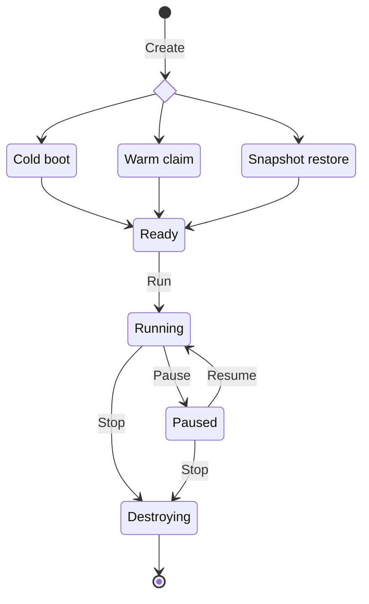

# Sandbox のライフサイクル {#sandbox-lifecycle}

worker を起動することと、プロジェクトのファイルを接続することは別の手順です。[Lamp の手順解説](../design/from-issue-to-patch.md)では、試行のたびに、新しい [virtual machine (VM)](../../glossary/virtual-machine.md) を使い捨ての [workspace](../../glossary/workspace.md) 付きで起動します。サービスが再利用するのは、クリーンな読み取り専用のコンパイライメージだけです。同じ [tenant](../../glossary/tenant.md) でも、worker、ディスク、実行中の process は再利用しません。

## 作成から破棄まで {#from-create-to-destroy}

Lamp は [cold boot](../../glossary/cold-boot.md) を使います。実行中だった状態を復元せず、Linux を最初から起動する方法です。図には別の選択肢も示していますが、それらが Lamp の実行で許可されているわけではありません。どの起動経路でも、同じ準備状況の確認を通ります。一時停止では現在の [session](../../glossary/sandbox-session.md) を保持しますが、ここでいう復元ではクリーンなテンプレートから新しい session を始めます。

[control plane](../../glossary/control-plane.md) は、起動に失敗した場合や、準備が完了した worker が実行前にキャンセルされた場合にも、クリーンアップを要求します。図を読みやすくするため、これらの経路は省略しています。

[warm pool](../../glossary/warm-pool.md) は、あらかじめ worker を起動し、待機中もリソースを確保しておく方式です。メモリを含む [snapshot](../../glossary/snapshot.md) を使えば起動を省けますが、保存された状態は読み込みます。ディスクのみの snapshot はファイルを復元しますが、起動は別途必要です。どちらの方式を採用する場合も、非公開データを追加する前に用意したテンプレートを使います。使用済みの worker はクリーンなプールに戻しません。

## 何がいつ削除されるか {#what-gets-deleted-and-when}

| データまたはリソース | Lamp の実行での担当とルール |
| --- | --- |
| 検索用 sandbox とタスクの要約 | host は、検索用インスタンスが要約を返した後、または失敗した後に、そのインスタンスを破棄します。control plane は、終了処理で、実行用にあらかじめ用意した入力を破棄します。 |
| Worker とメモリ | runtime が VM を停止し、リソースを解放します。ジョブのディスクもメモリの snapshot も保存しません。 |
| 使い捨ての `/work` ディスク | エクスポートが成功した場合も失敗した場合も、エクスポートなしで試行を終えた場合も、workspace サービスがディスクを削除します。これにより、ソースのコピー、タスクの要約、編集内容、バイナリ、一時ファイルが削除されます。 |
| クリーンなコンパイライメージ | プラットフォームチームが、後続の VM 用に読み取り専用で保持します。tenant のデータがイメージに書き戻されることはありません。 |
| 受け入れ済みのパッチとテストログ | [レビュー用ストア](../data-and-access/workspaces-and-artifacts.md#decide-what-leaves-work)が受け入れから 7 日後に削除します。worker を破棄しても削除されません。 |
| アクセスを制限した診断記録 | サービスオペレーターは、[診断記録の保持ルール](observability-and-debugging.md#keep-diagnostic-records-safe)に従って、状態や理由コードを確認できます。診断記録に作業用ファイルは含まれません。 |

成功、失敗、キャンセル、タイムアウトのどの場合でも、[control plane がクリーンアップを追跡します](control-planes.md#who-owns-what)。途中までのセットアップで残ったものも含め、runtime と workspace サービスがリソースの削除を確認するまで追跡を続けます。削除を確認できなければ、`cleanup_pending` を記録し、オペレーターに通知します。削除を確認できていないリソースは、クリーンアップの確認が取れるまで使用せず、使用中の容量として数えます。新しい試行には新しい VM とディスクを割り当て、以前の状態は引き継ぎません。

次の [リソースの上限](resource-limits.md) では、試行が停止する原因と、各上限にサービスがどう対処するかを説明します。
