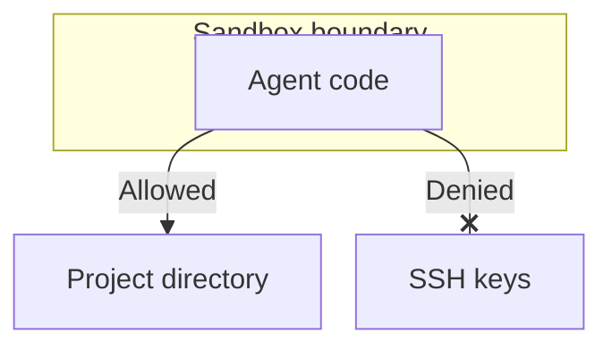
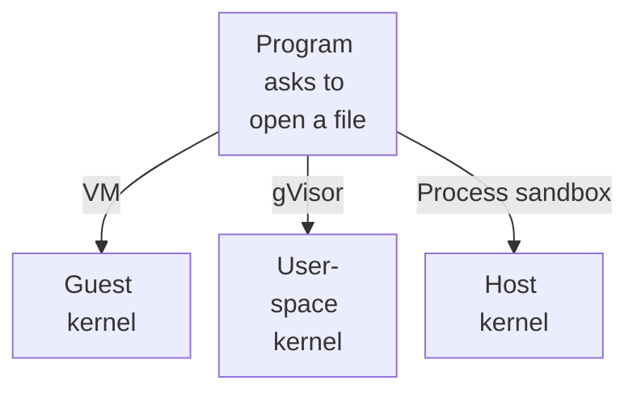
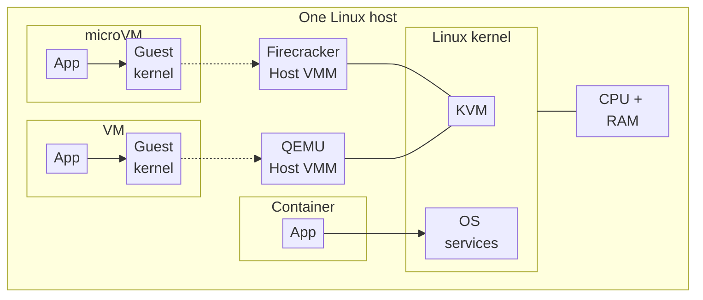

# Sandbox の隔離境界

[sandbox](glossary/sandbox.md) は、プログラムがアクセスできる範囲を制限しながら、プログラムを実行する環境です。たとえば、コーディング [agent](glossary/agent.md) にはプロジェクトを読み取って編集する必要があっても、あなたの SSH 鍵を読み取る必要はありません。[isolation boundary](glossary/isolation-boundary.md) は、その鍵にアクセスできないようにする仕組みです。[policy](glossary/policy.md) は、プログラムが利用できるファイル、ネットワークの接続先、[tool](glossary/tool.md) を定めるルールの集まりです。ルールは、それを強制するコンポーネントがあって初めて効力を持ちます。

プロジェクトは sandbox に公開されていますが、SSH 鍵は公開されていません。×印のある矢印は、プログラムに許可されていないアクセスを示します。

## ファイルを開く要求の流れ {#follow-a-request-to-open-a-file}

agent が架空のプロジェクト [Lamp（英語）](../practice/design/from-issue-to-patch.md) のテストランナーを起動するとします。テストランナーは [process](glossary/process.md)、つまり実行中のプログラムのインスタンスです。[kernel](glossary/kernel.md) は、メモリ、ファイル、デバイスなどのリソースを管理する OS の一部です。[system call](glossary/system-call.md) は、ファイルを開くなど、process が単独ではできない操作を kernel に依頼するための要求です。

1. テストランナーはソースファイル `total.c` を開くよう要求します。ライブラリが代わりに system call を実行することもできます。
2. OS のインターフェースを実装するコンポーネントは、process から見えるファイルの中でそのパスを探し、ファイルを開けるか確認します。
3. プロジェクトのファイルは利用可能なので、開くことができます。一方、[host](glossary/host.md) の SSH 鍵が process から見える範囲にない場合、その鍵を開く要求は失敗します。policy はプロジェクトを公開し、鍵は公開しないと定めています。設定された境界がそのルールを強制します。鍵に触れないよう agent に指示するだけでは、ルールを強制できません。

## OS 上で動く処理のための sandbox {#sandboxes-for-operating-system-workloads}

プロジェクトをビルドしてテストを実行する agent は、多くの場合、特定の CPU と OS のインターフェース向けに作られたプログラムである [native binary](glossary/native-binary.md) を実行する必要があります。以下の方式では、ファイルを開く要求をどのコンポーネントが処理するか、実行するコードが何を共有するかが異なります。

図はプログラムの要求を実装するコンポーネントを示しており、その後のすべての操作を示すものではありません。user-space kernel も、必要に応じて host kernel に要求を出せます。

### 1. ハードウェア支援型の VM {#1-hardware-backed-virtual-machines}

[virtual machine (VM)](glossary/virtual-machine.md) は、独自の OS kernel である [guest kernel](glossary/guest.md) を備えた、独立したコンピューター環境を提供します。テストランナーのファイル要求を処理するのは、この guest kernel です。同じ VM 内のプログラムは、その kernel を共有します。[microVM](glossary/microvm.md) は、一般に公開するデバイスを減らしてオーバーヘッドを抑えますが、guest kernel は引き続き備えています。どちらの方式でも、公開された host のディレクトリは guest から見えます。

**適した場面：** agent に、独自の kernel を備えた完全な Linux [workspace](glossary/workspace.md) が必要なときです。境界の同じインスタンスをどの処理が共有するか、つまり [isolation unit](glossary/isolation-unit.md) を確認してください。[ハードウェア支援型の VM の詳細（英語）](../isolation/native-programs/hardware-backed-virtual-machines.md)。

### 2. User-space kernel {#2-user-space-kernels}

[user-space kernel](glossary/user-space-kernel.md) は、Linux のインターフェースを独自に実装し、テストランナーの要求を処理します。[gVisor](https://gvisor.dev/docs/architecture_guide/intro/) がその一例です。基盤となるリソースは引き続き host kernel が提供するため、user-space kernel はそこに要求を出せます。この方式でも、host が公開したプロジェクトデータへのアクセスは防げません。

**適した場面：** Linux の [container](glossary/container.md) を実行しつつ、host kernel に直接アクセスできる範囲を抑えたいときです。互換性や性能が Linux と異なることがあるため、実際に動かすコードである [workload](glossary/workload.md) でテストしてください。[User-space kernel の詳細（英語）](../isolation/native-programs/user-space-kernels.md)。

### 3. Operating-system process sandbox {#3-operating-system-process-sandboxes}

[operating-system process sandbox](glossary/operating-system-process-sandbox.md) では、テストランナーと同じマシン上の他のプログラムが引き続き host kernel を共有します。kernel は process に見えるファイルを限定したり、特定の system call をフィルタリングしたりできます。ただし、ファイルを隠しても、プログラムがすでに受け取った内容のコピーは消えません。

**適した場面：** ローカルの agent に開発者が普段使うコマンドは必要でも、host への無制限のアクセス権までは引き継がせたくないときです。そのコマンドが起動する process にも制限が適用されるか確認してください。[Operating-system process sandbox の詳細（英語）](../isolation/native-programs/operating-system-process-sandboxes.md)。

### VM、container、microVM の比較 {#compare-a-vm-a-container-and-a-microvm}

**microVM は VM の一種です。** 一般に仮想デバイスの数は少ないものの、同じバックエンドを使う汎用 VM と同じハードウェア隔離を利用します。一方、ネイティブ Linux container では、process が host kernel 上で直接動作します。

この例では、ネイティブ container、[QEMU v9.2.0](https://github.com/qemu/qemu/blob/v9.2.0/docs/system/introduction.rst#L6-L50) の VM、[Firecracker v1.11.0](https://github.com/firecracker-microvm/firecracker/blob/v1.11.0/docs/design.md#internal-architecture) の microVM が、1 台の Linux host 上にあります。QEMU と Firecracker は、host の [user space](glossary/user-space.md) で [virtual machine monitor (VMM)](glossary/virtual-machine-monitor.md) として動作します。両者とも host kernel の [KVM](glossary/kernel-based-virtual-machine.md) を使い、[VT-x 対応の Intel x86-64 CPU](https://www.intel.com/content/www/us/en/developer/articles/technical/intel-sdm.html) 上で guest を実行します。

実線の矢印は system call を示します。点線の矢印は guest の VMM が処理するデバイスへの要求を示しますが、すべての I/O 経路を示すわけではありません。矢印のない線は、コンポーネントが利用する下位層を示すもので、要求の経路ではありません。QEMU と Firecracker はどちらも `/dev/kvm` を開いて [KVM API](https://docs.kernel.org/virt/kvm/api.html#general-description) を利用しますが、Firecracker が提供する仮想デバイスは少なめです。

**図の出典：** [Agache et al., *Firecracker: Lightweight Virtualization for Serverless Applications*, 図 1（NSDI 2020）](https://files.usenix.org/s3fs-public/cdn/nsdi20-paper-agache.pdf#page=4) をもとに、[Firecracker v1.11.0 の host との連携](https://github.com/firecracker-microvm/firecracker/blob/v1.11.0/docs/design.md#host-integration) と [QEMU v9.2.0 のシステムエミュレーションの概要](https://github.com/qemu/qemu/blob/v9.2.0/docs/system/introduction.rst#L6-L50) を参照して描き直し、情報を追加しました。

#### CPU での実行、メモリ、デバイス I/O {#cpu-execution-memory-and-device-io}

1. **CPU での実行。** テストランナーがファイルを開く要求を例にします。x86-64 の `SYSCALL` は、CPU の [privilege level](glossary/cpu-privilege-level.md) を ring 3（アプリケーション）から ring 0（kernel）に切り替えます。container では、host kernel がその process のマウント [namespace](glossary/namespace.md) でパスを探します。[seccomp](glossary/seccomp.md) は、その検索の前に呼び出しを拒否できます。どちらの VM でも、アプリケーションは自分の guest kernel に処理を渡します。どちらの VM も、Intel が guest モードを指して使う **VMX non-root operation** で動作します。guest の ring 0 に入るだけでは [VM exit](glossary/vm-exit.md) は起きません。VM exit は、制御を KVM に戻す別の CPU 遷移です。[Intel の VMX マニュアルの図 26-1](https://cdrdv2.intel.com/v1/dl/getContent/671506#page=4) を参照してください。
2. **メモリアドレスの変換。** ページテーブルは、メモリアドレスの対応付けとアクセス権を記録します。container では、CPU が host 側の process のページテーブルを使って、仮想アドレスを host の物理アドレスに変換します。どちらの VM にも、2 段階の対応付けがあります。guest のページテーブルが guest の仮想アドレスを guest の物理アドレスに変換し、[Extended Page Tables (EPT)](glossary/extended-page-tables.md) が guest の物理アドレスを host の物理アドレスに変換します。第 1 段階は guest kernel が、第 2 段階は KVM が管理します。CPU は guest のページテーブルを読むときにも EPT を適用します。[Linux KVM のメモリに関する文書](https://docs.kernel.org/virt/kvm/x86/mmu.html#translation) を参照してください。
3. **デバイス I/O。** guest がメモリにないディスクデータを必要とすると、ドライバーが仮想ディスクに要求を送ります。デバイスへのアクセスで VM exit が起きると、KVM は host kernel 内で処理するか、[`KVM_RUN`](https://docs.kernel.org/virt/kvm/api.html#kvm-run) から host 側の VMM に制御を戻すことができます。たとえば、デバイスレジスターへのアクセスでは [`KVM_EXIT_MMIO`](https://docs.kernel.org/virt/kvm/api.html#the-kvm-run-structure) が返り、デバイスに割り当てられたメモリアドレスの読み書きを VMM に依頼することがあります。仮想ディスクへの要求がすべてこの経路を通るわけではありません。host 上のファイルを仮想ディスクの実体にすることはできますが、guest が host 上の任意のファイルを開けるわけではありません。

| 比較項目 | 汎用 VM | ネイティブ Linux container | microVM |
| --- | --- | --- | --- |
| 隔離と共有 | ハードウェア支援による隔離。同じ VM の process は guest kernel を共有する。 | [Namespace](glossary/namespace.md) が process に見えるリソースを分ける。[Control group](glossary/control-group.md) でリソース使用量を計測または制限できる。アプリケーションは、他の container や host の process と同じ kernel に直接要求を出す。 | 汎用 VM と同じ種類のハードウェア支援による隔離。同じ microVM の process は guest kernel を共有する。 |
| OS とデバイスの対応範囲 | 対応する guest OS を実行でき、host OS と同じでなくてもよい。[QEMU v9.2.0](https://github.com/qemu/qemu/blob/v9.2.0/docs/system/introduction.rst#L39-L50) などの VMM は幅広い仮想デバイスを提供する。 | 別の Linux ツールやライブラリを使えるが、host の Linux kernel と runtime が公開するインターフェースで動作する必要がある。 | 対応する guest OS と、より少数のデバイスを確認する。たとえば、[Firecracker v1.11.0](https://github.com/firecracker-microvm/firecracker/blob/v1.11.0/docs/design.md#machine-model) は仮想ストレージとネットワークを提供するが、グラフィカル表示用のデバイスは提供しない。 |
| 新規起動 | アプリケーションの起動前に guest OS を起動する。 | guest を起動せずに process を開始する。ただし、イメージの取得や展開に時間がかかる場合がある。 | guest OS の起動は必要。デバイスモデルを小さくし、guest を最小構成にすると、起動時の処理を減らせる。 |
| メモリのオーバーヘッド | guest OS とそのアプリケーションに加え、host 側の VMM にもメモリが必要。 | container ごとに別の guest や VMM は不要。各アプリケーションにはメモリが必要。 | guest と VMM のメモリは必要。デバイスモデルを小さくし、guest を最小構成にすると、オーバーヘッドを抑えられる。 |
| 適した場面 | ジョブに独自の kernel が必要で、候補の microVM では必要な guest OS やデバイスに対応できない。 | ジョブにパッケージ化した Linux ツールチェーンが必要で、host kernel を共有してもよい。 | 短時間のジョブそれぞれに独自の kernel が必要で、対応する guest OS とデバイスで要件を満たせる。 |

速度を比べる前に、必要な境界を選びます。デバイスを減らせば guest が仮想デバイス経由で到達できるコードは少なくなりますが、隔離が強くなることや、起動時間が一定になることを保証するものではありません。VM は独自の guest kernel を持っていても、物理ハードウェアを共有できます。どちらの VM 方式でも、ジョブごとに別の guest が割り当てられるか確認してください。3 つの方式すべてで、公開されるファイルとネットワークサービスを確認してください。そのうえで、[同じ workload を計測（英語）](../practice/verification/measuring-a-sandbox.md)します。新規起動、[snapshot](glossary/snapshot.md) からの復元、[warm pool](glossary/warm-pool.md) からの割り当ては分けて計測します。

## 生成されたスクリプトのための sandbox {#sandboxes-for-generated-scripts}

課題のタイトルを取得して並べ替える agent なら、1 つの tool を使う短いスクリプトを実行するだけで足りるかもしれません。[runtime](glossary/runtime.md) は、コードを実行するか、コードの実行環境を用意します。この例では、言語やモジュール用の runtime が、完全な Linux 環境を与えずにスクリプトを実行できます。

1. スクリプトは、公開された tool に `LAMP-17` のタイトルを要求します。runtime はスクリプトが呼び出せる操作を制限します。スクリプト自体が課題のファイルを開いたり、ネットワーク要求を送ったりする必要はありません。
2. host 側の tool が検索を担当します。この呼び出し元に指定された課題の読み取りを許可するか、つまり [authorization](glossary/authorization.md) を確認します。tool を呼び出せても、その tool が扱うすべてのデータを読めるとは限りません。
3. 許可されていれば、tool はタイトルを返します。スクリプトは、返されたタイトルを runtime 内で並べ替えられます。tool が authorization を確認しない場合、runtime がリソースへの直接アクセスを制限していても、その tool 経由で課題データを読み取ることは防げません。

### 4. WebAssembly {#4-webassembly}

[WebAssembly (Wasm)](glossary/webassembly.md) は、実行可能なモジュールをさまざまな環境で動かすための形式です。Wasm runtime はメモリアクセスを検査し、モジュール外への呼び出しを、課題検索用の [host function](glossary/host-function.md) など host が提供する操作に限定します。モジュールは同じ host process で動作できますが、既定では互いのメモリを共有しません。生成されたコード自体を Wasm モジュールにすることも、Wasm にコンパイルされた言語エンジンで実行することもできます。

**適した場面：** workload またはその言語エンジンを Wasm で実行でき、通常の Linux 向けバイナリが不要なときです。メモリアクセスを検査しても、課題検索の tool 自体が読み取れる情報は制限されません。[WebAssembly の詳細（英語）](../isolation/generated-scripts/webassembly.md)。

### 5. Engine isolate {#5-engine-isolates}

[engine isolate](glossary/engine-isolate.md) は、言語エンジン内の独立した実行環境です。それぞれの isolate は独自のオブジェクトと管理対象の状態を持ちますが、host process を共有できます。プラットフォームは、スクリプトに OS 全般へのアクセスを与えず、課題を扱うサービスだけを公開できます。

**適した場面：** スクリプトに言語エンジンの機能と一部のプラットフォーム操作は必要でも、シェルやネイティブのパッケージマネージャーは不要なときです。サービスが要求ごとにアクセス権を確認しない場合、接続できるだけで広い範囲にアクセスできてしまうことがあります。[Engine isolate の詳細（英語）](../isolation/generated-scripts/engine-isolates.md)。

### 6. Restricted interpreter {#6-restricted-interpreters}

[restricted interpreter](glossary/restricted-interpreter.md) は、実装された言語機能だけを実行し、自身が提供する組み込み機能と tool だけを公開します。この例では、並べ替えを interpreter 内で実行し、課題検索を host の tool に任せます。host アプリケーションと同じ process で実行できますが、言語を制限するだけでは独立した OS は作れず、host の tool が及ぼす影響も制限できません。

**適した場面：** tool の呼び出しを組み合わせて結果を処理するのに、言語の一部だけで足りるときです。interpreter が対応する機能とライブラリを確認してください。[Restricted interpreter の詳細（英語）](../isolation/generated-scripts/restricted-interpreters.md)。

## パッケージ化、管理、隔離を分けて考える {#keep-packaging-management-and-isolation-separate}

製品を調べるときは、どの層が変わるのかを確認します。

| 層 | 役割 |
| --- | --- |
| パッケージ化 | [container image](glossary/container-image.md) は、テストランナー、その依存関係、起動時の設定をまとめて提供する。テストランナーがアクセスできる範囲は決めない。 |
| 実行 | [container runtime](glossary/container-runtime.md) は、テストランナーの実行環境を用意する。[Apple `container`](https://github.com/apple/container/blob/main/docs/technical-overview.md) は VM 内で container を実行する。一方、gVisor は、互換性のあるイメージを実行し、system call を user-space kernel で処理できる。 |
| 管理 | [control plane](glossary/control-plane.md) は、環境の起動、割り当て、後片付けを行う。[Kubernetes Agent Sandbox](https://agent-sandbox.sigs.k8s.io/docs/) はこの管理層を提供し、runtime が境界を設定する。control plane は workspace を選択できるが、個々のファイルを開く要求は処理しない。 |

1 つの agent が複数の境界を使うこともできます。たとえば、制限付きスクリプトで課題のタイトルを読み取り、テストジョブは Linux VM に送ります。この構成では、スクリプト用の sandbox が呼び出せる tool を制限し、検索用の tool が返せるデータを確認し、VM がテストジョブのアクセス範囲を制限します。

## 理解度を確認する {#check-your-understanding}

1. process sandbox、user-space kernel を使う sandbox、VM では、どのコンポーネントが `total.c` を開く要求を処理しますか？ [OS 上で動く処理のための sandbox](#sandboxes-for-operating-system-workloads) を確認してください。
2. スクリプトに課題検索の tool を呼び出す許可がある場合、`LAMP-17` のタイトルを返すかどうかはどこで決まりますか？ [生成されたスクリプトのための sandbox](#sandboxes-for-generated-scripts) を確認してください。
3. テストランナーに独自の kernel があっても、公開される host のディレクトリを確認すべきなのはなぜですか？ [ハードウェア支援型の VM](#1-hardware-backed-virtual-machines) を確認してください。

スクリプトと VM の境界を組み合わせた例は [課題からパッチまで（英語）](../practice/design/from-issue-to-patch.md) を、実際の実装の比較は [Agent 向け sandbox のアーキテクチャ（英語）](../agent-sandbox-architectures.md) を参照してください。
