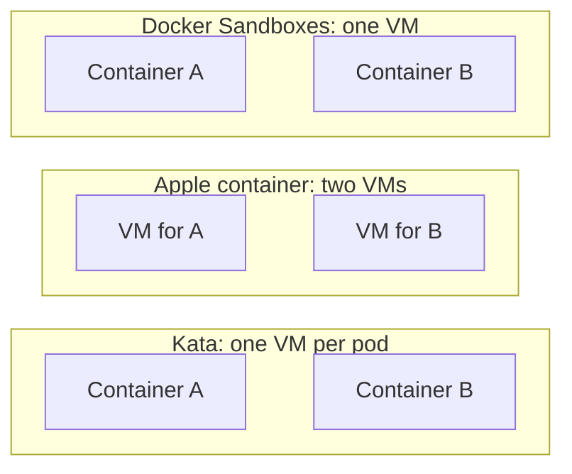
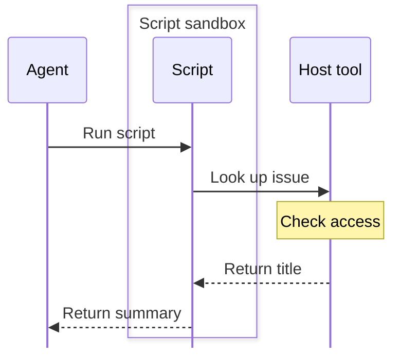

# Agent sandbox 아키텍처 {#agent-sandbox-architectures}

*조사 갱신일: 2026년 11월 22일. 이 장은 문서에 명시된 아키텍처를 비교합니다. 실측 성능이나 보안 보장을 비교하지는 않습니다.*

이 장에서는 여러 프로젝트가 코딩 [agent](glossary/agent.md)와 agent가 생성한 코드를 어떻게 격리하는지 비교합니다.

## 실행 경계 {#execution-boundaries}

[isolation boundary](glossary/isolation-boundary.md)는 프로그램의 접근 범위를 제한합니다. [policy](glossary/policy.md)는 무엇이 그 경계를 통과할 수 있어야 하는지 정합니다. 여섯 가지 격리 유형은 [Sandbox의 격리 경계](sandbox-isolation-boundaries.md)에서 먼저 살펴봅니다.

[virtual machine monitor (VMM)](glossary/virtual-machine-monitor.md)는 [virtual machine (VM)](glossary/virtual-machine.md)과 그 VM에 보이는 장치를 관리합니다. VMM 자체는 완전한 [sandbox](glossary/sandbox.md) 제품이 아닙니다. 별도의 [control plane](glossary/control-plane.md)이 VM을 언제 시작하고 어떤 자원을 제공할지 결정할 수 있습니다.

## 하드웨어 지원을 받는 Linux 환경 {#hardware-backed-linux-environments}

| 프로젝트 | 제공하는 기능 | 경계와 범위 |
| --- | --- | --- |
| [Docker Sandboxes (`sbx`)](https://docs.docker.com/ai/sandboxes/architecture/) | 바로 사용할 수 있는 코딩 agent 환경 | 각 로컬 sandbox는 자체 Docker 데몬을 갖춘 [microVM](glossary/microvm.md)에서 실행됩니다. Agent는 [container](glossary/container.md)를 빌드하고 실행할 수 있으며, 이때 [host](glossary/host.md)의 Docker 소켓에 접근할 필요가 없습니다. Host [workspace](glossary/workspace.md)의 [mount](glossary/mount.md)와 아웃바운드 프록시를 신뢰할지는 별도로 판단해야 합니다. [로컬 설치](https://docs.docker.com/ai/sandboxes/install/) 문서에서 macOS, Windows, Linux의 요구 사항을 확인할 수 있습니다. |
| [libkrun](https://github.com/containers/libkrun) | Rust와 C API를 제공하는 내장형 VMM 라이브러리 | Linux에서는 [KVM](glossary/kernel-based-virtual-machine.md), Apple silicon에서는 [Hypervisor Framework](https://developer.apple.com/documentation/hypervisor)를 사용합니다. 호출자가 노출할 host 파일과 장치를 정합니다. [Gondolin](https://github.com/earendil-works/gondolin/blob/main/docs/backends.md)은 libkrun이나 QEMU를 VMM으로 사용할 수 있는 sandbox 계층입니다. |
| [Cloud Hypervisor](https://github.com/cloud-hypervisor/cloud-hypervisor) | 범용 클라우드 VMM | KVM이나 [MSHV](glossary/microsoft-hypervisor.md)에서 실행되며 Linux와 Windows [guest](glossary/guest.md)를 지원합니다. 이는 백엔드이며, workspace와 [credential](glossary/credential.md) policy까지 갖춘 완전한 agent sandbox는 아닙니다. |
| [Firecracker](https://github.com/firecracker-microvm/firecracker) | MicroVM용 최소 기능 VMM | 일반적인 배포에서는 Linux에서 KVM을 사용합니다. 원본 프로젝트에는 host KVM 대신 AWS Nitro를 사용하는 [AWS Nitro Sandboxes 백엔드](https://github.com/firecracker-microvm/firecracker/tree/main/docs/nitro-sandboxes)도 문서화되어 있습니다. |
| [Kata Containers](https://github.com/kata-containers/kata-containers/blob/main/docs/design/architecture/README.md) | VM을 기반으로 하는 [container runtime](glossary/container-runtime.md) | [Kubernetes](https://kubernetes.io/docs/concepts/overview/)에서 [pod](glossary/pod.md)는 guest VM에서 실행되며, 해당 pod의 container는 guest [kernel](glossary/kernel.md)을 공유할 수 있습니다. Kata는 QEMU, Cloud Hypervisor, Firecracker를 포함한 [여러 VMM을 지원합니다](https://github.com/kata-containers/kata-containers/blob/main/docs/hypervisors.md). Kata와 Firecracker는 서로 다른 계층이며, 서로를 직접 대체하지 않습니다. |
| [Microsoft NVX](https://github.com/microsoft/nvx/blob/42f413d226290e31ea288686d6f3dbfd20c45733/README.md) | OpenVMM 기반 microVM 스택과 guest runtime | KVM이나 MSHV를 사용하는 Linux host와 [Windows Hypervisor Platform](glossary/windows-hypervisor-platform.md)을 사용하는 Windows host를 문서에서 다룹니다. Guest runtime은 [Linux microVM당 하나의 workload sandbox](https://github.com/microsoft/nvx/blob/42f413d226290e31ea288686d6f3dbfd20c45733/doc/design/4-guest-runtime-architecture.md)를 목표로 합니다. |
| [Apple `container`](https://github.com/apple/container/blob/main/docs/technical-overview.md) | Apple silicon용 로컬 [OCI](glossary/open-container-initiative.md) container 도구 | Apple의 [Virtualization framework](https://developer.apple.com/documentation/virtualization)를 통해 **container마다** 경량 Linux VM을 실행합니다. [container image](glossary/container-image.md)를 입력으로 받지만 isolation boundary는 user-space kernel이 아니라 VM입니다. |

### 어떤 workload가 guest kernel을 공유합니까? {#which-workloads-share-a-guest-kernel}

[isolation unit](glossary/isolation-unit.md)은 경계 인스턴스 하나를 공유하는 workload 집합입니다. 예시 container A와 B가 구현마다 어디에서 실행되는지 비교합니다.

Docker와 Kata 예시에서는 A와 B가 guest kernel을 공유합니다. Apple 예시에서는 서로 다른 VM에서 실행됩니다. 두 workload를 VM 경계에서 서로 격리해야 한다면 runtime이 둘을 같은 guest에 배치하는지 확인합니다.

## Guest Linux kernel 없이 실행하는 container와 process {#containers-and-processes-without-a-guest-linux-kernel}

- [Google gVisor](https://gvisor.dev/docs/architecture_guide/intro/)는 OCI runtime인 `runsc`를 제공합니다. [user-space kernel](glossary/user-space-kernel.md)인 **Sentry**가 Linux [system call](glossary/system-call.md)을 [workload](glossary/workload.md)에서 받아 처리합니다. gVisor의 KVM 플랫폼에서도 Linux 시스템 인터페이스를 제공하는 것은 Sentry입니다. Kata처럼 별도의 Linux guest kernel을 쓰는 것은 아닙니다. 모든 Linux 인터페이스가 똑같이 동작한다고 가정하지 말고, 실제 workload로 호환성과 성능을 시험합니다.
- [Anthropic Sandbox Runtime](https://github.com/anthropic-experimental/sandbox-runtime)은 guest VM 없이 native process를 제한할 수 있습니다. Linux에서는 [Bubblewrap](https://github.com/containers/bubblewrap), macOS에서는 Seatbelt를 사용하며, 프록시를 통해 네트워크를 제한합니다. 이는 [operating-system process sandbox](glossary/operating-system-process-sandbox.md)입니다. gVisor와 달리 workload가 여전히 host OS kernel을 직접 사용하며 해당 OS의 제한을 받습니다.

## Code Mode: 셸 대신 tool 스크립트 격리하기 {#code-mode-isolating-tool-scripts-instead-of-shells}

[Code Mode](glossary/code-mode.md)에서 모델은 [tool](glossary/tool.md)을 호출하고 그 결과를 조합하는 프로그램을 작성합니다. 외부 애플리케이션이 어떤 tool을 사용할 수 있고 그 tool이 무엇을 할 수 있는지 결정합니다. 이 프로그램을 실행하는 sandbox가 [host tool handler](glossary/host-function.md)나 agent의 나머지 부분까지 자동으로 제한하지는 않습니다.

구현 방식을 비교하기 전에 이슈 조회 한 건이 어떻게 처리되는지 살펴봅니다.

Host tool handler가 호출자에게 이슈를 읽을 권한이 있는지 확인합니다. Sandbox는 스크립트가 호출할 수 있는 tool을 제한하지만, tool 요청 하나하나의 [authorization](glossary/authorization.md)을 수행하지는 않습니다.

| 구현 | 실행 경계 | 차이점 |
| --- | --- | --- |
| [Pi `codemode`](https://github.com/earendil-works/pi/blob/9c4652688590abb836b40ebd1e4725ecf9a7c7d1/packages/codemode/README.md) | [Wasm](glossary/webassembly.md)으로 컴파일한 QuickJS (`quickjs-wasi`) | 여기서 검토한 Pi 리비전은 JavaScript를 실행하고 tool을 주입해 제공합니다. 스크립트는 Node API, 파일 시스템, 네트워크에 직접 접근할 수 없습니다. `quickjs-wasi`를 사용한다고 해서 sandbox가 범용 [WASI](glossary/webassembly-system-interface.md) 파일 시스템에 대한 접근을 허용하는 것은 아닙니다. |
| [Earendil `djs`](https://github.com/earendil-works/djs/blob/c34b2a5974db47d9caafe7083a67ce4408d7333d/README.md) | Rust로 작성하고 주로 Wasm을 대상으로 빌드하는 JavaScript/TypeScript 엔진 | 통제된 입력에서 결정적으로 실행하고 스크립트를 일시 중지했다가 재개할 수 있도록 설계되었습니다. 프로젝트에서는 이를 QuickJS의 대체재로 소개하며 Pi 어댑터도 제공합니다. 위의 Pi 리비전은 여전히 [`quickjs-wasi`에 의존합니다](https://github.com/earendil-works/pi/blob/9c4652688590abb836b40ebd1e4725ecf9a7c7d1/packages/codemode/package.json). 전환이 이루어졌다고 가정하기 전에 설치된 릴리스를 확인합니다. |
| [OpenCode Code Mode](https://github.com/anomalyco/opencode/blob/5310e42203af41c3452ee44b24fc7d0c52aaa3cc/packages/codemode/README.md) | JavaScript와 유사한 스크립트용 [restricted interpreter](glossary/restricted-interpreter.md)이며, Wasm sandbox는 아님 | [Psychoscript](https://github.com/anomalyco/psychoscript)를 사용해 지원되는 JavaScript 하위 집합을 해석합니다. 파일, 네트워크, API에는 host가 제공하는 tool을 통해 접근합니다. |
| [Cloudflare Dynamic Workers](https://blog.cloudflare.com/dynamic-workers/) | V8 [engine isolate](glossary/engine-isolate.md) | 동적으로 불러온 코드를 Workers runtime에서 실행합니다. 호출자는 아웃바운드 요청을 차단하고 특정 바인딩을 전달할 수 있습니다. [Cloudflare의 Linux container sandbox](https://developers.cloudflare.com/sandbox/)는 다른 선택지로, 인스턴스마다 microVM을 사용합니다. |
| [Wasmtime](https://docs.wasmtime.dev/security.html) | 범용 Wasm runtime | 임의의 Linux 바이너리가 아니라 Wasm 모듈로 배포되는 workload에 적합합니다. 이를 내장한 애플리케이션이 사용할 수 있는 import와 host 기능을 제어합니다. |

스크립트가 제한 없는 `bash` tool이나 광범위한 쓰기 권한을 가진 API를 사용한다면, interpreter에 직접 I/O가 없다는 이유만으로 스크립트의 권한이 낮다고 볼 수 없습니다. Host 경계에서 각 tool 호출의 권한을 확인합니다. Tool이 native code를 실행해야 한다면 해당 코드를 별도의 Linux sandbox로 보내 실행할 수 있습니다.

## 2026년에 달라지는 점 {#what-is-changing-in-2026}

1. **프로비저닝 방식이 부팅에서 복원으로 바뀌고 있습니다.** [E2B Runtime](https://github.com/e2b-dev/infra)은 미리 부팅한 Firecracker 템플릿을 복원하며 sandbox의 일시 중지와 재개를 지원합니다. [Vercel Sandbox](https://vercel.com/docs/sandbox)도 Firecracker를 사용하며 [snapshot](glossary/snapshot.md)을 제공합니다. [Amazon Bedrock AgentCore Runtime V2](https://aws.amazon.com/about-aws/whats-new/2026/11/new-agentcore-runtime-default/)는 2026년 11월 12일부터 새 runtime의 기본값이 되었으며, 준비된 snapshot에서 microVM session을 복원합니다. [cold boot](glossary/cold-boot.md)와 snapshot 복원을 구분합니다. 각 시작 경로에서 처음으로 명령을 사용할 수 있을 때까지 걸리는 시간을 측정합니다. Snapshot에 디스크 상태, 메모리, 또는 둘 다 포함되는지, credential이 들어갈 수 있는지 확인합니다.
2. **Control plane이 실행 백엔드에서 분리되고 있습니다.** [Kubernetes Agent Sandbox](https://agent-sandbox.sigs.k8s.io/docs/)는 선언형 수명 주기 API, 템플릿, claim, [warm pool](glossary/warm-pool.md)을 추가합니다. gVisor나 Kata를 사용할 수 있지만 경계는 선택한 runtime이 결정합니다. [NVIDIA OpenShell](https://github.com/NVIDIA/OpenShell)은 policy 계층의 예입니다. 게이트웨이가 sandbox 접근을 관리하고 승인된 아웃바운드 목적지에만 credential을 제공할 수 있습니다. 이 기능은 실행 경계와 별도로 비교합니다.
3. **하드웨어 지원 격리가 host KVM에 한정되지는 않습니다.** 2026년 11월 9일, [AWS는 EKS, ECS, EC2용 Nitro Sandboxes를 발표했습니다](https://aws.amazon.com/about-aws/whats-new/2026/11/nitro-sandboxes-eks-ecs-ec2/). Nitro Sandboxes를 사용하도록 설정한 EKS pod 또는 ECS 작업은 각각 Nitro가 관리하는 자체 VM을 받습니다. EC2에서는 Firecracker가 상위 인스턴스의 KVM을 사용하지 않고 guest를 관리할 수 있습니다.
4. **Agent 하나가 여러 경계를 사용할 수 있습니다.** Cloudflare 문서는 몇 가지 메서드만 호출하는 코드에는 isolate를, 완전한 환경이 필요한 코드에는 Linux microVM을 사용하는 방식을 설명합니다. 로컬이나 자체 호스팅 스택에서도 같은 방식으로 나눌 수 있습니다. Tool 스크립트는 Wasm이나 restricted interpreter에서 실행하고, 빌드나 테스트는 필요할 때만 Linux sandbox로 보냅니다.

## 후보 평가 방법 {#how-to-evaluate-a-candidate}

1. **Isolation unit을 선택합니다.** [sandbox session](glossary/sandbox-session.md), [tenant](glossary/tenant.md), pod, 또는 개별 tool 호출 중 무엇을 서로 분리해야 하는지 결정합니다. 정리가 어떻게 이루어지는지, 재시작, snapshot 복원, fork를 거쳐도 무엇이 남는지 확인합니다.
2. **경계를 통과하는 것을 목록으로 만듭니다.** 모든 host mount, 소켓, 네트워크 경로, credential, tool API를 기록합니다. 직접 수정할 필요가 없다면 읽기 전용 workspace나 workspace 복사본을 우선 사용합니다. 아웃바운드 트래픽을 제한하고, policy broker가 요청별로 credential을 제공할 수 있다면 재사용 가능한 credential은 sandbox 밖에 둡니다.
3. **필요한 접근 규칙을 하나씩 확인합니다.** 무해한 테스트 데이터를 사용합니다. 허용한 동작은 성공하고 거부한 동작은 실패하는지 확인합니다. 이때 자원이 애초에 없어서가 아니라 규칙 때문에 실패한다는 것을 보여 줍니다. 로컬 예시는 [접근 규칙 검증하기](practice/verification/verifying-access-rules.md)를 참조합니다.
4. **요구 사항을 충족하는 각 후보에서 같은 작업을 측정합니다.** 첫 출력까지 걸리는 시간과 작업 완료까지 걸리는 시간을 따로 기록합니다. 대기열에 머무는 시간과 결과 전송 시간이 중요하다면 함께 포함합니다. 두 시작 경로가 같은 일을 한다고 가정하지 말고 자원 사용량, 호환성, cache 상태를 보고합니다. 로컬에서 시간을 재는 예시는 [Sandbox 측정하기](practice/verification/measuring-a-sandbox.md)를 참조합니다.

[Sandbox 선택하기](practice/design/choosing-a-sandbox.md)를 참고해 이 점검 목록을 바탕으로 설계 결정을 내립니다. 두 실습은 Bubblewrap 구성 하나만 검사합니다. 그 결과를 이 장에서 조사한 제품이나 실제 배포 구성에 대한 검증 근거로 삼을 수는 없습니다.
