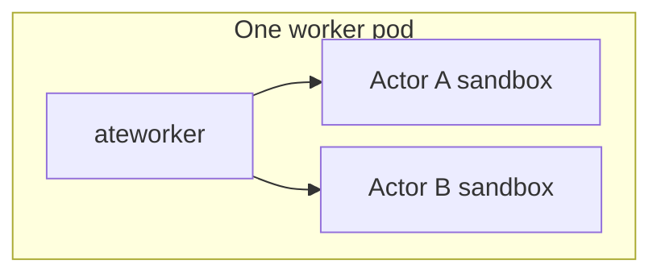

# Agent Substrate

**[Agent Substrate](https://github.com/agent-substrate/substrate/blob/f5428049ac0b81458eb12e81fa5a6b65cd39a2ad/docs/concepts/architecture.md)는 오랫동안 상태를 유지해야 하는 여러 [workload](glossary/workload.md)를 더 적은 수의 [Kubernetes](https://kubernetes.io/docs/concepts/overview/) worker [pod](glossary/pod.md)에서 실행합니다.** 작업 요청이 간헐적으로 들어올 때 특히 유용합니다. workload는 대기 중에 컴퓨팅 자원을 반환하고 다음 요청이 오면 저장된 상태에서 이어서 실행할 수 있습니다.

## Agent Substrate란? {#what-is-agent-substrate}

Agent Substrate는 Kubernetes에서 실행되는 [sandbox](glossary/sandbox.md) 플랫폼입니다. Agent framework나 단일 sandbox runtime은 아닙니다. *Actor*는 coding [agent](glossary/agent.md)나 HTTP 서비스처럼 이름을 가진 workload 인스턴스입니다. Kubernetes는 worker pod를 미리 준비하고, Substrate는 실행할 Actor마다 worker 자원과 전용 sandbox를 할당합니다. 한 worker가 여러 Actor를 동시에 실행할 수 있지만 Actor끼리 sandbox를 공유하지는 않습니다.

격리 방식은 worker pool에서 선택합니다. **[gVisor](https://gvisor.dev/docs/architecture_guide/intro/)** 또는 [Cloud Hypervisor](https://github.com/cloud-hypervisor/cloud-hypervisor) 기반 **[Kata Containers](https://github.com/kata-containers/kata-containers/blob/main/docs/design/architecture/README.md) [microVM](glossary/microvm.md)** 중 하나입니다. 애플리케이션이 Actor를 일시 중지하면 Substrate는 [snapshot](glossary/snapshot.md)을 저장하고 Actor가 차지하던 자원을 반환합니다. 다음 요청이 오면 같은 Actor를 다시 시작할 수 있으며, 호환되는 다른 worker에서도 가능합니다. 어떤 상태가 복원되는지는 snapshot에 무엇을 저장했는지에 따라 다릅니다. 이 페이지는 revision `f5428049`를 기준으로 합니다.

## 다른 프로젝트와 무엇이 다른가? {#agent-substrate-comparison}

핵심 차이는 **무엇을 계속 유지하느냐**입니다. Substrate에서 Actor의 신원과 저장된 상태는 worker pod의 수명과 별개입니다. warm pool만으로 이 동작이 생기는 것은 아니며, snapshot에서 microVM을 복원하는 기능도 Substrate만의 기능은 아닙니다.

| 비교 항목 | Agent Substrate | [Kubernetes Agent Sandbox: Warm Pool(v1.0.12)](https://github.com/kubernetes-sigs/agent-sandbox/blob/v1.0.12/examples/warmpool-quickstart/README.md) | [E2B Runtime(47c9255)](https://github.com/e2b-dev/runtime/blob/47c92550945704a8b2ac4ab5f20f1c3096141d08/README.md) | [로컬 Docker Sandboxes](https://docs.docker.com/ai/sandboxes/architecture/) |
| --- | --- | --- | --- | --- |
| 호출자가 다루는 단위 | 기존 Kubernetes worker에 배치되는 이름 있는 Actor. | 준비된 Sandbox가 있으면 `SandboxClaim`으로 할당받음. | 전용 Firecracker microVM 한 개를 사용하는 sandbox. | 전용 VM과 Docker daemon을 가진 로컬 sandbox. |
| 무엇을 준비하거나 복원하는가? | worker 자원을 미리 준비하고, Actor 상태를 독립된 gVisor 또는 microVM sandbox에 복원합니다. | 템플릿을 바탕으로 pool에 Sandbox 인스턴스를 미리 만듭니다. | 생성 시 미리 부팅한 VM 템플릿에서 복원합니다. 일시 중지한 sandbox는 자체 snapshot에서 재개할 수 있습니다. | sandbox마다 로컬 VM, 자체 Docker daemon 상태와 이미지 캐시를 갖습니다. |

warm pool을 비교할 때는 Kubernetes Agent Sandbox가 가장 비슷합니다. 일시 중지와 복원 측면에서는 E2B가 가장 비슷하며, E2B도 트래픽이 들어오면 sandbox를 재개할 수 있습니다. Substrate는 두 방식을 결합해 오래 유지하는 Actor를 재사용할 수 있는 Kubernetes worker에 배치하고, 두 가지 runtime class를 지원합니다.

## Agent Substrate는 어떤 상황에 적합한가? {#agent-substrate-when-to-choose}

**이미 Kubernetes를 운영하고, 여러 agent session이나 [workspace](glossary/workspace.md)를 유지해야 하지만 동시에 작업하는 것은 그중 일부일 때 적합합니다.** 예를 들어 coding agent가 패치를 만든 뒤 사람의 검토를 몇 시간 기다릴 수 있습니다. 그동안 harness가 Actor를 일시 중지할 수 있습니다. 검토 결과가 돌아오면 다음 요청으로 파일을 복원하고, 호환되는 메모리 snapshot이 있으면 저장한 process도 이어서 실행할 수 있습니다.

개발자 컴퓨터 한 대에 로컬 sandbox만 필요하거나, 작업 상태를 버려도 되거나, workload가 거의 쉬지 않고 실행된다면 적합성이 떨어집니다. 이 경우 snapshot과 별도의 스케줄링 계층을 운영해야 하지만 아낄 수 있는 컴퓨팅 자원은 많지 않을 수 있습니다.

이 설계는 유휴 연산 자원을 줄이는 대신 snapshot을 저장하고 전송하고 복원하는 작업을 추가합니다. 실제 workload에서 요청이 들어온 시점부터 첫 번째로 사용 가능한 응답을 받을 때까지 걸리는 시간을 측정합니다. Actor가 이미 실행 중인 경우, node 로컬에서 복원하는 경우, 원격에서 복원하는 경우를 비교합니다. 요청이 갑자기 몰려 pool을 가득 채우는 상황도 포함하여 지연 시간과 `503` 응답 비율을 모두 확인합니다. Control plane에서 측정한 수치를 종단 간 지연 시간으로 해석하지 마세요. Upstream의 [ResumePaused benchmark](https://github.com/agent-substrate/substrate/blob/f5428049ac0b81458eb12e81fa5a6b65cd39a2ad/docs/guides/benchmarking.md#resumepaused-benchmark)는 router와 실제 sandbox 복원을 의도적으로 제외합니다.

## 구현 세부 사항 {#agent-substrate-implementation}

### Worker pod는 격리 단위가 아닙니다 {#agent-substrate-isolation}

Worker pod를 미리 시작해 둔 [warm pool](glossary/warm-pool.md)이 실행 용량을 제공합니다. Worker 하나는 여러 Actor를 **동시에** 실행할 수 있으며, 각 Actor는 별도의 sandbox에서 실행됩니다. 한 sandbox에는 같은 Actor에 속한 container가 여러 개 있을 수 있습니다. 서로 신뢰하지 않는 workload를 한 Actor 안의 서로 다른 container에 배치하지 마세요. [Upstream 보안 모델](https://github.com/agent-substrate/substrate/blob/f5428049ac0b81458eb12e81fa5a6b65cd39a2ad/docs/security/security.md#defensible-multi-tenancy)은 개별 container가 아니라 Actor를 격리 경계로 봅니다.

각 `WorkerPool`은 하나의 [sandbox class](https://github.com/agent-substrate/substrate/blob/f5428049ac0b81458eb12e81fa5a6b65cd39a2ad/docs/reference/sandbox-classes.md#summary-of-differences)를 사용합니다. 하나의 cluster에서 두 class를 별도의 pool로 제공할 수 있습니다. 두 class 모두 [OCI](glossary/open-container-initiative.md) [container image](glossary/container-image.md)로 패키징한 workload를 실행합니다. Image 형식이 코드의 격리 방식을 결정하지는 않습니다. 일반 Linux container는 Actor sandbox로 지원되지 않습니다.

| Class | Actor를 분리하는 방식 | 선택 전에 확인할 사항 |
| --- | --- | --- |
| `gvisor` | Actor마다 gVisor `runsc` sandbox를 사용합니다. gVisor의 Sentry는 [user-space kernel](glossary/user-space-kernel.md)로서 Linux [system call](glossary/system-call.md)을 구현하며, Linux [guest kernel](glossary/guest.md)을 부팅하지 않습니다. | 일반 Linux node에서 실행됩니다. Workload에 필요한 Linux 인터페이스를 테스트합니다. 자원 한도는 Actor 단위로 적용되며, runtime은 개별 container의 한도를 무시합니다. |
| `microvm` | Actor마다 별도의 Linux guest가 있습니다. Cloud Hypervisor가 VM을 제공하고 Kata의 guest 구성 요소가 그 안에서 container를 실행합니다. | `/dev/kvm`을 제공하는 node가 필요합니다. Guest RAM과 VM의 부가 비용을 감안해 용량을 확보합니다. 이 class는 guest 안에서 개별 container의 한도를 적용하지만, 그렇다고 container마다 별도의 VM을 제공하지는 않습니다. |

### 누가 Actor를 배치하고 복원하며 요청을 전달합니까? {#agent-substrate-request-path}

Kubernetes와 Substrate는 서로 다른 대상을 배치합니다. `atecontroller`는 Kubernetes의 `WorkerPool` 리소스를 [Deployment](https://kubernetes.io/docs/concepts/workloads/controllers/deployment/)로 만들고, Kubernetes는 해당 pod를 node에 배치합니다. Substrate 자체 [control plane](glossary/control-plane.md)인 `ate-api-server`는 **Actor를 기존 worker에 배치합니다**. `ActorTemplate`, Actor, Worker는 Kubernetes object가 아니라 [PostgreSQL](https://www.postgresql.org/about/)의 레코드로 저장합니다. `ActorTemplate`은 image, 자원, snapshot 설정을 제공하고, Kubernetes의 `SandboxConfig`는 해당 class의 runtime 버전을 제공합니다. [리소스 모델](https://github.com/agent-substrate/substrate/blob/f5428049ac0b81458eb12e81fa5a6b65cd39a2ad/docs/concepts/architecture.md#api-resource-models)을 참조합니다.

1. **생성합니다.** Substrate는 실행 중인 sandbox를 예약하지 않고 Actor를 등록합니다. Actor를 생성할 때 템플릿에 미리 준비된 상태(*golden snapshot*)가 있으면 일반적으로 이 상태에서 시작합니다. 시작에 사용할 snapshot이 없으면 `ActorTemplate`의 image에서 시작합니다. [Golden snapshot 절차](https://github.com/agent-substrate/substrate/blob/f5428049ac0b81458eb12e81fa5a6b65cd39a2ad/docs/reference/api-guide.md#the-golden-snapshot)를 참조합니다.
2. **깨우고 요청을 전달합니다.** HTTP 요청이 들어오면 `atenet-router`는 control plane에 atespace와 이름으로 Actor를 찾도록 요청합니다. *Atespace*는 접근 제어를 위해 Substrate 리소스를 묶는 단위이며, Kubernetes namespace가 아닙니다. Actor가 일시 중지되어 있으면 control plane은 조건에 맞는 worker의 용량을 할당합니다. Node를 관리하는 `atelet`은 해당 pod 안의 `ateworker`에 sandbox를 복원하거나 부팅하도록 지시합니다. 준비가 끝나면 router는 worker의 인증된 `atunnel` 연결을 통해 요청을 전달합니다. [요청 경로와 수명 주기](https://github.com/agent-substrate/substrate/blob/f5428049ac0b81458eb12e81fa5a6b65cd39a2ad/docs/concepts/architecture.md#actor-lifecycle)를 참조합니다.
3. **일시 중지하고 재사용합니다.** 애플리케이션이나 agent harness는 Actor가 점유한 연산 자원을 해제하려고 할 때 `SuspendActor`를 호출합니다. 요청 처리가 끝났다고 해서 router가 Actor를 일시 중지한다고 가정하지 마세요. Runtime은 snapshot을 만들고 Actor의 slot을 해제합니다. 이후 요청이 들어오면 다른 호환 worker에서 같은 Actor를 복원할 수 있습니다. 요청이 급증하면 router는 [요청을 잠시 보류한 뒤 다시 시도](https://github.com/agent-substrate/substrate/blob/f5428049ac0b81458eb12e81fa5a6b65cd39a2ad/docs/concepts/request-parking.md#behavior)할 수 있습니다. 여유 용량이 생기지 않으면 HTTP `503`을 반환할 수 있습니다.

### 일시 중지 후에 무엇이 남습니까? {#agent-substrate-snapshots}

[Snapshot 설정](https://github.com/agent-substrate/substrate/blob/f5428049ac0b81458eb12e81fa5a6b65cd39a2ad/docs/concepts/architecture.md#state-management--persistence)에 따라 보존할 수 있는 상태가 달라집니다. 템플릿의 `preferredFidelity`는 보존 수준의 상한이며, 복원할 때마다 메모리가 유지된다는 보장은 아닙니다.

| Snapshot 수준 | 보존하는 상태 | 재개 시 동작 |
| --- | --- | --- |
| `VOLUMES` | Snapshot을 지원하는 `DurableDir` volume의 데이터입니다. | 해당 데이터를 사용할 수 있는 상태로 새 process를 시작합니다. |
| `ROOTFS` | Volume 데이터와 container의 쓰기 가능한 루트 파일 시스템에 생긴 변경 사항입니다. | 파일 변경 사항이 반영된 상태로 새 process를 시작합니다. |
| `MEMORY` (기본 선호값) | Volume 데이터, 루트 파일 시스템의 변경 사항, 실행 중인 process의 상태와 메모리입니다. | 호환되는 runtime을 갖춘 worker에서 저장된 process를 재개할 수 있습니다. |

[Counter 데모](https://github.com/agent-substrate/substrate/blob/f5428049ac0b81458eb12e81fa5a6b65cd39a2ad/demos/counter/README.md#how-to-use)는 process를 복원하는 것과 image에서 다시 시작하는 것의 차이를 보여 줍니다. 메모리 snapshot에서 복원하면 메모리의 카운트와 파일에 저장된 두 카운트가 모두 1에서 이어져 2가 됩니다. 그렇다고 모든 snapshot을 어디로든 옮길 수 있는 것은 아닙니다. 복원에는 원래 sandbox class를 사용합니다. 메모리를 복원할 여유 용량이 있는 호환 worker가 없다면, 영속 저장된 snapshot으로 [`ROOTFS` 수준에서 복원하고 새 process를 시작](https://github.com/agent-substrate/substrate/blob/f5428049ac0b81458eb12e81fa5a6b65cd39a2ad/docs/reference/sandbox-classes.md#snapshots-volumes-rootfs-and-memory)할 수 있습니다.

기본적으로 일시 중지 호출은 **node 로컬** checkpoint가 준비되면 반환됩니다. Checkpoint는 백그라운드에서 object storage(Google Cloud Storage 또는 S3)로 전송되어 영속적으로 저장됩니다. 업로드가 끝나기 전에 node에 장애가 나면 최신 checkpoint를 잃을 수 있습니다. 호출이 반환될 때 snapshot이 node 밖에 저장되어 있어야 한다면 Actor가 실행 중일 때 [동기식 `SuspendActor`](https://github.com/agent-substrate/substrate/blob/f5428049ac0b81458eb12e81fa5a6b65cd39a2ad/docs/reference/api-guide.md#suspendactor)를 사용합니다. 일시 중지된 Actor에 `SuspendActor`를 다시 호출하면 동기 모드에서도 Actor를 변경 없이 반환하며 진행 중인 업로드를 기다리지 않습니다. 최신 snapshot에 의존하기 전에 `status.snapshots`에서 해당 snapshot의 `durableSnapshot.state`가 `SNAPSHOT_STORAGE_STATE_COMPLETED`인지 확인합니다. [Eviction 가이드](https://github.com/agent-substrate/substrate/blob/f5428049ac0b81458eb12e81fa5a6b65cd39a2ad/docs/reference/api-guide.md#eviction)는 harness가 pod 종료 시 자동 checkpoint 생성에 의존하지 말고 pod가 축출되는 상황에 대비해야 하는 이유를 설명합니다.

### 네트워크 접근과 credential {#agent-substrate-access}

[보안 모델](https://github.com/agent-substrate/substrate/blob/f5428049ac0b81458eb12e81fa5a6b65cd39a2ad/docs/security/security.md#security-boundaries)에 따라 각 Actor는 전용 네트워크를 갖습니다. 들어오는 트래픽은 다른 Actor에서 직접 도달하지 않고 인증을 거치는 router를 통해 들어옵니다. 나가는 트래픽은 기본적으로 차단됩니다. DNS relay와 `atenet-egress`가 Actor가 접근할 수 있는 목적지를 제한합니다. **어떤 최종 사용자가 어떤 Actor를 호출할 수 있는지**는 여전히 외부 애플리케이션이 결정해야 합니다.

[Credential injection](glossary/credential-injection.md)에서는 Actor가 요청 header에 placeholder를 넣어 보냅니다([upstream 가이드](https://github.com/agent-substrate/substrate/blob/f5428049ac0b81458eb12e81fa5a6b65cd39a2ad/docs/guides/egress-credential-injection.md#how-it-works) 참조). 규칙이 요청을 허용하고 해당 header를 지정하면 gateway는 credential 또는 Actor를 식별하는 서명된 token을 가져옵니다. 그런 다음 placeholder를 실제 값으로 바꾸고 대상 서비스로 요청을 전송합니다. HTTPS header를 바꾸려면 gateway에서 TLS 연결을 종단해야 하고 Actor는 gateway의 인증 기관을 신뢰해야 합니다. Actor는 credential 없이 요청할 수 있으므로, 값을 추가하는 과정에서 비밀 정보가 Actor의 메모리나 snapshot에 들어가지 않습니다. 그러나 애플리케이션이 sandbox에 넣거나 대상 서비스가 응답으로 보내는 비밀 정보까지 보호하지는 않습니다. 허용 범위가 넓은 규칙은 원치 않는 호출도 허용할 수 있습니다.

플랫폼은 worker 관리 구성 요소, gateway, snapshot 저장소 등 sandbox 외부의 인프라를 여전히 신뢰합니다. Upstream [상태 표](https://github.com/agent-substrate/substrate/blob/f5428049ac0b81458eb12e81fa5a6b65cd39a2ad/docs/security/security.md#defensible-multi-tenancy)에서는 worker의 권한 축소와 정리 보장을 진행 중인 작업으로 표시합니다. Atespace는 별도의 sandbox나 [네트워크 policy](practice/data-and-access/network-policy.md)를 대신하지 않습니다.

Substrate를 다른 sandbox 플랫폼과 비교하려면 [Agent sandbox 아키텍처](agent-sandbox-architectures.md#agent-substrate)를 참조합니다.
