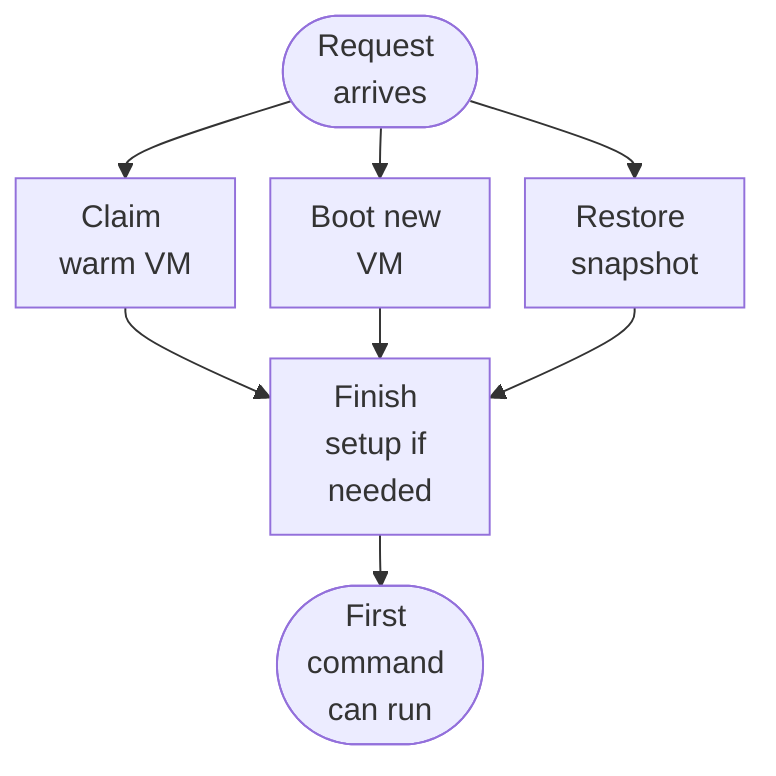

# Cold start

Cold start는 바로 사용할 수 있는 실행 환경이 없을 때 [sandbox](sandbox.md)나 다른 실행 환경을 준비하는 데 필요한 작업이다. 환경을 어떤 방식으로 시작하는지가 아니라 작업 요청이 들어올 때 무슨 일이 일어나는지를 설명하는 말이다. [cold boot](cold-boot.md)를 하거나, [snapshot](snapshot.md)에서 복원하거나, 언어 [runtime](runtime.md)을 시작하는 과정이 포함될 수 있다.

## 예시

Test runner의 [warm pool](warm-pool.md)이 비어 있을 때 요청이 들어온다. Test runner는 저장해 둔 Linux VM을 복원하고 프로젝트 workspace를 연결한 다음, sandbox가 명령을 받을 수 있을 때까지 기다린다. VM이 운영 체제를 처음부터 부팅하지 않았어도 이 요청에는 cold start가 발생한다.

## 실제 작업을 시작할 수 있을 때까지 걸리는 시간 측정

Cold-start latency는 환경이 실제 작업을 수행할 수 있을 때까지 기다리는 시간이다. 명령을 실행하는 sandbox라면 요청이 들어온 시점부터 sandbox가 첫 명령을 실행할 수 있는 시점까지 측정한다. Image 읽기, VM 부팅 또는 복원, 요청별 데이터 준비처럼 개별 단계에 걸린 시간도 기록한다. 부팅이나 복원이 빠르다고 해서 요청의 전체 대기 시간을 알 수 있는 것은 아니다.

부팅과 복원은 모두 cold start의 일부가 될 수 있다. Warm pool에서 실행 중인 VM을 할당받으면 요청이 들어오기 전에 부팅이나 복원을 마칠 수 있지만, 프로젝트 workspace 연결과 같은 설정은 여전히 필요할 수 있다.

설정이 필요한 요청과 이미 준비된 sandbox를 할당받는 요청을 비교한다. 독자가 측정에 무엇이 포함되었는지 알 수 있도록 어떤 파일이나 image가 이미 cache에 있었는지 명시한다. 여러 provisioning 경로의 예는 [Agent sandbox architectures](../agent-sandbox-architectures.md#what-is-changing-in-2026)를 참고한다.

[용어집으로 돌아가기](../glossary.md)
