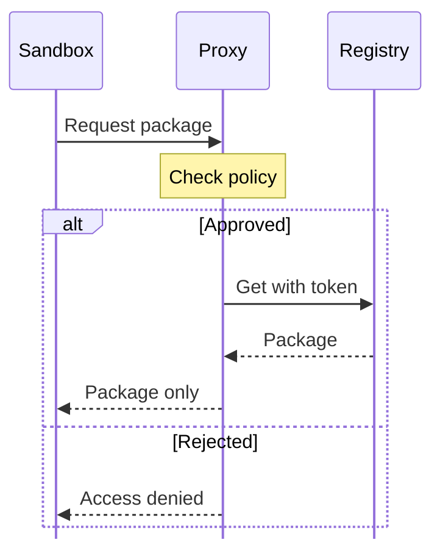

# Credential injection

Credential injection은 sandbox에서 실행되는 프로그램을 대신해 요청에 [credential](credential.md)을 추가하는 것을 말한다. 요청을 전달하는 서비스인 proxy는 요청을 확인하고, 대상 서비스에 보내기 전에 credential을 추가할 수 있다. 프로그램은 credential을 직접 받지 않는다. Proxy와 대상 서비스가 모두 프로그램에 credential을 노출하지 않는다고 신뢰할 수 있어야 한다.

## 예시

Sandbox에서 실행되는 빌드가 비공개 패키지 하나를 다운로드해야 한다. 빌드는 proxy에 해당 패키지를 요청한다. Proxy는 요청 대상과 패키지를 확인하고, 다운로드 요청이 맞는지도 확인한다. 그런 다음 해당 패키지에 대한 읽기 전용 token을 사용하고, 빌드에는 token이 아니라 다운로드한 데이터를 반환한다.

## Credential을 추가하는 위치

Proxy는 전달할 요청에 credential을 추가하기 전에 [policy](policy.md)를 적용한다. 예를 들어 웹 요청에서 대상 서비스가 읽는 필드인 [Authorization header](https://www.rfc-editor.org/rfc/rfc6750.html#section-2.1)에 bearer token을 추가할 수 있다. 실제 token을 workload가 읽을 수 있는 설정에 넣는 것은 이와 다르다. 그렇게 하면 workload가 token 자체를 얻는다.

Token은 proxy가 registry에 보내는 요청에만 들어간다. 거부된 요청은 registry에 도달하지 않는다.

[OpenShell v0.1.9](https://github.com/NVIDIA/OpenShell/blob/v0.1.9/docs/how-it-works/providers/overview.mdx#how-credential-injection-works) 문서는 한 가지 방식을 설명한다. 코드는 placeholder를 받고, proxy는 승인된 HTTP 요청에서 placeholder를 실제 값으로 바꿀 수 있다. Proxy가 요청을 볼 수 없게 하는 tunnel에서는 이 방식으로 요청을 수정할 수 없다.

## Proxy가 보호해야 하는 것

Proxy는 승인된 요청에 한해 지정된 서비스에만 credential을 보내야 하며, workload가 읽을 수 있는 로그에는 credential을 남기지 않아야 한다. 대상 서비스가 응답에 credential을 노출하지 않는다고 신뢰할 수 있어야 한다. Token을 숨긴다고 해서 허용 범위가 넓은 [egress](egress.md) 규칙이 안전해지는 것은 아니다. Workload는 여전히 policy가 허용하는 모든 작업을 proxy에 요청할 수 있다.

[용어집으로 돌아가기](../glossary.md)
