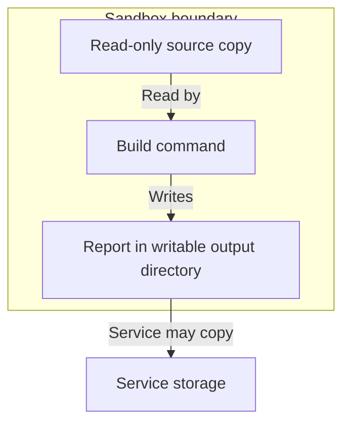

# Sandbox

Sandbox는 그 안에서 실행되는 코드가 접근하거나 변경할 수 있는 대상을 제한하는 환경이다. 애플리케이션 전체를 담을 수도 있고 작은 스크립트 하나만 담을 수도 있다. 보호 범위는 코드를 분리하는 방식, 적용하는 규칙, 코드에 노출하는 리소스에 따라 달라진다.

## 예시

서비스는 읽기 전용 소스 복사본과 쓰기 가능한 출력 디렉터리를 갖춘 sandbox에서 빌드 명령을 실행한다. 이 명령은 원본 프로젝트를 변경하지 않고 빌드 보고서를 생성할 수 있다. 서비스는 빌드에 서비스 저장소에 대한 직접 접근 권한을 주지 않고도 보고서를 sandbox 밖으로 복사할 수 있다.

## Sandbox의 구성 요소

[isolation boundary](isolation-boundary.md)는 실행 중인 코드를 다른 코드나 리소스와 분리한다. [policy](policy.md)는 코드가 사용할 수 있는 파일, 네트워크 목적지 또는 tool을 지정한다. [isolation unit](isolation-unit.md)은 어떤 작업들이 동일한 isolation boundary를 공유하는지 나타낸다. [control plane](control-plane.md)은 sandbox를 시작하고 규칙을 설정할 수 있다. Runtime과 tool handler 같은 다른 구성 요소는 실제 접근이 일어나는 지점에서 규칙을 적용한다.

[virtual machine](virtual-machine.md)과 [restricted interpreter](restricted-interpreter.md)는 모두 sandbox로 쓸 수 있지만 서로 다른 종류의 코드를 실행한다. 같은 boundary를 사용하는 두 sandbox도 서로 다른 접근 권한을 부여할 수 있다. Sandbox를 비교할 때는 사용하는 기술뿐 아니라 무엇을 안으로 들이고 밖으로 내보낼 수 있는지도 나열한다. [Sandbox isolation boundaries](../sandbox-isolation-boundaries.md)를 참고한다.

[용어집으로 돌아가기](../glossary.md)
