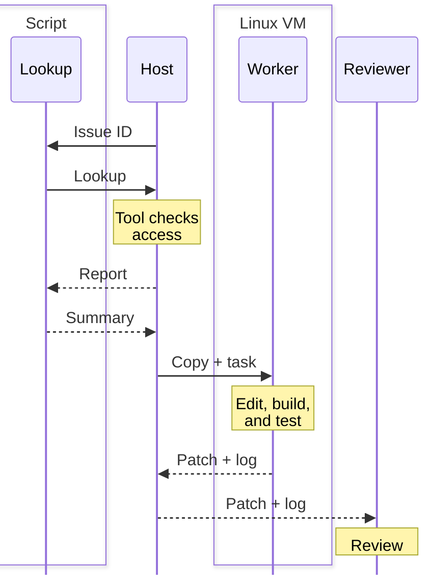

# 이슈에서 패치까지 {#from-issue-to-patch}

[sandbox](../../glossary/sandbox.md) 안의 코드에 게시 권한을 주지 않고도 패치를 밖으로 내보낼 수 있습니다. 이 예에서는 스크립트가 이슈 하나를 조회하고, 별도의 Linux worker가 소스 사본을 수정하고 테스트하며, 사람이 반환된 텍스트 파일 두 개를 검토합니다. 어느 프로그램도 원본 저장소를 변경할 수 없습니다.

여기서 다루는 것은 예시용 제한을 적용한 가상 서비스이며, 검증된 배포 사례가 아닙니다. 다른 환경은 [설계 비교](choosing-a-sandbox.md)에서 다룹니다. 여기서는 호스팅 환경에서 실행 한 건을 따라갑니다. Lamp와 Cedar는 별개의 [tenant](../../glossary/tenant.md)입니다. 서비스를 공유하지만 서로의 데이터는 볼 수 없어야 합니다.

## 이슈 하나, 경계 두 개 {#one-issue-two-boundaries}

Lamp 프로젝트의 이슈 `LAMP-17`은 두 묶음의 항목 수를 더할 때 합계가 잘못 나온다고 보고합니다. 예를 들어 항목 두 개와 세 개를 합치면 다섯 개가 되어야 합니다. 작은 C 프로그램으로 이 오류를 재현할 수 있습니다. 스크립트에는 이슈 조회 [tool](../../glossary/tool.md)이 필요하고, worker에는 컴파일러와 쓰기 가능한 임시 작업 디렉터리가 필요합니다. 어느 쪽도 상대방의 자원에 접근할 필요는 없습니다.

[host](../../glossary/host.md)는 코드가 접근할 수 있는 대상을 제한하는 장치인 [isolation boundary](../../glossary/isolation-boundary.md)를 두 개 사용합니다. 조회 스크립트에는 [restricted interpreter](../../glossary/restricted-interpreter.md)를, worker에는 Linux [virtual machine (VM)](../../glossary/virtual-machine.md)을 사용합니다. Host의 [control plane](../../glossary/control-plane.md)은 실행을 관리하지만 worker의 파일 읽기 요청을 가로채지는 않습니다. 대신 worker가 시작되기 전에 VM에서 무엇을 볼 수 있는지 설정합니다.



## 각 단계에서 무엇이 전달되나요? {#what-moves-at-each-step}

1. **요청 → host.** 권한이 있는 Lamp 요청자는 `LAMP-17`과 승인된 Lamp 소스 리비전을 제출합니다. Control plane은 호출자의 신원과 해당 실행을 시작할 [authorization](../../glossary/authorization.md)을 확인합니다. Lamp, 이슈, 리비전을 해당 실행에 연결하고 어느 프로그램도 이를 선택하지 못하게 합니다. 요청이 거부되면 worker를 시작하지 않습니다.
2. **이슈 기록 → 스크립트 → host.** Host는 조회 스크립트에 이슈 ID를 전달합니다. Interpreter는 `get_issue`만 노출합니다. Host의 핸들러는 [호출이 해당 실행에서 허용된 범위에 속하는지 확인](tool-authorization.md)하고, 로컬 fixture(미리 준비한 예시 데이터)를 읽어 제목과 보고 내용만 반환합니다. 스크립트는 짧은 작업 요약을 반환합니다. 보고 내용과 요약은 데이터일 뿐, 추가 접근 권한을 부여할 수 있는 지시가 아닙니다.
3. **작업과 소스 사본 → worker.** Control plane은 새 VM을 시작합니다. Workspace 서비스는 작업 요약과 승인된 리비전의 소스 및 테스트를 일회용 [`/work` workspace](../data-and-access/workspaces-and-artifacts.md)에 복사합니다. Worker는 설치된 컴파일러를 사용해 사본을 수정하고 테스트를 실행합니다. Worker에는 [외부로 나가는 네트워크 경로](../data-and-access/network-policy.md)도, 이슈 tool도, 이슈 저장소나 검토용 저장소 또는 소스 저장소에 대한 [credential](../../glossary/credential.md)도 없습니다.
4. **텍스트 파일 두 개 → 검토.** 빌드가 완료되고 테스트를 통과했다고 실행 결과가 보고되면 worker가 중지됩니다. VM 외부의 수집기는 중지된 workspace에서 `change.patch`와 `test.log`만 받습니다. 실행 ID와 기준 리비전은 worker가 아니라 control plane에서 받습니다. 검토용 저장소는 읽기 요청마다 [지정된 Lamp 검토자에게 접근 권한이 있는지 확인](../data-and-access/multi-tenant-isolation.md)하고, 받아들인 [artifact](../../glossary/artifact.md)를 7일 동안 보관합니다. 두 파일은 신뢰할 수 없는 데이터입니다. 로그만으로는 원래 테스트가 실행됐다고 입증할 수 없으며, 패치가 자동으로 적용되어서는 안 됩니다.
5. **실행 종료 → 정리.** 실행이 성공하거나 실패하거나 취소되거나 시간 제한에 도달하면 control plane은 해당 실행에 대한 접근을 차단하고, runtime과 workspace 서비스가 VM과 임시 작업 데이터를 폐기했는지 확인합니다. 폐기 여부를 확인하지 못한 자원은 재사용하지 않습니다. [검토용 저장소는 자체 사본을 만료시킵니다](../data-and-access/workspaces-and-artifacts.md#decide-what-leaves-work). Worker를 삭제해도 이 사본은 삭제되지 않습니다. [자원 제한](../operations/resource-limits.md)에서 실행이 언제 중지되고 실패 시 무엇이 반환되는지 설명합니다.

## Lamp 접근 규칙 {#lamp-access-rules}

다음은 이 실행에 적용되는 권한이며 VM이나 interpreter가 기본으로 부여하는 권한은 아닙니다.

| 주체 | 허용되는 작업 | 부여되지 않는 권한 |
| --- | --- | --- |
| 권한이 있는 Lamp 요청자 | 허가된 실행을 시작하고, 실행 상태와 안전하게 공개할 수 있는 사유 코드를 확인합니다. | 별도로 검토자로 지정되지 않으면 검토용 파일을 읽을 수 없습니다. |
| 조회 스크립트 | `get_issue`를 호출해 Lamp의 `LAMP-17`을 조회하고, 작업 요약을 host에 반환합니다. | 셸, 직접 파일 또는 네트워크에 접근할 권한, 다른 이슈에 접근할 권한, 쓰기 tool을 사용할 권한은 없습니다. |
| Linux worker | 설치된 tool과 라이브러리를 읽고, 자체 일회용 workspace에서 읽기, 쓰기, 빌드, 테스트를 수행합니다. | 원본 checkout, host 파일, Cedar의 workspace, VM 외부의 네트워크 endpoint, 이슈 tool, 서비스 credential에 접근할 수 없습니다. |
| 수집기 | 해당 실행에 연결된 workspace에서 지정된 파일 두 개를 읽고, 검증한 텍스트를 해당 실행의 검토 항목에 씁니다. | 패치를 적용하거나 반환된 파일을 실행하거나 worker가 지정한 목적지를 받아들일 수 없습니다. |
| 지정된 Lamp 검토자 | 보관 기간이 끝날 때까지 해당 실행의 패치와 테스트 로그를 읽습니다. | 이 작업 흐름에서 게시하거나 Cedar의 artifact를 읽을 수 없습니다. 실행 ID만으로는 접근 권한이 생기지 않습니다. |

[control plane과 runtime](../operations/control-planes.md#who-owns-what)의 역할은 다릅니다. VM은 worker가 노출된 자원에만 접근하도록 제한하지만, 호출자가 특정 이슈나 패치를 읽을 수 있는지는 tool 핸들러와 검토용 저장소만 판단할 수 있습니다. 이 작업 흐름에서 게시 권한을 가진 구성 요소는 없습니다. 게시를 맡는 주체가 있다면 해당 실행 바깥의 별도 역할입니다.

## 설계 결정 기록 작성하기 {#fill-in-your-decision-record}

이 기록을 복사해 자신의 작업에 맞게 작성하세요. Lamp의 [isolation unit](../../glossary/isolation-unit.md)은 interpreter 인스턴스당 조회 스크립트 하나, VM당 빌드 시도 한 번입니다. 위 표를 참고해 각 주체가 할 수 있는 일을 명시하고, [lifecycle](../operations/sandbox-lifecycle.md)을 참고해 각 사본을 누가 삭제하는지 기록하세요. 규칙이 작동하는지 모른다면 검증하지 않았다고 표시하고 확인 방법을 적으세요.

```text
Task, inputs, and intended outputs:
Who can submit code? What must stay out of reach?
Required boundary and isolation unit (what shares one instance):
Why this choice? Which alternative did it rule out, and why?

For each allowed access: actor → action and exact resource → enforcer/owner:
  Tool, action, and record scope:
  Files read, written, or exported:
  Network destinations and direction (or none):
  Credentials: who holds them, what they allow, when they expire:
  Output: who may read it and what they cannot do:
Forbidden access to check (including another tenant):

Operator and resource limits (including time and concurrency):
On denial, limit, failure, or cancellation: who stops it and what is returned?
Reuse: what can be shared, and what state must never carry over?
Cleanup: for each retained item, who deletes it, when, and how is it confirmed?
What has been verified? What would make you reconsider this design?
```

격리 방식을 선택하려면 [Sandbox 선택하기](choosing-a-sandbox.md)를 참고하세요. 권한과 담당 주체를 자세히 살펴보려면 [Tool authorization](tool-authorization.md)에서 시작해 접근 규칙과 운영으로 이어지는 링크를 따라가세요.
