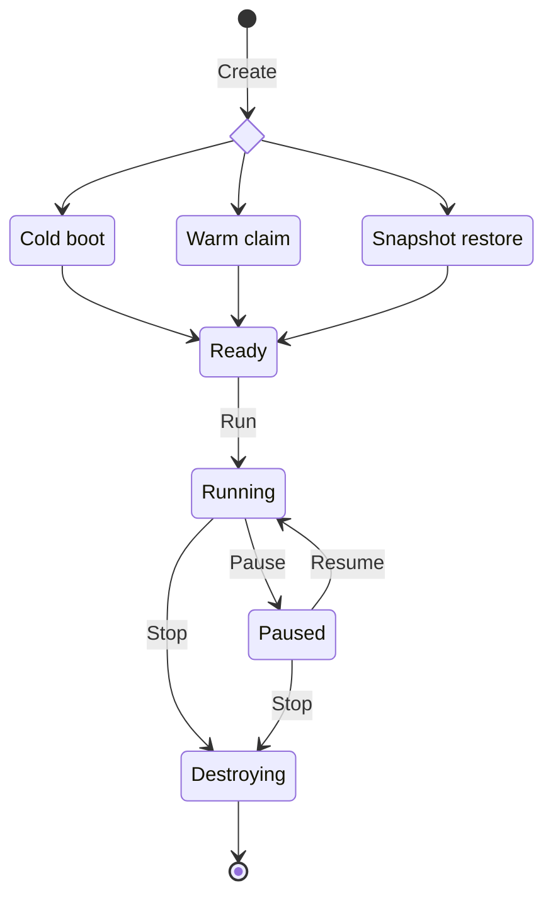

# Sandbox 수명 주기 {#sandbox-lifecycle}

Worker를 시작하는 일과 프로젝트 파일을 연결하는 일은 별개의 단계입니다. [Lamp 예제](../design/from-issue-to-patch.md)에서는 시도할 때마다 새 [virtual machine (VM)](../../glossary/virtual-machine.md)을 시작하고 일회용 [workspace](../../glossary/workspace.md)를 연결합니다. 서비스는 깨끗한 읽기 전용 컴파일러 image만 재사용합니다. 같은 [tenant](../../glossary/tenant.md)의 작업이라도 worker, 디스크, 실행 중인 process는 재사용하지 않습니다.

## 생성부터 폐기까지 {#from-create-to-destroy}

Lamp는 [cold boot](../../glossary/cold-boot.md)를 사용합니다. 실행 중이던 상태를 복원하지 않고 Linux를 처음부터 시작하는 방식입니다. 그림에는 다른 시작 방식도 나오지만, Lamp 실행에서 그 방식이 허용된다는 뜻은 아닙니다. 어느 방식으로 시작해도 같은 준비 상태 확인을 거칩니다. 일시 중지는 현재 [session](../../glossary/sandbox-session.md)을 유지합니다. 여기서 복원은 깨끗한 템플릿으로 새 session을 시작하는 것을 뜻합니다.

[control plane](../../glossary/control-plane.md)은 시작이 실패하거나 준비된 worker가 실행 전에 취소된 경우에도 정리를 요청합니다. 그림에서는 쉽게 읽을 수 있도록 이 경로를 생략했습니다.

[warm pool](../../glossary/warm-pool.md)은 worker를 미리 시작하고 대기하는 동안에도 자원을 점유합니다. 메모리를 담은 [snapshot](../../glossary/snapshot.md)을 사용하면 부팅을 건너뛸 수 있지만 저장된 상태는 여전히 불러옵니다. 디스크만 담은 snapshot은 파일을 복원하며 부팅은 여전히 필요합니다. 두 방식 중 어느 쪽을 쓰든 비공개 데이터를 추가하기 전에 준비한 템플릿을 사용하세요. 사용한 worker를 깨끗한 pool에 돌려보내지 마세요.

## 무엇을 언제 삭제하는가 {#what-gets-deleted-and-when}

| 데이터 또는 자원 | Lamp 실행의 담당자와 규칙 |
| --- | --- |
| 조회용 sandbox와 작업 요약 | Host는 조회 인스턴스가 요약을 반환하거나 실패하면 그 인스턴스를 폐기합니다. Control plane은 환경을 정리할 때 미리 준비한 실행 입력을 폐기합니다. |
| Worker와 메모리 | Runtime은 VM을 중지하고 그 자원을 해제합니다. 작업 디스크나 메모리의 snapshot은 저장하지 않습니다. |
| 일회용 `/work` 디스크 | Workspace 서비스는 내보내기가 성공하거나 실패했을 때, 또는 내보내지 않고 시도가 끝났을 때 디스크를 제거합니다. 그러면 소스 사본, 작업 요약, 변경 사항, 바이너리, 임시 파일이 삭제됩니다. |
| 깨끗한 컴파일러 image | 플랫폼 팀은 이후 VM에서 쓸 수 있도록 읽기 전용으로 보관합니다. Tenant 데이터는 이 image로 돌아가지 않습니다. |
| 수락한 패치와 테스트 로그 | [검토 저장소](../data-and-access/workspaces-and-artifacts.md#decide-what-leaves-work)는 수락한 날로부터 7일 뒤에 둘을 삭제합니다. Worker를 폐기해도 이 파일은 삭제되지 않습니다. |
| 접근이 제한된 진단 레코드 | 서비스 운영자는 [진단 레코드 보관 규칙](observability-and-debugging.md#keep-diagnostic-records-safe)에 따라 상태와 사유 코드를 확인할 수 있습니다. 이 레코드에는 작업용 임시 파일이 포함되지 않습니다. |

성공, 실패, 취소, 시간 초과 중 어느 경우든 [control plane은 정리 상태를 추적합니다](control-planes.md#who-owns-what). Runtime과 workspace 서비스가 자원 제거를 확인할 때까지 추적하며, 설정이 일부만 완료된 상태에서 남은 자원도 포함합니다. 제거를 확인할 수 없으면 `cleanup_pending`을 기록하고 운영자에게 알립니다. 제거가 확인되지 않은 자원은 정리가 확인될 때까지 사용할 수 없지만, 그 자원이 차지하는 용량은 계속 사용량에 포함합니다. 새 시도에는 이전 상태가 아니라 새 VM과 디스크를 제공합니다.

다음: [Resource limit](resource-limits.md)에서는 시도가 중지되는 조건과 서비스가 각 한도를 처리하는 방법을 설명합니다.
