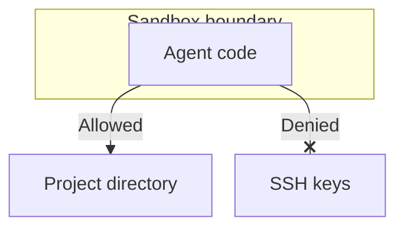
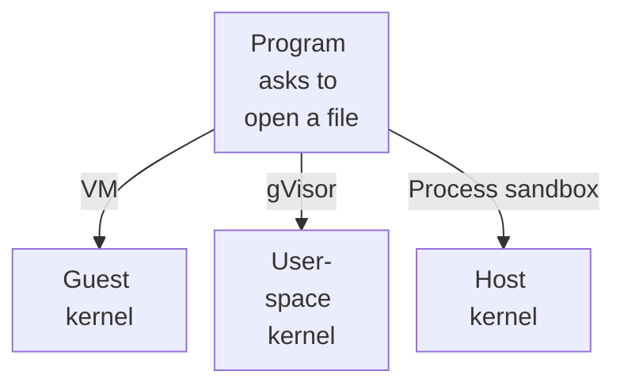
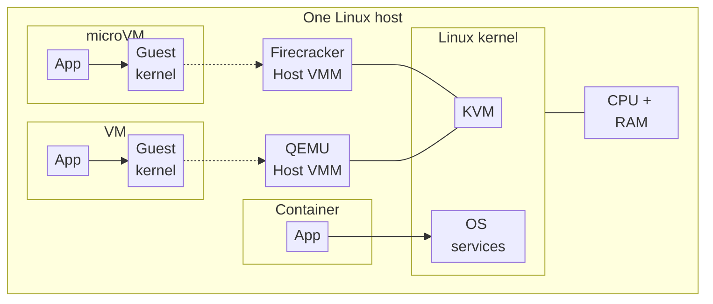

# Sandbox의 격리 경계

[sandbox](glossary/sandbox.md)는 프로그램을 실행하면서 접근할 수 있는 대상을 제한합니다. 예를 들어 코딩 [agent](glossary/agent.md)는 프로젝트를 읽고 수정해야 할 수 있지만 사용자의 SSH 키까지 읽을 필요는 없습니다. [isolation boundary](glossary/isolation-boundary.md)는 프로그램이 그 키에 접근하지 못하게 하는 장치입니다. [policy](glossary/policy.md)는 프로그램이 사용할 수 있는 파일, 네트워크 목적지, [tool](glossary/tool.md)을 정하는 규칙입니다. 구성 요소가 규칙을 실제로 적용해야 그 규칙이 효력을 갖습니다.

프로젝트는 sandbox에 노출되지만 SSH 키는 노출되지 않습니다. 끝에 X가 있는 화살표는 프로그램이 접근할 수 없음을 나타냅니다.

## 파일 열기 요청이 처리되는 과정 {#follow-a-request-to-open-a-file}

Agent가 가상 프로젝트 [Lamp (영어)](../practice/design/from-issue-to-patch.md)의 테스트 실행기를 시작한다고 가정해 봅시다. 테스트 실행기는 실행 중인 프로그램의 인스턴스, 즉 [process](glossary/process.md)입니다. [kernel](glossary/kernel.md)은 메모리, 파일, 장치 등의 자원을 관리하는 운영체제의 한 부분입니다. [system call](glossary/system-call.md)은 파일을 여는 일처럼 process가 혼자 할 수 없는 작업을 kernel에 요청하는 것입니다.

1. 테스트 실행기가 소스 파일 `total.c`를 열어 달라고 요청합니다. 라이브러리가 실행기를 대신해 system call을 보낼 수 있습니다.
2. 운영체제 인터페이스를 구현하는 구성 요소가 process에 보이는 파일 중에서 해당 경로를 찾아 파일을 열 수 있는지 확인합니다.
3. 프로젝트 파일에 접근할 수 있으므로 열기 요청은 성공할 수 있습니다. [host](glossary/host.md)의 SSH 키가 process에 보이는 파일에 포함되지 않으면 그 키를 열어 달라는 요청은 실패합니다. Policy는 프로젝트만 노출하고 키는 노출하지 않도록 정하고, 설정된 경계는 그 규칙을 적용합니다. Agent에게 키를 건드리지 말라고 지시하는 것만으로는 규칙이 적용되지 않습니다.

## 운영체제 workload를 위한 Sandbox {#sandboxes-for-operating-system-workloads}

프로젝트를 빌드하고 테스트하는 agent는 특정 CPU와 운영체제 인터페이스에 맞게 빌드한 프로그램인 [native binary](glossary/native-binary.md)를 실행해야 할 때가 많습니다. 다음 방식은 누가 파일 열기 요청을 처리하는지, workload가 여전히 무엇을 공유하는지에 따라 다릅니다.

그림은 어느 구성 요소가 프로그램의 요청을 처리하는지 보여 줄 뿐, 그 뒤에 이어지는 모든 동작을 보여 주지는 않습니다. User-space kernel도 자체 요청을 host kernel에 보낼 수 있습니다.

### 1. 하드웨어 지원을 받는 Virtual machine {#1-hardware-backed-virtual-machines}

[virtual machine (VM)](glossary/virtual-machine.md)은 자체 운영체제 kernel인 [guest kernel](glossary/guest.md)을 갖춘 별도의 컴퓨터 환경을 제공합니다. 테스트 실행기의 파일 요청은 이 kernel이 처리합니다. 하나의 VM 안에 있는 프로그램은 그 kernel을 공유합니다. [microVM](glossary/microvm.md)은 보통 더 적은 수의 장치를 노출하여 부가 비용을 줄이도록 설계되지만, 여전히 guest kernel을 갖습니다. 어느 방식이든 host 디렉터리를 노출하면 guest에서 접근할 수 있습니다.

**적합한 경우:** Agent에 별도의 kernel을 갖춘 완전한 Linux [workspace](glossary/workspace.md)가 필요할 때입니다. 경계 하나를 공유하는 workload 집합인 [isolation unit](glossary/isolation-unit.md)을 확인하세요. [하드웨어 지원을 받는 Virtual machine 자세히 보기 (영어)](../isolation/native-programs/hardware-backed-virtual-machines.md).

### 2. User-space kernel 사용 방식 {#2-user-space-kernels}

[gVisor](https://gvisor.dev/docs/architecture_guide/intro/)의 [user-space kernel](glossary/user-space-kernel.md)처럼, 이 방식에서는 Linux 인터페이스를 자체 구현하여 테스트 실행기의 요청을 처리합니다. 기반 자원은 여전히 host kernel이 제공하며, user-space kernel은 host kernel에 자체 요청을 보낼 수 있습니다. 이 방식이 host에서 노출하기로 한 프로젝트 데이터에 대한 접근까지 막지는 않습니다.

**적합한 경우:** Linux [container](glossary/container.md)를 실행하되 host kernel에 직접 접근하는 범위를 줄이고 싶을 때입니다. Linux와 호환성 및 성능이 다를 수 있으므로 실제로 실행해야 하는 코드, 즉 [workload](glossary/workload.md)로 테스트하세요. [User-space kernel 자세히 보기 (영어)](../isolation/native-programs/user-space-kernels.md).

### 3. 운영체제 Process Sandbox {#3-operating-system-process-sandboxes}

[operating-system process sandbox](glossary/operating-system-process-sandbox.md)에서는 테스트 실행기가 같은 머신의 다른 프로그램과 여전히 host kernel을 공유합니다. Kernel은 process에 보이는 파일 범위를 제한하거나 특정 system call을 필터링할 수 있습니다. 파일을 숨겨도 프로그램이 이미 받은 내용의 사본은 없어지지 않습니다.

**적합한 경우:** 로컬 agent에 개발자가 평소 쓰는 명령이 필요하지만, host에 대한 무제한 접근 권한까지 물려주면 안 될 때입니다. 그 명령이 시작하는 process에도 제한이 적용되는지 확인하세요. [운영체제 Process Sandbox 자세히 보기 (영어)](../isolation/native-programs/operating-system-process-sandboxes.md).

### VM, Container, microVM 비교 {#compare-a-vm-a-container-and-a-microvm}

**microVM은 VM의 한 종류입니다.** 보통 더 적은 가상 장치를 제공하지만, 같은 backend를 사용한다면 범용 VM과 동일한 방식으로 하드웨어 격리를 적용합니다. 반면 native Linux container의 process는 host kernel에서 바로 실행됩니다.

이 예에서는 Linux host 한 대에서 native container와 [QEMU v9.2.0](https://github.com/qemu/qemu/blob/v9.2.0/docs/system/introduction.rst#L6-L50) VM, [Firecracker v1.11.0](https://github.com/firecracker-microvm/firecracker/blob/v1.11.0/docs/design.md#internal-architecture) microVM을 실행합니다. QEMU와 Firecracker는 각각 [virtual machine monitor (VMM)](glossary/virtual-machine-monitor.md)로서 host의 [user space](glossary/user-space.md)에서 실행됩니다. 둘 다 host kernel의 [KVM](glossary/kernel-based-virtual-machine.md)을 사용해 [VT-x를 지원하는 Intel x86-64 CPU](https://www.intel.com/content/www/us/en/developer/articles/technical/intel-sdm.html)에서 guest를 실행합니다.

실선 화살표는 system call을 나타냅니다. 점선 화살표는 guest의 VMM이 처리하는 장치 요청을 나타내며, 모든 I/O 경로를 보여 주지는 않습니다. 화살표가 없는 선은 요청의 경로가 아니라 구성 요소가 사용하는 하위 계층을 나타냅니다. QEMU와 Firecracker는 모두 `/dev/kvm`을 열어 [KVM API](https://docs.kernel.org/virt/kvm/api.html#general-description)를 사용하지만, Firecracker가 제공하는 가상 장치의 종류는 더 적습니다.

**그림 출처:** [Agache 외, *Firecracker: Lightweight Virtualization for Serverless Applications*, 그림 1 (NSDI 2020)](https://files.usenix.org/s3fs-public/cdn/nsdi20-paper-agache.pdf#page=4)을 바탕으로 [Firecracker v1.11.0의 Host 통합 설명](https://github.com/firecracker-microvm/firecracker/blob/v1.11.0/docs/design.md#host-integration)과 [QEMU v9.2.0의 시스템 에뮬레이션 개요](https://github.com/qemu/qemu/blob/v9.2.0/docs/system/introduction.rst#L6-L50)를 참고해 다시 그리고 내용을 추가했습니다.

#### CPU 실행, 메모리, 장치 I/O {#cpu-execution-memory-and-device-io}

1. **CPU 실행.** 테스트 실행기의 파일 열기 호출을 예로 들어 봅시다. x86-64에서 `SYSCALL`은 CPU의 [privilege level](glossary/cpu-privilege-level.md)을 ring 3(앱)에서 ring 0(kernel)으로 바꿉니다. Container에서는 host kernel이 process의 mount [namespace](glossary/namespace.md)에서 경로를 찾습니다. [seccomp](glossary/seccomp.md)는 경로를 찾기 전에 호출을 차단할 수 있습니다. 두 VM에서는 모두 앱의 호출이 자체 guest kernel로 들어갑니다. 앱과 guest kernel은 둘 다 Intel이 guest 모드를 가리킬 때 쓰는 **VMX non-root operation** 상태에서 실행됩니다. Guest의 ring 0으로 전환하는 일 자체는 [VM exit](glossary/vm-exit.md)를 일으키지 않습니다. VM exit는 제어권을 KVM에 돌려주는 별도의 CPU 전환입니다. [Intel VMX 설명서의 그림 26-1](https://cdrdv2.intel.com/v1/dl/getContent/671506#page=4)을 참고하세요.
2. **메모리 주소 변환.** Page table은 메모리 주소 간 대응 관계와 접근 권한을 기록합니다. Container에서 CPU는 host process의 page table을 사용해 가상 주소를 host 물리 주소로 변환합니다. 두 VM에서는 모두 두 단계의 변환이 일어납니다. Guest의 page table은 guest 가상 주소를 guest 물리 주소로 변환하고, [Extended Page Tables (EPT)](glossary/extended-page-tables.md)는 guest 물리 주소를 host 물리 주소로 변환합니다. 첫 단계는 guest kernel이, 두 번째 단계는 KVM이 제어합니다. CPU는 guest의 page table을 읽을 때에도 EPT를 적용합니다. [Linux KVM 메모리 문서](https://docs.kernel.org/virt/kvm/x86/mmu.html#translation)를 참고하세요.
3. **장치 I/O.** Guest에 필요한 디스크 데이터가 메모리에 없으면 guest의 드라이버가 가상 디스크에 요청을 보냅니다. 장치에 접근하다 VM exit가 발생하면 KVM은 host kernel에서 이를 처리하거나 [`KVM_RUN`](https://docs.kernel.org/virt/kvm/api.html#kvm-run)에서 반환하여 host의 VMM에 제어권을 넘길 수 있습니다. 예를 들어 장치 레지스터 접근은 [`KVM_EXIT_MMIO`](https://docs.kernel.org/virt/kvm/api.html#the-kvm-run-structure)로 반환될 수 있습니다. 이때 VMM은 장치에 할당된 메모리 주소의 읽기나 쓰기를 처리합니다. 모든 가상 디스크 요청이 이 경로를 거치는 것은 아닙니다. Host의 파일을 가상 디스크의 저장소로 사용할 수는 있지만, 그렇다고 guest가 임의의 host 파일을 열 수 있는 것은 아닙니다.

| 비교 항목 | 범용 VM | Native Linux container | microVM |
| --- | --- | --- | --- |
| 격리와 공유 | 하드웨어 지원으로 격리하며, 같은 VM의 process는 guest kernel을 공유합니다. | [Namespace](glossary/namespace.md)는 보이는 자원의 범위를 나눕니다. [Control group](glossary/control-group.md)은 자원 사용량을 집계하거나 제한할 수 있습니다. 앱은 다른 container와 host process가 쓰는 동일한 kernel에 직접 요청을 보냅니다. | 범용 VM과 같은 방식으로 하드웨어 지원을 받아 격리합니다. 같은 microVM의 process는 guest kernel을 공유합니다. |
| OS 및 장치 지원 | 지원되는 guest OS를 실행할 수 있으며 host OS와 달라도 됩니다. [QEMU v9.2.0](https://github.com/qemu/qemu/blob/v9.2.0/docs/system/introduction.rst#L39-L50) 같은 VMM은 다양한 가상 장치를 제공합니다. | 다른 Linux 도구와 라이브러리를 사용할 수 있지만, host의 Linux kernel 및 runtime이 노출하는 인터페이스와 호환되어야 합니다. | 지원되는 guest OS와 더 제한적인 장치 목록을 확인하세요. 예를 들어 [Firecracker v1.11.0](https://github.com/firecracker-microvm/firecracker/blob/v1.11.0/docs/design.md#machine-model)은 가상 저장 장치와 네트워크를 제공하지만 그래픽 디스플레이 장치는 제공하지 않습니다. |
| 새로 시작할 때 | 앱을 시작하기 전에 guest OS를 부팅합니다. | Guest를 부팅하지 않고 process를 시작합니다. 이미지를 가져오고 푸는 데 시간이 걸릴 수 있습니다. | Guest OS를 부팅해야 하는 것은 같습니다. 더 작은 장치 모델과 최소 구성의 guest로 시작 작업을 줄일 수 있습니다. |
| 추가 메모리 사용량 | Guest OS와 앱에 필요한 메모리 외에 host의 VMM에도 메모리가 필요합니다. | Container마다 별도의 guest나 VMM이 필요하지 않습니다. 앱마다 메모리가 필요한 것은 같습니다. | Guest와 VMM 모두에 메모리가 필요합니다. 더 작은 장치 모델과 최소 구성의 guest로 추가 사용량을 줄일 수 있습니다. |
| 적합한 경우 | 별도의 kernel이 필요하고, 검토 중인 microVM이 지원하지 않는 guest OS나 장치가 필요한 작업입니다. | 패키지로 묶인 Linux 도구 모음이 필요하고 host kernel을 공유해도 되는 작업입니다. | 실행 시간이 짧고 별도의 kernel이 필요하며, 지원되는 guest OS와 장치만으로 충분한 작업입니다. |

속도를 비교하기 전에 경계를 선택하세요. 가상 장치가 적으면 guest가 장치를 통해 접근할 수 있는 코드의 범위를 줄일 수 있지만, 격리가 더 강해지거나 시작 시간이 일정해진다는 보장은 없습니다. VM은 별도의 guest kernel을 쓰더라도 물리 하드웨어를 공유할 수 있습니다. 두 VM 방식에서는 작업마다 별도의 guest를 받는지 확인하고, 세 방식 모두에서 어떤 파일과 네트워크 서비스가 노출되는지 확인하세요. 그런 다음 [동일한 workload를 측정하되 (영어)](../practice/verification/measuring-a-sandbox.md) 새로 시작하는 경우, [snapshot](glossary/snapshot.md)에서 복원하는 경우, [warm pool](glossary/warm-pool.md)에서 할당받는 경우를 구분하세요.

## 생성된 스크립트를 위한 Sandbox {#sandboxes-for-generated-scripts}

이슈 제목을 조회하고 결과를 정렬하는 agent라면 tool 하나를 쓰는 짧은 스크립트만 실행해도 충분할 수 있습니다. [runtime](glossary/runtime.md)은 코드를 실행하거나 코드가 실행될 환경을 준비합니다. 여기서는 언어 또는 모듈 runtime이 완전한 Linux 환경을 제공하지 않고도 스크립트를 실행할 수 있습니다.

1. 스크립트는 노출된 tool에 `LAMP-17`의 제목을 요청합니다. Runtime은 스크립트가 호출할 수 있는 동작을 제한합니다. 스크립트가 직접 이슈 파일을 열거나 네트워크 요청을 보낼 필요는 없습니다.
2. Host의 tool이 조회를 처리합니다. 이때 호출자에게 요청한 이슈를 읽을 권한이 있는지, 즉 [authorization](glossary/authorization.md)을 확인합니다. Tool을 호출할 수 있다고 해서 그 tool의 모든 데이터를 읽을 수 있는 것은 아닙니다.
3. 읽을 권한이 있으면 tool이 제목을 반환합니다. 스크립트는 runtime 안에서 반환된 제목을 정렬할 수 있습니다. Tool이 authorization을 확인하지 않으면 runtime에서 직접 자원 접근을 제한하더라도 그 tool을 통한 이슈 데이터 읽기는 막을 수 없습니다.

### 4. WebAssembly {#4-webassembly}

[WebAssembly (Wasm)](glossary/webassembly.md)는 여러 환경에서 쓸 수 있는 실행 모듈 형식입니다. Wasm runtime은 메모리 접근을 확인하고, 모듈 밖으로 보내는 호출을 이슈 조회용 [host function](glossary/host-function.md)처럼 host가 제공하는 동작으로 제한합니다. 모듈끼리 host process를 공유할 수 있지만, 기본적으로 서로의 메모리를 공유하지는 않습니다. 생성된 코드 자체가 Wasm 모듈일 수도 있고, Wasm으로 컴파일한 언어 엔진에서 실행되는 코드일 수도 있습니다.

**적합한 경우:** Workload나 해당 언어 엔진을 Wasm에서 실행할 수 있고 일반 Linux binary가 필요 없을 때입니다. 메모리 접근을 확인한다고 해서 이슈 조회 tool 자체가 읽을 수 있는 범위까지 제한되는 것은 아닙니다. [WebAssembly 자세히 보기 (영어)](../isolation/generated-scripts/webassembly.md).

### 5. Engine isolate 사용 방식 {#5-engine-isolates}

[engine isolate](glossary/engine-isolate.md)는 언어 엔진 내부의 별도 실행 환경입니다. 각 isolate에는 고유한 객체와 관리 상태가 있지만, 여러 isolate가 host process를 공유할 수 있습니다. 플랫폼은 스크립트에 일반적인 운영체제 접근 권한을 주지 않고도 이슈 서비스를 노출할 수 있습니다.

**적합한 경우:** 스크립트에 엔진의 언어 기능과 일부 플랫폼 동작은 필요하지만 셸이나 native package manager는 필요 없을 때입니다. 서비스가 요청마다 권한을 확인하지 않으면 서비스에 연결하는 것만으로도 넓은 접근 권한이 생길 수 있습니다. [Engine isolate 자세히 보기 (영어)](../isolation/generated-scripts/engine-isolates.md).

### 6. Restricted interpreter 사용 방식 {#6-restricted-interpreters}

[restricted interpreter](glossary/restricted-interpreter.md)는 자체 구현한 언어 기능만 실행하고 자체 제공하는 내장 기능과 tool만 노출합니다. 정렬은 interpreter 안에서 수행하고, 이슈 조회는 host의 tool에 맡깁니다. 이 interpreter는 host 애플리케이션의 process 안에서 실행될 수 있습니다. 언어를 제한하는 것만으로 별도의 운영체제가 생기거나 host의 tool이 미치는 영향이 제한되지는 않습니다.

**적합한 경우:** 언어의 일부 기능만으로 tool 호출을 조합하고 결과를 처리하기에 충분할 때입니다. Interpreter가 어떤 기능과 라이브러리를 지원하는지 확인하세요. [Restricted interpreter 자세히 보기 (영어)](../isolation/generated-scripts/restricted-interpreters.md).

## 패키징, 관리, 격리를 구분하기 {#keep-packaging-management-and-isolation-separate}

제품을 살펴볼 때는 그 제품이 어느 계층을 바꾸는지 확인하세요.

| 계층 | 하는 일 |
| --- | --- |
| 패키징 | [container image](glossary/container-image.md)는 테스트 실행기와 종속 항목, 시작 설정을 제공합니다. 테스트 실행기가 무엇에 접근할 수 있는지는 정하지 않습니다. |
| 실행 | [container runtime](glossary/container-runtime.md)은 테스트 실행기가 실행될 환경을 준비합니다. [Apple `container`](https://github.com/apple/container/blob/main/docs/technical-overview.md)는 VM 안에서 container를 실행합니다. 반면 gVisor는 호환되는 이미지를 실행하면서 user-space kernel에서 system call을 처리할 수 있습니다. |
| 관리 | [control plane](glossary/control-plane.md)은 환경을 시작하고 할당하고 정리합니다. [Kubernetes Agent Sandbox](https://agent-sandbox.sigs.k8s.io/docs/)는 이 관리 계층을 제공하고, runtime은 경계를 설정합니다. Control plane은 workspace를 선택할 수 있지만 각 파일 열기 요청을 처리하지는 않습니다. |

Agent 하나가 둘 이상의 경계를 사용할 수 있습니다. 제한된 스크립트를 통해 이슈 제목을 읽고 테스트 작업을 Linux VM에 보낼 수 있습니다. 이 설계에서는 스크립트 sandbox가 스크립트에서 호출할 수 있는 tool을 제한하고, 조회 tool이 반환 가능한 데이터를 확인하며, VM은 테스트 작업이 접근할 수 있는 대상을 제한합니다.

## 이해했는지 확인하기 {#check-your-understanding}

1. Process sandbox, user-space kernel sandbox, VM에서 각각 어느 구성 요소가 `total.c`를 열어 달라는 요청을 처리하나요? [운영체제 workload를 위한 Sandbox](#sandboxes-for-operating-system-workloads)를 확인하세요.
2. 스크립트가 이슈 조회 tool을 호출할 수 있다면, `LAMP-17`의 제목을 반환할지는 누가 결정하나요? [생성된 스크립트를 위한 Sandbox](#sandboxes-for-generated-scripts)를 확인하세요.
3. 테스트 실행기에 자체 kernel이 있더라도 어떤 host 디렉터리가 노출되는지 확인해야 하는 이유는 무엇인가요? [하드웨어 지원을 받는 Virtual machine](#1-hardware-backed-virtual-machines)을 확인하세요.

스크립트와 VM의 경계를 함께 사용하는 단계별 예제는 [이슈에서 패치까지 (영어)](../practice/design/from-issue-to-patch.md)를, 실제 구현 사례는 [Agent sandbox 아키텍처 (영어)](../agent-sandbox-architectures.md)를 참고하세요.
