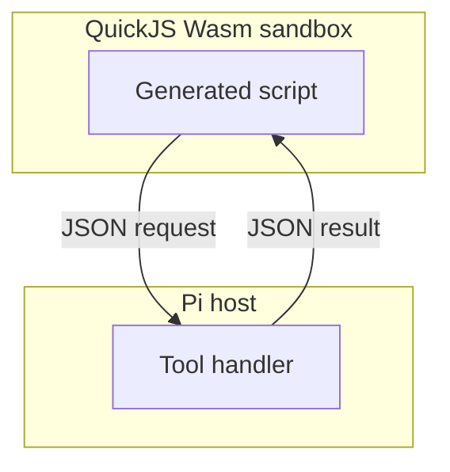

# Pi Codemode

**Pi Codemode lets the model write a small program that calls tools and returns only the result it needs.** The program runs in a restricted [sandbox](glossary/sandbox.md), but its tools run outside that sandbox. A tool can still read, write, or send data if the host gives it that authority. This page describes Pi v1.6.0 and the Node and Bun implementation of `CodemodeSandbox`.

## What does Codemode do? {#what-is-pi-codemode}

With [Code Mode](glossary/code-mode.md), a model writes a [JavaScript](https://github.com/earendil-works/pi/blob/v1.6.0/packages/coding-agent/docs/codemode.md#scripts) program to coordinate [tool](glossary/tool.md) calls without asking the model to decide what to do after every result. The script can run independent calls in parallel, extract selected fields, and return a short answer. For example, if a tool returns a full issue record, a script can return only the issue title. This saves model context; it does not change which issue records the tool may read. A single ordinary tool call is simpler if no coordination or filtering is needed.

## Where does the script run? {#codemode-execution-boundary}

For each execution, [`CodemodeSandbox`](https://github.com/earendil-works/pi/blob/v1.6.0/packages/codemode/README.md#how-it-works) starts a worker thread and creates a fresh QuickJS instance compiled to [WebAssembly (Wasm)](glossary/webassembly.md). The thread keeps the script off Pi's main thread. **The thread is not the permission boundary.** The Wasm instance has its own memory, and the [host](glossary/host.md) grants only limited imports, including a bridge to registered [host functions](glossary/host-function.md). The script has no direct Node.js API, filesystem, network, shell, or timers.

The host dispatches registered tool calls; it does not give the script direct access to the host's tools or resources.

## What must the host enforce? {#codemode-host-policy}

- **Choose which operations to expose.** A tool that reads an approved issue can grant one narrow operation. A general shell tool gives the script whatever access the shell has. In the [Pi integration](https://github.com/earendil-works/pi/blob/v1.6.0/packages/coding-agent/docs/codemode.md#call-tools), callable session tools are available through `tools`; hiding their declarations from the model does not remove them from the script's tool set.
- **Validate arguments and authorize each action.** A [tool schema](https://github.com/earendil-works/pi/blob/v1.6.0/packages/codemode/README.md#declarations-for-the-model) describes inputs but the standalone library does not validate arguments against it. For a custom integration, use the agent's tool pipeline if it supplies the checks you need. [Calling `tool.execute()` directly](https://github.com/earendil-works/pi/blob/v1.6.0/packages/codemode/README.md#using-with-pi-agent-core) skips the agent's before- and after-call hooks. [Tool authorization](practice/design/tool-authorization.md) explains how to check the caller, action, and resource separately.
- **Limit resources and expect partial effects.** Pi's [Codemode integration](https://github.com/earendil-works/pi/blob/v1.6.0/packages/coding-agent/docs/codemode.md#limits) sets a 256 MiB QuickJS memory limit and caps the number of live workers per Pi process. The memory limit does not cap memory used by host tools. Pi also supports a per-script deadline, which is unset by default. Cancellation requests that the worker stop and signals pending tool calls; it does not undo completed actions. On Bun, a built-in that does not check for interrupts can keep computing after the caller receives the cancellation result.

## When do you need a different boundary? {#when-to-use-pi-codemode}

Use Codemode when the task is to combine existing tools or reduce their output before it reaches the model. If the task must build or test untrusted code, put that work in an [OS-level sandbox](glossary/operating-system-process-sandbox.md) or a [microVM](glossary/microvm.md). If you must isolate Pi and all its extensions, run the whole Pi process inside the selected environment. These boundaries can be used together: Codemode can compose calls to a tool that executes jobs in a separate Linux sandbox.

See [Where Pi runs](agent-sandbox-architectures.md#where-pi-runs) for ways to isolate tools or the whole Pi process, and the [Code Mode comparison](agent-sandbox-architectures.md#code-mode-isolating-tool-scripts-instead-of-shells) for other script runtimes.
