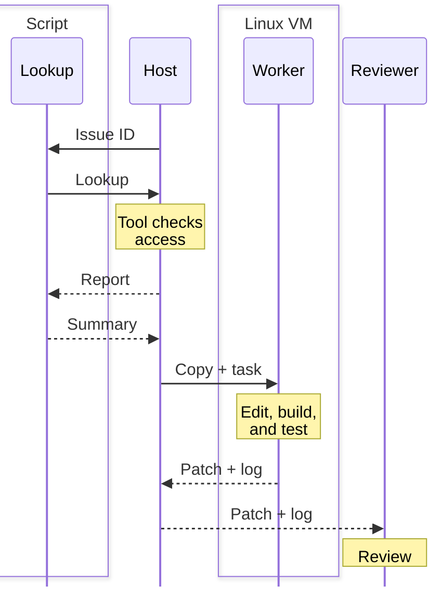

# From issue to patch

A patch can leave a [sandbox](../../glossary/sandbox.md) without giving the code inside permission to publish it. In this worked example, a script looks up one issue, a separate Linux worker edits and tests a copy of the source, and a person reviews two returned text files. Neither program can change the original repository.

This is a fictional service with example limits, not a tested deployment. The [design comparison](choosing-a-sandbox.md) covers other settings. Here we follow one hosted run in which Lamp and Cedar are separate [tenants](../../glossary/tenant.md): they share a service but must not see each other's data.

## One issue, two boundaries

In project Lamp, issue `LAMP-17` says that adding two item counts gives the wrong total. For example, two items plus three items should total five. A tiny C program reproduces the error. The script needs an issue lookup [tool](../../glossary/tool.md); the worker needs a compiler and a writable scratch directory. Neither needs access to the other's resources.

The [host](../../glossary/host.md) uses two [isolation boundaries](../../glossary/isolation-boundary.md), mechanisms that enforce what code can reach: a [restricted interpreter](../../glossary/restricted-interpreter.md) for the lookup script and a Linux [virtual machine (VM)](../../glossary/virtual-machine.md) for the worker. The host's [control plane](../../glossary/control-plane.md) manages the run but does not intercept the worker's file reads. It sets up what the VM can see before the worker starts.



## What moves at each step

1. **Request → host.** A permitted Lamp requester supplies `LAMP-17` and an approved Lamp source revision. The control plane checks the caller's identity and [authorization](../../glossary/authorization.md) to start that run. It binds Lamp, the issue, and the revision to the run; it does not let either program choose them. A rejected request does not start a worker.
2. **Issue record → script → host.** The host gives the issue ID to the lookup script. The interpreter exposes only `get_issue`. The host handler [checks the call](tool-authorization.md) against the run's scope, reads the local fixture (prepared example data), and returns only the title and report. The script returns a short task summary. The report and summary are data, not instructions that can grant more access.
3. **Task and source copy → worker.** The control plane starts a fresh VM. The workspace service copies the task summary and the approved revision's source and tests into a disposable [`/work` workspace](../data-and-access/workspaces-and-artifacts.md). Using the installed compiler, the worker edits the copy and runs the tests. It has no [network route out](../data-and-access/network-policy.md), issue tool, or [credentials](../../glossary/credential.md) for the issue store, review store, or repository.
4. **Two text files → review.** When the run reports a completed build and passing tests, the worker stops. A collector outside the VM accepts only `change.patch` and `test.log` from the stopped workspace. It takes the run ID and base revision from the control plane, not from the worker. The review store [authorizes the designated Lamp reviewer](../data-and-access/multi-tenant-isolation.md) on each read and keeps the accepted [artifacts](../../glossary/artifact.md) for seven days. The files are untrusted: the log does not prove the original tests ran, and the patch must not apply itself.
5. **End the run → clean up.** On success, failure, cancellation, or timeout, the control plane cuts off run access and verifies that the runtime and workspace service disposed of the VM and its scratch data. It holds unconfirmed resources out of reuse. The [review store expires its own copies](../data-and-access/workspaces-and-artifacts.md#decide-what-leaves-work); deleting the worker does not delete those copies. [Resource limits](../operations/resource-limits.md) explain when the run stops and what a failure returns.

## Lamp access rules

These are the permissions for this run, not what a VM or interpreter grants by default.

| Actor | Allowed | Not granted |
| --- | --- | --- |
| Permitted Lamp requester | Start the authorized run and see its status and safe reason code. | Read the review files unless separately designated as reviewer. |
| Lookup script | Call `get_issue` for Lamp's `LAMP-17`; return a task summary to the host. | Shell, direct file or network access, any other issue, or write tools. |
| Linux worker | Read the installed tools and libraries; read, write, build, and test in its own disposable workspace. | Original checkout, host files, Cedar's workspace, network endpoints outside the VM, issue tool, and service credentials. |
| Collector | Read the two named files from the bound workspace; write validated text to that run's review entry. | Apply the patch, execute returned files, or accept a worker-supplied destination. |
| Designated Lamp reviewer | Read the patch and test log for this run until expiry. | Publish through this workflow or read Cedar's artifacts. A run ID alone grants no access. |

The [control plane and runtime](../operations/control-planes.md#who-owns-what) have different jobs. The VM confines the worker to exposed resources, but only the tool handler and review store know whether a caller may read a particular issue or patch. No component in this workflow has publication authority. A publisher would be a separate role outside the run.

## Fill in your decision record

Copy this record for your own task. Lamp's [isolation unit](../../glossary/isolation-unit.md) is one lookup script per interpreter instance and one build attempt per VM. Use the table above to name what each actor may do, and the [lifecycle](../operations/sandbox-lifecycle.md) to name who removes each copy. If you do not know whether a rule works, mark it unverified and write down how you will check it.

```text
Task, inputs, and intended outputs:
Who can submit code? What must stay out of reach?
Required boundary and isolation unit (what shares one instance):
Why this choice? Which alternative did it rule out, and why?

For each allowed access: actor → action and exact resource → enforcer/owner:
  Tool, action, and record scope:
  Files read, written, or exported:
  Network destinations and direction (or none):
  Credentials: who holds them, what they allow, when they expire:
  Output: who may read it and what they cannot do:
Forbidden access to check (including another tenant):

Operator and resource limits (including time and concurrency):
On denial, limit, failure, or cancellation: who stops it and what is returned?
Reuse: what can be shared, and what state must never carry over?
Cleanup: for each retained item, who deletes it, when, and how is it confirmed?
What has been verified? What would make you reconsider this design?
```

For the mechanism choice, see [Choosing a sandbox](choosing-a-sandbox.md). To follow the permissions and owners in detail, start with [Tool authorization](tool-authorization.md) and follow the links through access rules and operations.
