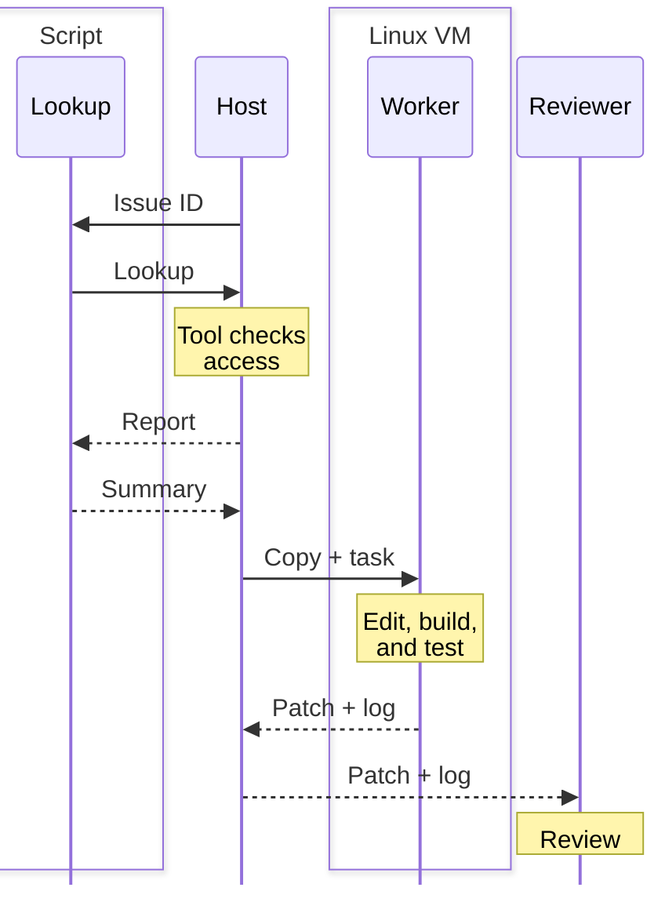

# From issue to patch

Give each part of a coding task only the access it needs. In this illustrative design, a script reads an issue, a separate Linux worker edits and tests a copy of the code, and a person reviews the result. The worker can return a patch, but it cannot publish it.

## One issue, two boundaries

In project Lamp, fictional issue `LAMP-17` says that adding two item counts gives the wrong total. For example, two items plus three items should total five. A tiny C program reproduces the error. The script needs an issue lookup tool; the worker needs a compiler and a writable scratch directory. Neither needs access to the other's resources.

The script sandbox and the Linux virtual machine (VM) are separate [execution boundaries](../../sandbox-isolation-boundaries.md). The host sends a source copy and task to the worker, not access to the issue tool or the original repository. The worker sends back text, not a command for the host to run.

## What moves at each step

1. **Look up the report.** The host gives the issue ID to a script in a restricted interpreter. The script requests `LAMP-17` through the host's read-only tool. Outside the interpreter, the tool checks the run's access to Lamp and reads the fictional fixture. It returns the needed issue fields, and the script sends a summary back to the host.
2. **Edit and test the copy.** The host's [control plane](../../glossary/control-plane.md) starts a Linux VM and supplies a copy of the Lamp source at a recorded revision and the task summary. Inside the VM, the worker edits only its scratch copy, compiles the C program, and runs the tests. The worker has no general network access, issue tool, or repository credentials.
3. **Collect and review the result.** The host collects only a text patch and size-limited test output, labels them with the run and base revision, and keeps them in a restricted review store until expiry. The control plane stops the worker and discards its scratch copy. The designated reviewer reads the patch and output as untrusted text. A passing log alone does not prove that the worker ran the intended tests.

Review does not grant repository write access. If a change is later approved for publication, a separate publisher outside the worker uses its own repository permissions. This example stops at review.

Next: [Choosing a sandbox](choosing-a-sandbox.md) explains when the Linux worker needs a VM and when a different boundary may fit.
