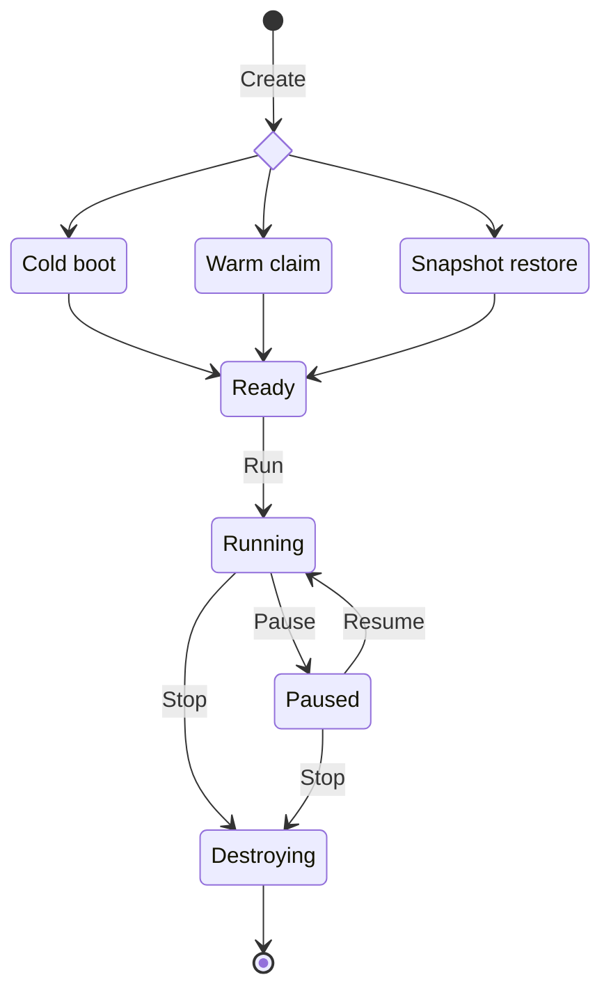

# Sandbox lifecycle

Starting a worker and attaching a project's files are separate steps. In the [Lamp walkthrough](../design/from-issue-to-patch.md), each attempt starts a fresh [virtual machine (VM)](../../glossary/virtual-machine.md) with a disposable [workspace](../../glossary/workspace.md). The service reuses only the clean, read-only compiler image. It does not reuse the worker, disk, or running processes, even for the same [tenant](../../glossary/tenant.md).

## From create to destroy

Lamp uses a [cold boot](../../glossary/cold-boot.md): start Linux from the beginning, with no running state restored. The diagram also shows alternatives, not permissions of the Lamp run. All startup paths lead to the same readiness check. Pausing keeps the current [session](../../glossary/sandbox-session.md); restoring here starts a new session from a clean template.

The [control plane](../../glossary/control-plane.md) also requests cleanup if startup fails or a ready worker is cancelled before running. The diagram omits these paths for clarity.

A [warm pool](../../glossary/warm-pool.md) starts workers in advance and holds resources while they wait. A [snapshot](../../glossary/snapshot.md) with memory can skip boot but still loads saved state; a disk-only snapshot restores files and still needs a boot. If adopting either approach, use a template prepared before adding private data. Do not return a used worker to the clean pool.

## What gets deleted and when

| Data or resource | Owner and rule in the Lamp run |
| --- | --- |
| Lookup sandbox and task summary | The host discards the lookup instance after it returns a summary or fails. The control plane discards its staged run inputs at teardown. |
| Worker and memory | The runtime stops the VM and releases its resources. It saves no job disk or memory snapshot. |
| Disposable `/work` disk | The workspace service removes it after a successful export, a failed export, or an attempt with no export. That deletes the source copy, task summary, edits, binaries, and temporary files. |
| Clean compiler image | The platform team keeps it read-only for later VMs. No tenant data returns to it. |
| Accepted patch and test log | The [review store](../data-and-access/workspaces-and-artifacts.md#decide-what-leaves-work) deletes them seven days after acceptance. Destroying a worker does not delete them. |
| Restricted diagnostic records | The service operator can inspect status and reason codes under the [diagnostic retention rule](observability-and-debugging.md#keep-diagnostic-records-safe). They do not include the scratch files. |

On success, failure, cancellation, or timeout, the [control plane tracks cleanup](control-planes.md#who-owns-what) until the runtime and workspace service confirm removal, including any resources left by partial setup. It records `cleanup_pending` and alerts the operator if it cannot confirm removal. Unconfirmed resources stay out of use and count against capacity until cleanup is confirmed. A new attempt gets a new VM and disk, not the old state.

Next: [Resource limits](resource-limits.md) explains what causes an attempt to stop and how the service handles each limit.
