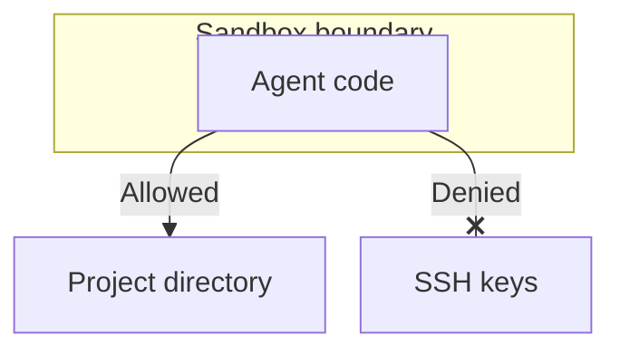
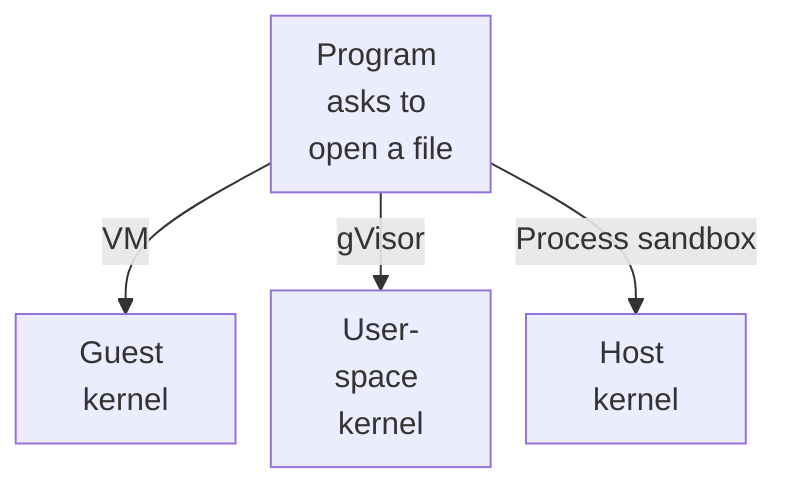
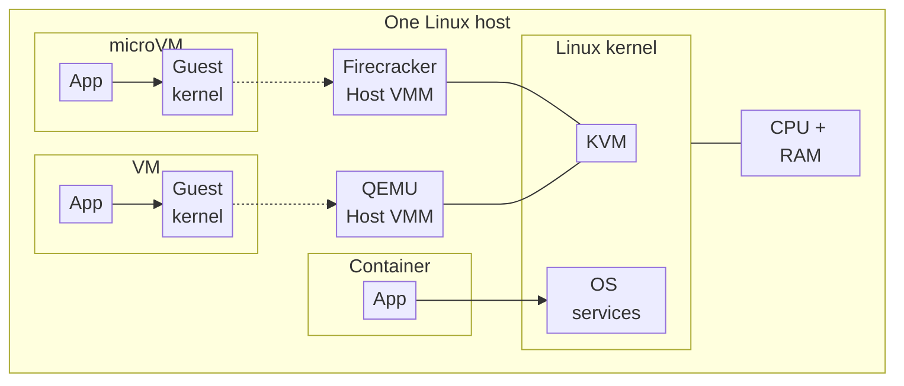

# Sandbox isolation boundaries

A [sandbox](glossary/sandbox.md) lets a program run while limiting what it can reach. For example, a coding [agent](glossary/agent.md) may need to read and edit a project, but it does not need to read your SSH keys. The [isolation boundary](glossary/isolation-boundary.md) is the mechanism that puts those keys out of reach. The [policy](glossary/policy.md) is the set of rules about which files, network destinations, and [tools](glossary/tool.md) the program may use. A rule only works if a component enforces it.

The project is exposed to the sandbox; the SSH keys are not. The crossed arrow marks access the program does not have.

## Follow a request to open a file

Suppose an agent starts a test runner for [Lamp](practice/design/from-issue-to-patch.md), a fictional project. The test runner is a [process](glossary/process.md): a running instance of a program. A [kernel](glossary/kernel.md) is the part of an operating system that manages resources such as memory, files, and devices. A [system call](glossary/system-call.md) is a request to the kernel to do something a process cannot do on its own, such as opening a file.

1. The test runner asks to open the source file `total.c`. A library can make the system call on its behalf.
2. The component that implements the operating-system interface looks for the path in the files visible to the process and checks whether it can open the file.
3. The project file is available, so the open can succeed. A request for the [host](glossary/host.md)'s SSH keys fails if the keys are outside the visible files. The policy says to expose the project but not the keys; the configured boundary enforces that rule. Telling the agent to avoid the keys would not enforce it.

## Sandboxes for operating-system workloads

An agent that builds a project and runs tests often needs to run [native binaries](glossary/native-binary.md): programs built for a particular CPU and operating-system interface. These approaches differ in who handles the file-open request and what the workload still shares.

The figure shows which component implements the program's request, not every operation that follows. A user-space kernel can still make its own requests to the host kernel.

### 1. Hardware-backed virtual machines

A [virtual machine (VM)](glossary/virtual-machine.md) provides a separate computer environment with its own operating-system kernel, the [guest kernel](glossary/guest.md). It handles the test runner's file request. Programs in one VM share that kernel. A [microVM](glossary/microvm.md) aims to reduce overhead, typically by exposing fewer devices, but it still has a guest kernel. Neither type makes an exposed host directory private from the guest.

**Use it when:** The agent needs a full Linux [workspace](glossary/workspace.md) with a separate kernel. Check the [isolation unit](glossary/isolation-unit.md): the workloads that share one instance of the boundary. [Read about hardware-backed virtual machines](isolation/native-programs/hardware-backed-virtual-machines.md).

### 2. User-space kernels

A [user-space kernel](glossary/user-space-kernel.md), such as the one in [gVisor](https://gvisor.dev/docs/architecture_guide/intro/), handles the test runner's request through its own implementation of the Linux interface. It can make its own requests to the host kernel, which still supplies underlying resources. This does not prevent access to project data the host has chosen to expose.

**Use it when:** You want to run Linux [containers](glossary/container.md) while limiting their direct exposure to the host kernel. Test with your [workload](glossary/workload.md), the code you need to run, because compatibility and performance can differ from Linux. [Read about user-space kernels](isolation/native-programs/user-space-kernels.md).

### 3. Operating-system process sandboxes

In an [operating-system process sandbox](glossary/operating-system-process-sandbox.md), the test runner and other programs on the machine still share the host kernel. The kernel can give the process a restricted view of files or filter selected system calls. Hiding a file does not remove a copy of its contents that the program has already received.

**Use it when:** A local agent needs the developer's usual commands, but should not inherit unrestricted access to the host. Check that the restrictions also apply to processes started by those commands. [Read about operating-system process sandboxes](isolation/native-programs/operating-system-process-sandboxes.md).

### Compare a VM, a container, and a microVM

A **microVM is a kind of VM**. It typically presents fewer virtual devices but uses the same hardware isolation as a general-purpose VM on the same backend. A native Linux container, by contrast, runs its processes directly on the host kernel.

The example puts a native container, a [QEMU v9.2.0](https://github.com/qemu/qemu/blob/v9.2.0/docs/system/introduction.rst#L6-L50) VM, and a [Firecracker v1.11.0](https://github.com/firecracker-microvm/firecracker/blob/v1.11.0/docs/design.md#internal-architecture) microVM on one Linux host. QEMU and Firecracker run in host [user space](glossary/user-space.md) as [virtual machine monitors (VMMs)](glossary/virtual-machine-monitor.md). Both use [KVM](glossary/kernel-based-virtual-machine.md) in the host kernel to run their guests on an [Intel x86-64 CPU with VT-x](https://www.intel.com/content/www/us/en/developer/articles/technical/intel-sdm.html).

Solid arrows show system calls. Dotted arrows show device requests that the guest's VMM handles; they do not show every I/O path. Lines without arrows show which lower layer a component uses, not a request path. QEMU and Firecracker both open `/dev/kvm` to use the [KVM API](https://docs.kernel.org/virt/kvm/api.html#general-description), but Firecracker presents a smaller set of virtual devices.

**Figure sources:** Redrawn and extended from [Agache et al., *Firecracker: Lightweight Virtualization for Serverless Applications*, Figure 1 (NSDI 2020)](https://files.usenix.org/s3fs-public/cdn/nsdi20-paper-agache.pdf#page=4), using [Firecracker v1.11.0 Host Integration](https://github.com/firecracker-microvm/firecracker/blob/v1.11.0/docs/design.md#host-integration) and the [QEMU v9.2.0 system emulation overview](https://github.com/qemu/qemu/blob/v9.2.0/docs/system/introduction.rst#L6-L50).

#### CPU execution, memory, and device I/O

1. **CPU execution.** Take the test runner's file-open call. On x86-64, `SYSCALL` switches the CPU's [privilege level](glossary/cpu-privilege-level.md) from ring 3 (app) to ring 0 (kernel). In the container, the host kernel looks up the path in the process's mount [namespace](glossary/namespace.md); [seccomp](glossary/seccomp.md) can block the call before lookup. In either VM, the app enters its own guest kernel. Both run in **VMX non-root operation**, Intel's term for guest mode. Entering guest ring 0 does not by itself cause a [VM exit](glossary/vm-exit.md), which is a separate CPU transition that returns control to KVM. See [Intel's VMX manual, Figure 26-1](https://cdrdv2.intel.com/v1/dl/getContent/671506#page=4).
2. **Memory translation.** A page table maps memory addresses and records permissions. In the container, the CPU uses the host process's page tables to translate virtual addresses to host physical addresses. In either VM, there are two mappings: the guest's page tables map guest virtual addresses to guest physical addresses, and [Extended Page Tables (EPT)](glossary/extended-page-tables.md) map guest physical addresses to host physical addresses. The guest kernel controls the first mapping; KVM controls the second. The CPU applies EPT even when it reads the guest page tables. See the [Linux KVM memory documentation](https://docs.kernel.org/virt/kvm/x86/mmu.html#translation).
3. **Device I/O.** If the guest needs disk data that is not in memory, its driver sends a request to a virtual disk. If a device access causes a VM exit, KVM can handle it in the host kernel or return from [`KVM_RUN`](https://docs.kernel.org/virt/kvm/api.html#kvm-run) to the host-side VMM. For example, a device register access can return as [`KVM_EXIT_MMIO`](https://docs.kernel.org/virt/kvm/api.html#the-kvm-run-structure), which asks the VMM to handle a read or write to a memory address assigned to a device. Not every virtual disk request takes that route. A virtual disk can be backed by a file on the host; the guest does not get to open arbitrary host files.

| What to compare | General-purpose VM | Native Linux container | microVM |
| --- | --- | --- | --- |
| Isolation and sharing | Hardware-backed isolation; processes in the same VM share its guest kernel. | [Namespaces](glossary/namespace.md) separate views of resources. [Control groups](glossary/control-group.md) can account for or limit resource use. Apps make requests directly to the same kernel as other containers and host processes. | The same kind of hardware-backed isolation as a general-purpose VM; processes in the same microVM share its guest kernel. |
| OS and device support | Can run a supported guest OS, which can differ from the host OS. A VMM such as [QEMU v9.2.0](https://github.com/qemu/qemu/blob/v9.2.0/docs/system/introduction.rst#L39-L50) provides a wide choice of virtual devices. | Can have different Linux tools and libraries, but must work with the host's Linux kernel and the interfaces the runtime exposes. | Check the supported guest OS and the smaller device set. For example, [Firecracker v1.11.0](https://github.com/firecracker-microvm/firecracker/blob/v1.11.0/docs/design.md#machine-model) offers virtual storage and networking but no graphical display device. |
| Fresh startup | Boots a guest OS before starting the app. | Starts processes without a guest boot. Fetching and unpacking the image can still delay startup. | Also boots a guest OS. A smaller device model and a minimal guest can reduce startup work. |
| Memory overhead | Needs memory for the guest OS and its apps, plus memory for the VMM on the host. | No separate guest or VMM per container. Each app still needs memory. | Also needs guest and VMM memory. A smaller device model and a minimal guest can lower overhead. |
| When it fits | The job needs a separate kernel plus a guest OS or device that a candidate microVM does not support. | The job needs a packaged Linux toolchain, and sharing the host kernel is acceptable. | Short-lived jobs need separate kernels, and the supported guest OS and devices meet their needs. |

Choose the boundary before comparing speed. A smaller device set can reduce the code a guest can reach through virtual devices, but it does not guarantee stronger isolation or a fixed startup time. VMs can share physical hardware even when they have separate guest kernels. For either VM design, check whether each job gets its own guest; for all three, check which files and network services are exposed. Then [measure the same workload](practice/verification/measuring-a-sandbox.md), separating fresh starts from [snapshot](glossary/snapshot.md) restores and [warm pool](glossary/warm-pool.md) assignments.

## Sandboxes for generated scripts

An agent that looks up issue titles and sorts the results may only need to run a short script with one tool. A [runtime](glossary/runtime.md) runs code or sets up the environment for it. Here a language or module runtime can run the script without giving it a full Linux environment.

1. The script asks an exposed tool for the title of `LAMP-17`. The runtime limits which operations the script can call; the script does not need to open any issue files or make its own network request.
2. The host tool handles the lookup. It checks [authorization](glossary/authorization.md): whether this caller may read the requested issue. A tool can be available to call without all of its data being available to read.
3. The tool returns the title if allowed. The script can sort returned titles inside the runtime. If the tool does not check authorization, the runtime's restrictions on direct resource access do not protect the issue data from reads through that tool.

### 4. WebAssembly

[WebAssembly (Wasm)](glossary/webassembly.md) is a portable format for executable modules. The Wasm runtime checks memory access and limits calls outside the module to operations that the host supplies, such as a [host function](glossary/host-function.md) for issue lookup. Modules can share a host process, but do not share each other's memory by default. The generated code can be a Wasm module itself, or it can run in a language engine compiled to Wasm.

**Use it when:** Your workload or its language engine can run in Wasm and does not need ordinary Linux binaries. Memory checks do not restrict what the issue lookup tool itself can read. [Read about WebAssembly](isolation/generated-scripts/webassembly.md).

### 5. Engine isolates

An [engine isolate](glossary/engine-isolate.md) is a separate execution environment within a language engine. Each isolate has its own objects and managed state, but isolates can share a host process. The platform can expose an issue service without giving the script general operating-system access.

**Use it when:** The script needs the engine's language features and selected platform operations, but not a shell or a native package manager. A service connection can still grant broad access if the service does not check each request. [Read about engine isolates](isolation/generated-scripts/engine-isolates.md).

### 6. Restricted interpreters

A [restricted interpreter](glossary/restricted-interpreter.md) runs only the language features it implements and exposes only the built-ins and tools it provides. It runs sorting inside the interpreter and delegates issue lookup to a host tool. It can run in the host application's process; a restricted language does not by itself provide a separate operating system or limit the host tool's effects.

**Use it when:** A language subset is enough to combine tool calls and process their results. Check which features and libraries the interpreter supports. [Read about restricted interpreters](isolation/generated-scripts/restricted-interpreters.md).

## Keep packaging, management, and isolation separate

When you read about a product, ask which layer it changes:

| Layer | What it does |
| --- | --- |
| Packaging | A [container image](glossary/container-image.md) supplies the test runner, its dependencies, and starting configuration. It does not decide what the test runner can reach. |
| Execution | The [container runtime](glossary/container-runtime.md) sets up the environment that runs the test runner. [Apple `container`](https://github.com/apple/container/blob/main/docs/technical-overview.md) runs a container inside a VM, while gVisor can run a compatible image with a user-space kernel handling the system calls. |
| Management | A [control plane](glossary/control-plane.md) starts, assigns, and cleans up environments. [Kubernetes Agent Sandbox](https://agent-sandbox.sigs.k8s.io/docs/) provides that management layer; the runtime sets up the boundary. The control plane can select the workspace, but does not handle each file-open request. |

One agent can use more than one boundary. It can read issue titles through a restricted script and send a test job to a Linux VM. In that design, the script sandbox limits which tools the script can invoke, the lookup tool checks what data it can return, and the VM limits what the test job can reach.

## Check your understanding

1. Which component handles the request to open `total.c` in a process sandbox, a user-space kernel sandbox, and a VM? Check [Sandboxes for operating-system workloads](#sandboxes-for-operating-system-workloads).
2. If a script is allowed to call the issue lookup tool, who decides whether the script gets the title of `LAMP-17`? Check [Sandboxes for generated scripts](#sandboxes-for-generated-scripts).
3. Why should you check which host directories are exposed even if the test runner has its own kernel? Check [Hardware-backed virtual machines](#1-hardware-backed-virtual-machines).

See [From issue to patch](practice/design/from-issue-to-patch.md) for a worked example that combines script and VM boundaries, or [Agent sandbox architectures](agent-sandbox-architectures.md) for a survey of real implementations.
