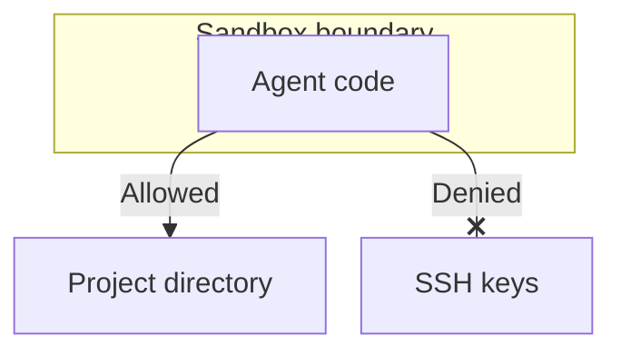
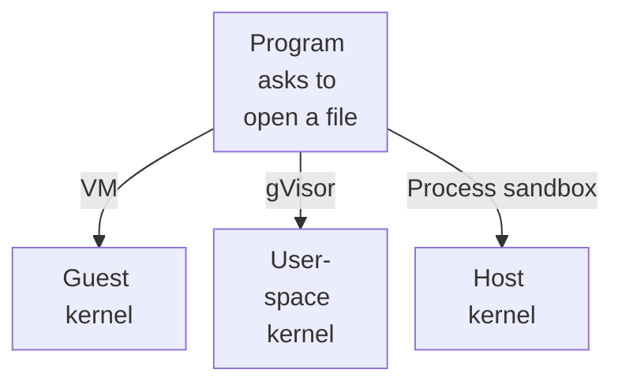

# Sandbox isolation boundaries

A [sandbox](glossary/sandbox.md) changes what a program can reach. For example, a coding agent may need to read and edit a project, but it does not need to read your SSH keys. The **isolation boundary** is the mechanism that puts those keys out of reach. The **policy** specifies which files, network destinations, and tools the program is allowed to use.

The project is exposed to the sandbox; the SSH keys are not. The crossed arrow marks access the program does not have.

Start with two tasks. An agent that builds a project and runs its tests needs a place to execute native programs. An agent that sorts search results and looks up issue titles may only need a place to run a short script with two tools. The two tasks do not need the same execution environment.

## Sandboxes for operating-system workloads

These approaches can run native programs. They differ in which kernel handles a program's requests. A **kernel** is the part of the operating system that manages resources such as memory, files, and devices.

The figure shows which component implements the program's request, not every operation that follows. A user-space kernel can still make its own requests to the host kernel.

### 1. Hardware-backed virtual machines

A **virtual machine (VM)** provides a separate computer environment with its own operating-system kernel, called the **guest kernel**. Hardware virtualization separates the guest from the host. A **microVM** is a VM designed to run with a smaller device set and less overhead. The guest can run native Linux commands, but it sees only the disks, devices, and network connections that the host exposes.

**Use it when:** The agent needs a full Linux workspace or each workload needs a separate kernel. Check whether the runtime creates a VM per session, pod, or container. Docker Sandboxes, Apple `container`, and Kata Containers use VMs at different levels. [Read about hardware-backed virtual machines](isolation/native-programs/hardware-backed-virtual-machines.md).

### 2. User-space kernels

A program normally asks Linux to open a file or create a process through a **system call**. A user-space kernel, such as the one in gVisor, handles those requests instead of passing them directly to the host kernel. It implements the Linux interface that the container expects and makes its own, more limited requests to the host kernel.

**Use it when:** You want to run Linux containers while limiting their exposure to the host kernel. Test with your workload because the implementation can differ from Linux in compatibility and performance. [Read about user-space kernels](isolation/native-programs/user-space-kernels.md).

### 3. Operating-system process sandboxes

The native program still uses the host kernel. The operating system limits what the program can see or do, for example by giving it a restricted view of the filesystem or filtering some system calls. Anthropic Sandbox Runtime uses this approach to restrict local processes.

**Use it when:** A local agent needs the developer's usual commands and workspace, but should not inherit unrestricted access to the host. Check that the restrictions also apply to child processes. [Read about operating-system process sandboxes](isolation/native-programs/operating-system-process-sandboxes.md).

## Sandboxes for generated scripts

These approaches run code in a language or module runtime rather than giving it a full Linux environment. The host application decides which tools and data to expose to that code.

### 4. WebAssembly

**WebAssembly (Wasm)** is a portable format for executable modules. A Wasm runtime keeps module memory separate and controls which host functions a module can call. The generated code can be a Wasm module itself, or it can run inside an interpreter compiled to Wasm. Pi's QuickJS-WASI Code Mode is an example of the second approach.

**Use it when:** Your workload or its interpreter can run in Wasm and does not need ordinary Linux binaries. [Read about WebAssembly](isolation/generated-scripts/webassembly.md).

### 5. Engine isolates

An **isolate** is a separate execution environment within a language engine such as V8. Each isolate has its own objects and memory managed by the engine. The application can give each isolate specific APIs instead of access to a general operating system. Cloudflare Dynamic Workers is one example.

**Use it when:** The script needs the engine's language features and selected platform APIs, but not a shell or a native package manager. [Read about engine isolates](isolation/generated-scripts/engine-isolates.md).

### 6. Restricted interpreters

A custom interpreter runs only the language features it implements and exposes only the built-ins and tools it provides. OpenCode Code Mode, for example, uses Psychoscript to run a JavaScript-like language. This approach does not require WebAssembly.

**Use it when:** A language subset is enough to combine tool calls and process their results. Check which features and libraries the interpreter actually supports. [Read about restricted interpreters](isolation/generated-scripts/restricted-interpreters.md).

## Keep packaging, management, and isolation separate

A **container image** packages a program and its dependencies. Identical images can run behind different boundaries. For example, Apple `container` runs an image inside a VM, while gVisor serves the container's Linux system calls in user space. A **control plane**, such as Kubernetes Agent Sandbox, creates and stops execution environments; the selected runtime determines the isolation boundary.

One agent can use more than one boundary. It can read issue titles through a restricted script and send a test job to a Linux VM. In that design, the script sandbox limits which tools the script can invoke, and the VM limits what the test job can reach. Each tool still needs its own authorization: a sandbox does not make a tool with broad host access safe to expose.

See [From issue to patch](practice/design/from-issue-to-patch.md) for a worked example that combines both boundaries, or [Agent sandbox architectures](agent-sandbox-architectures.md) for a survey of real implementations.
