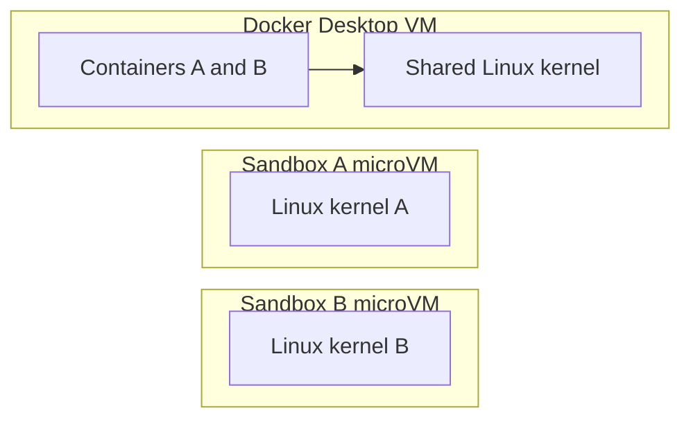
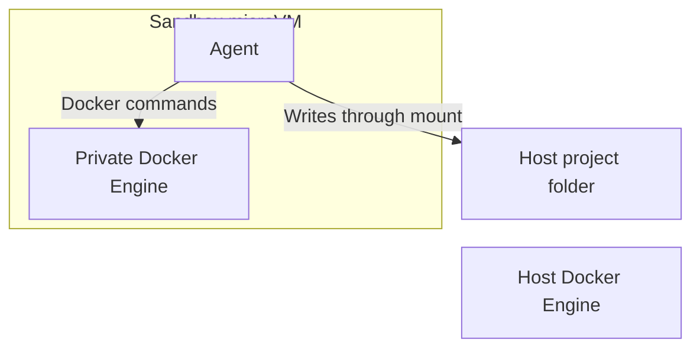
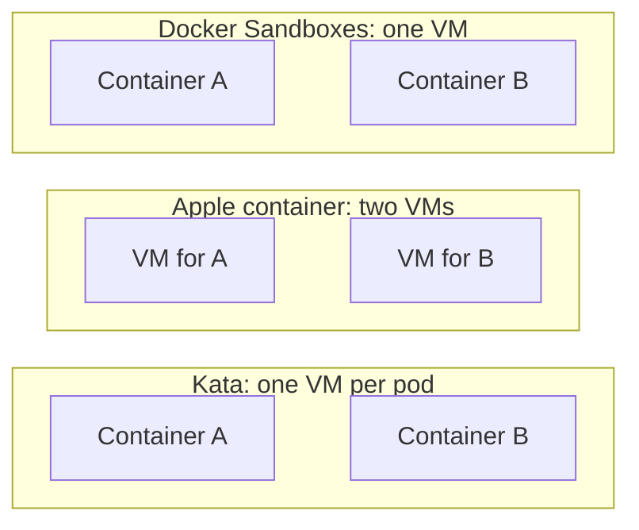
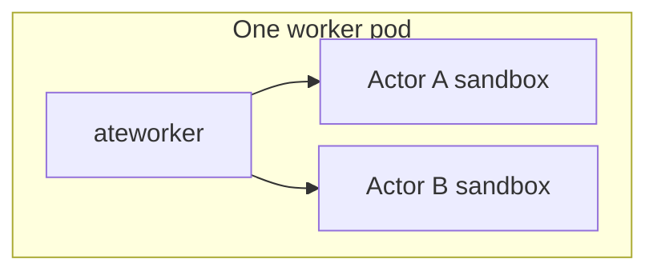
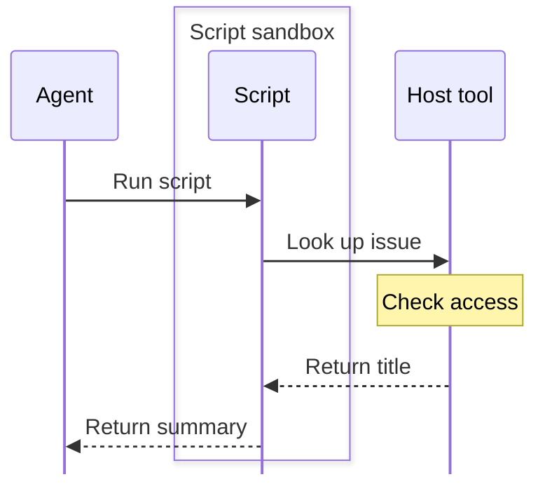

# Agent 的 sandbox 架構 {#agent-sandbox-architectures}

*本調查更新於 2026 年 11 月 22 日。本章比較的是文件所描述的架構，不是實測效能，也不是安全保證。*

本調查比較不同專案如何隔離協助開發的 [agents](glossary/agent.md) 和它們產生的程式碼。

## 執行邊界 {#execution-boundaries}

[Isolation boundary](glossary/isolation-boundary.md) 限制程式可以觸及的範圍。[Policy](glossary/policy.md) 規定哪些項目應可跨越這個邊界。若要瞭解六種隔離方式，請先閱讀 [Sandbox 的隔離邊界](sandbox-isolation-boundaries.md)。

[Virtual machine monitor (VMM)](glossary/virtual-machine-monitor.md) 管理 [virtual machine (VM)](glossary/virtual-machine.md) 和 VM 可見的裝置。VMM 並不是完整的 [sandbox](glossary/sandbox.md) 產品：可由獨立的 [control plane](glossary/control-plane.md) 決定何時啟動 VM，以及要提供哪些資源給它。

## 使用硬體輔助的 Linux 環境 {#hardware-backed-linux-environments}

| 專案 | 提供的功能 | 邊界與範圍 |
| --- | --- | --- |
| [Docker Sandboxes (`sbx`)](https://docs.docker.com/ai/sandboxes/architecture/) | 可直接使用的開發 agent 環境 | 每個本機 sandbox 都在一台 [microVM](glossary/microvm.md) 裡執行，並有自己的 [Docker Engine](https://docs.docker.com/engine/)。哪些資源會被隔離，哪些不會，請參閱 [Docker Sandboxes 案例](#docker-sandboxes)。[本機安裝](https://docs.docker.com/ai/sandboxes/install/)說明 macOS、Windows 和 Linux 的需求。 |
| [libkrun](https://github.com/containers/libkrun) | 可嵌入的 VMM 函式庫，提供 Rust 和 C API | 在 Linux 上使用 [KVM](glossary/kernel-based-virtual-machine.md)，在 Apple silicon 上使用 [Hypervisor Framework](https://developer.apple.com/documentation/hypervisor)。呼叫端決定開放哪些 host 檔案和裝置。[Gondolin](https://github.com/earendil-works/gondolin/blob/main/docs/backends.md) 是一層 sandbox，可用 libkrun 或 QEMU 作為 VMM。 |
| [Cloud Hypervisor](https://github.com/cloud-hypervisor/cloud-hypervisor) | 通用的雲端 VMM | 在 KVM 或 [MSHV](glossary/microsoft-hypervisor.md) 上執行，支援 Linux 和 Windows [guests](glossary/guest.md)。它是後端，不是具有 workspace 和 [credential](glossary/credential.md) policy 的完整 agent sandbox。 |
| [Firecracker](https://github.com/firecracker-microvm/firecracker) | 供 microVM 使用的精簡 VMM | 一般部署是在 Linux 上使用 KVM。上游專案也記載了 [AWS Nitro Sandboxes 後端](https://github.com/firecracker-microvm/firecracker/tree/main/docs/nitro-sandboxes)，這個後端使用 AWS Nitro，而不是 host KVM。 |
| [Kata Containers](https://github.com/kata-containers/kata-containers/blob/main/docs/design/architecture/README.md) | 以 VM 為基礎的 [container runtime](glossary/container-runtime.md) | 在 [Kubernetes](https://kubernetes.io/docs/concepts/overview/) 中，[pod](glossary/pod.md) 在 guest VM 裡執行；同一個 pod 裡的 container 可以共用 guest [kernel](glossary/kernel.md)。Kata [支援多種 VMM](https://github.com/kata-containers/kata-containers/blob/main/docs/hypervisors.md)，包括 QEMU、Cloud Hypervisor 和 Firecracker。Kata 和 Firecracker 屬於不同層，不能直接互相替代。 |
| [Microsoft NVX](https://github.com/microsoft/nvx/blob/42f413d226290e31ea288686d6f3dbfd20c45733/README.md) | 以 OpenVMM 為基礎的 microVM 技術堆疊和 guest runtime | 文件涵蓋使用 KVM 或 MSHV 的 Linux host，以及使用 [Windows Hypervisor Platform](glossary/windows-hypervisor-platform.md) 的 Windows host。Guest runtime 的設計目標是[每台 Linux microVM 執行一個 workload sandbox](https://github.com/microsoft/nvx/blob/42f413d226290e31ea288686d6f3dbfd20c45733/doc/design/4-guest-runtime-architecture.md)。 |
| [Apple `container`](https://github.com/apple/container/blob/main/docs/technical-overview.md) | Apple silicon 上的本機 [OCI](glossary/open-container-initiative.md) container 工具 | 透過 Apple 的 [Virtualization framework](https://developer.apple.com/documentation/virtualization)，**每個 container** 各執行一台輕量的 Linux VM。它以 [container images](glossary/container-image.md) 為輸入，但隔離邊界是 VM，而不是 user-space kernel。 |

### Docker Sandboxes：每個 sandbox 一台 VM {#docker-sandboxes}

每個本機 Docker Sandbox 都有自己的 Linux [guest kernel](glossary/guest.md)，但 agent 仍能修改你開放寫入的 [host](glossary/host.md) [workspace](glossary/workspace.md)。這是 Kaan Yagci 在 [〈Wait, Docker Sandboxes Aren’t Containers?〉](https://x.com/yagcidev/article/2120166357060768143) 指出的差別：sandbox 隔離了執行環境，但不會隔離 agent 能存取的所有資源。

Docker Sandboxes 不需要在 [host 安裝 Docker Desktop 或 Docker Engine](https://docs.docker.com/ai/sandboxes/install/)。在 macOS 和 Windows 上，[Docker Desktop 把 Linux containers 放在 Linux VM 裡執行](https://docs.docker.com/desktop/features/vmm/)。這些 [containers](glossary/container.md) 仍共用這台 VM 的 [kernel](glossary/kernel.md)。[Docker Sandboxes](https://docs.docker.com/ai/sandboxes/security/isolation/#hypervisor-isolation) 則是每個 sandbox 一台 VM，不是每個 container 一台。

Agent 的 Docker 指令會送到 [sandbox 內的 Docker Engine](https://docs.docker.com/ai/sandboxes/security/isolation/#docker-engine-isolation)。它不必存取 host 的 Docker socket，就能建置映像檔和執行 containers。寫入檔案則走另一條路：如果 [mount](glossary/mount.md) 可寫，變更就會直接寫入 host 的專案資料夾。

獨立的 Docker Engine 無法取代[網路 policy](practice/data-and-access/network-policy.md)。例如，如果 agent 的 [Docker context](https://docs.docker.com/engine/manage-resources/contexts/) 指向正式環境的 Docker Engine、網路允許連線，而且 agent 能通過身分驗證，它就仍然能連到正式環境。比對 sandbox 內外的 `docker context ls` 輸出只能檢查用戶端設定，不能證明正式環境的存取已被封鎖。

使用[本機 workspace](https://docs.docker.com/ai/sandboxes/security/isolation/#workspace-isolation) 時，如果沒有指定路徑，`sbx run` 會將目前目錄當成可寫的 workspace。移除 sandbox 不會復原對該目錄的變更。用 [`--clone`](https://docs.docker.com/ai/sandboxes/security/isolation/#clone-mode) 讓 agent 編輯獨立的副本，方便先審查再帶回變更。VM 仍能讀取原始 repository 中的檔案，包括 `.env` 等未被 Git 追蹤的檔案。如果 agent 不需要任何專案檔案，可建立不掛載 host workspace 的 sandbox。

#### 何時選用 Docker Sandboxes？ {#when-to-choose-docker-sandboxes}

當 agent 需要存取本機專案，又需要自己的 Docker Engine 時，適合選用本機 Docker Sandboxes。例如，讓 agent 修正後端 bug、建置 image、用 [Docker Compose](https://docs.docker.com/compose/) 啟動資料庫，再跑整合測試。這些 containers 在 sandbox VM 裡執行，不會使用你平常的 Docker 環境。

- **把 sandbox 嵌入自己的應用程式：** [Gondolin](https://github.com/earendil-works/gondolin#feature-highlights) 也提供 Linux microVM。若你想用 JavaScript 定義檔案存取和對外 HTTP 連線的 policy，而不是透過 `sbx` 啟動 coding agent，可考慮 Gondolin。
- **由服務按需啟動 sandboxes：** 比較 [E2B Runtime](https://github.com/e2b-dev/infra) 和 [Docker Sandboxes 雲端 API 與 SDK](https://docs.docker.com/ai/sandboxes-api/)。兩者都能由程式建立 sandbox。[Docker 雲端 sandboxes](https://docs.docker.com/ai/sandboxes/cloud/local-vs-cloud/) 不會掛載發出啟動指令的電腦上的資料夾。要讓工作在無人操作時執行，先確認逾時設定和到期後的處理方式。

### 哪些 workload 共用 guest kernel？ {#which-workloads-share-a-guest-kernel}

[Isolation unit](glossary/isolation-unit.md) 是共用同一個邊界實例的一組 workload。比較範例中的兩個 container（A 和 B）在各種實作中分別在哪裡執行。

在 Docker 和 Kata 的範例中，A 和 B 共用 guest kernel。在 Apple 的範例中，它們在不同的 VM 裡執行。如果兩個 workload 必須在 VM 邊界彼此隔離，就要確認 runtime 是否會把它們放在同一個 guest 裡。

## 不使用 guest Linux kernel 的 container 與 process {#containers-and-processes-without-a-guest-linux-kernel}

- [Google gVisor](https://gvisor.dev/docs/architecture_guide/intro/) 提供 OCI runtime `runsc`。其中的 **Sentry** 是 [user-space kernel](glossary/user-space-kernel.md)，負責處理 Linux [system calls](glossary/system-call.md)，這些呼叫來自 [workload](glossary/workload.md)。即使在 gVisor 的 KVM 平台上，Linux 系統介面仍由 Sentry 提供；Sentry 本身不是 Kata 那樣的獨立 Linux guest kernel。用實際的 workload 測試相容性與效能，不要假設每個 Linux 介面的行為都完全相同。
- [Anthropic Sandbox Runtime](https://github.com/anthropic-experimental/sandbox-runtime) 不需要 guest VM 就能限制原生 process。它在 Linux 上使用 [Bubblewrap](https://github.com/containers/bubblewrap)，在 macOS 上使用 Seatbelt，並透過 proxy 限制網路。這是 [operating-system process sandbox](glossary/operating-system-process-sandbox.md)：與 gVisor 不同，workload 仍直接使用 host 作業系統的 kernel，並受該作業系統的限制。

## Agent Substrate：在 Kubernetes 上為每個 Actor 建立獨立 sandbox {#agent-substrate}

[Agent Substrate](https://github.com/agent-substrate/substrate/blob/f5428049ac0b81458eb12e81fa5a6b65cd39a2ad/docs/concepts/architecture.md) 是一套**在 Kubernetes 上執行、能保留工作狀態的 sandbox 平台**。Kubernetes 預先準備 worker pods，Substrate 再把需要執行的 *Actor* 分配給 worker，並為每個 Actor 建立獨立的 sandbox：**gVisor** 或 **由 Cloud Hypervisor 提供虛擬機的 Kata Containers microVM**。標準的 counter demo 用 gVisor；實際部署時，由 pool 設定決定 sandbox class。Actor 是一個工作實例，不一定是 AI agent。即使沒有持續執行的 pod 或 sandbox，Actor 仍可以保留身分與已儲存的狀態。本文以 upstream revision `f5428049` 為準。

### Worker pod 提供容量，Actor 才是隔離單位 {#agent-substrate-isolation}

[Warm pool](glossary/warm-pool.md) 是一組事先啟動、等候分配工作的 worker pods。一個 worker 可**同時**承載多個 Actor，但每個 Actor 都有自己的 sandbox。一個 Actor 可以包含多個 container；不要把互不信任的 workload 放進同一個 Actor 的不同 container。[官方安全模型](https://github.com/agent-substrate/substrate/blob/f5428049ac0b81458eb12e81fa5a6b65cd39a2ad/docs/security/security.md#defensible-multi-tenancy) 以 Actor 為隔離邊界，不以其中的個別 container 為邊界。

每個 `WorkerPool` 採用一種 [sandbox class](https://github.com/agent-substrate/substrate/blob/f5428049ac0b81458eb12e81fa5a6b65cd39a2ad/docs/reference/sandbox-classes.md#summary-of-differences)。同一個 cluster 可以用不同的 pool 提供兩種 class。兩者都接受 OCI container image，但映像格式不決定執行時的隔離邊界。一般的 Linux container 不能單獨當作 Actor sandbox。

| Class | 如何隔離 Actor | 選擇前要確認什麼 |
| --- | --- | --- |
| `gvisor` | 每個 Actor 都有自己的 gVisor `runsc` sandbox。Sentry 在 user space 實作 Linux system calls，不會啟動 Linux guest kernel。 | 可在一般 Linux node 上執行。要測試 workload 需要的 Linux 介面；資源限制套用在 Actor 層級，runtime 不會執行個別 container 的資源限制。 |
| `microvm` | 每個 Actor 各有一個 Linux guest；Cloud Hypervisor 提供 VM，Kata Containers 的 guest 元件在其中執行 workload。 | Node 必須提供 `/dev/kvm`，也要為 guest RAM 和 VM 本身的開銷預留容量。可以在 guest 內限制個別 container 的資源，但不會給每個 container 一台 VM。 |

### 誰負責排程、還原與轉送請求？ {#agent-substrate-request-path}

Kubernetes 和 Substrate 的排程分工不同。`atecontroller` 把 Kubernetes 的 `WorkerPool` 資源轉成 Deployment，由 Kubernetes 把這些 pods 排到 nodes；Substrate 的 `ate-api-server` 則把 **Actor 排到已經存在的 worker**。它把 `ActorTemplate`、Actor 和 Worker 的記錄放在 PostgreSQL，而不是把它們建成 Kubernetes objects。`ActorTemplate` 定義映像、資源和 snapshot 設定，Kubernetes 的 `SandboxConfig` 則提供該 class 可用的 runtime 版本。見[官方資源模型](https://github.com/agent-substrate/substrate/blob/f5428049ac0b81458eb12e81fa5a6b65cd39a2ad/docs/concepts/architecture.md#api-resource-models)。

1. **建立 Actor。** Substrate 先登記 Actor，不會先替它保留一個運作中的 sandbox。若建立時已有範本的 *golden snapshot*，通常會用它當起始狀態；沒有起始 snapshot，就從 `ActorTemplate` 的映像啟動。見 [golden snapshot 流程](https://github.com/agent-substrate/substrate/blob/f5428049ac0b81458eb12e81fa5a6b65cd39a2ad/docs/reference/api-guide.md#the-golden-snapshot)。
2. **喚醒並轉送。** 收到 HTTP 請求時，`atenet-router` 請 control plane 依 atespace 和名稱找出 Actor。*Atespace* 是 Substrate 用來分組資源和管理存取的範圍，不是 Kubernetes namespace。若 Actor 已休眠，control plane 會分配相容的 worker 容量，讓 node 上的 `atelet` 指示 pod 內的 `ateworker` 還原或啟動 sandbox。就緒後，router 透過 worker 上經驗證的 `atunnel` 連線轉送原請求。見[請求路徑與生命週期](https://github.com/agent-substrate/substrate/blob/f5428049ac0b81458eb12e81fa5a6b65cd39a2ad/docs/concepts/architecture.md#actor-lifecycle)。
3. **休眠並讓出容量。** 應用程式或 agent harness 呼叫 `SuspendActor`，讓 runtime 擷取 snapshot 並釋放 Actor 原本佔用的容量。Router 轉送完請求，不代表 Actor 會自動休眠。下次收到請求時，同一個 Actor 可以在不同的相容 worker 上還原。如果流量突然塞滿 pool，router 可以[暫留請求並重試](https://github.com/agent-substrate/substrate/blob/f5428049ac0b81458eb12e81fa5a6b65cd39a2ad/docs/concepts/request-parking.md#behavior)；如果還是騰不出容量，仍可能回傳 HTTP `503`。

### 休眠後，哪些狀態會保留？ {#agent-substrate-snapshots}

[Snapshot 設定](https://github.com/agent-substrate/substrate/blob/f5428049ac0b81458eb12e81fa5a6b65cd39a2ad/docs/concepts/architecture.md#state-management--persistence) 決定可以保留哪些狀態。範本的 `preferredFidelity` 是保存層級的上限，不保證每次都能從記憶體狀態接續。

| Snapshot 層級 | 保存的狀態 | 喚醒時會怎麼做 |
| --- | --- | --- |
| `VOLUMES` | 支援 snapshot 的 `DurableDir` volumes 裡的資料。 | 保留 volume 資料，但啟動新的 processes。 |
| `ROOTFS` | Volume 資料，加上 containers 可寫入的根檔案系統變更。 | 保留檔案變更，但啟動新的 processes。 |
| `MEMORY`（預設偏好） | Volume 資料、根檔案系統變更，以及正在執行的 process 狀態和記憶體。 | 可在 runtime 相容的 worker 上接續執行原本的 processes。 |

[官方 counter demo](https://github.com/agent-substrate/substrate/blob/f5428049ac0b81458eb12e81fa5a6b65cd39a2ad/demos/counter/README.md#how-to-use) 展示了接續 process 和從映像重新啟動的差別：用 `MEMORY` snapshot 還原後，記憶體裡的計數和兩個寫入檔案的計數都從 1 接著加到 2。但 snapshot 不能任意遷移：還原時必須沿用原本的 sandbox class。若沒有相容且有空間的 worker 可還原記憶體，已上傳至 object storage 的 snapshot 可以[降級為 `ROOTFS` 還原，啟動新的 processes](https://github.com/agent-substrate/substrate/blob/f5428049ac0b81458eb12e81fa5a6b65cd39a2ad/docs/reference/sandbox-classes.md#snapshots-volumes-rootfs-and-memory)。

預設的休眠操作只等待 **node 本機**寫完 checkpoint，接著在背景上傳到 object storage（Google Cloud Storage 或 S3）。若 node 在上傳完成前故障，最新的 checkpoint 可能遺失。同步休眠會等上傳完成；如果應用程式必須先確認狀態保存到 node 之外，再進行下一步，就應選同步模式。[官方 eviction 說明](https://github.com/agent-substrate/substrate/blob/f5428049ac0b81458eb12e81fa5a6b65cd39a2ad/docs/reference/api-guide.md#eviction) 解釋了為什麼 harness 必須處理 pod 被移除的情況，不能依賴平台自動擷取 checkpoint。

### 運算隔離不等於網路授權 {#agent-substrate-access}

依照[官方安全模型](https://github.com/agent-substrate/substrate/blob/f5428049ac0b81458eb12e81fa5a6b65cd39a2ad/docs/security/security.md#security-boundaries)，每個 Actor 有自己的網路環境。傳入請求必須經過驗證呼叫端身分的 router，不能由另一個 Actor 直接送達。對外連線預設拒絕，由 DNS relay 和 `atenet-egress` 執行存取規則。外層應用程式仍要負責決定**哪個使用者可以呼叫哪個 Actor**。

使用 [credential injection](https://github.com/agent-substrate/substrate/blob/f5428049ac0b81458eb12e81fa5a6b65cd39a2ad/docs/guides/egress-credential-injection.md#how-it-works) 時，Actor 只在請求標頭放入佔位值。如果規則允許這個請求且指定了該標頭，gateway 才會取得憑證或可辨識 Actor 身分的簽署 token，替換標頭後送往目標服務。若要替換 HTTPS 標頭，gateway 必須終止 TLS 連線，Actor 也必須信任 gateway 的憑證授權單位。Actor 不必持有憑證就能發出請求，所以代填這一步不會把機密寫進 Actor 的記憶體或 snapshot。但這無法保護應用程式自行放進 sandbox 的機密，或目標服務在回應中傳回的機密。規則放得太寬，仍可能允許不當操作。

平台仍必須信任 sandbox 之外的基礎設施，包括 worker 管理元件、gateways 和 snapshot 儲存系統。[官方狀態表](https://github.com/agent-substrate/substrate/blob/f5428049ac0b81458eb12e81fa5a6b65cd39a2ad/docs/security/security.md#defensible-multi-tenancy) 把縮減 worker 權限和保證清除資料列為進行中的工作。Atespace 不能取代獨立的 sandbox 或網路政策。

### 什麼情況值得採用？ {#agent-substrate-when-to-choose}

如果你已經維運 Kubernetes，要保留大量長期存在的 agent 身分或 workspace，但同一時間只有一部分需要運算，這套架構值得考慮。例如，一個等待使用者數小時才收到下一次輸入的 agent，可以先讓出運算容量，再按需還原原本的 workspace。若 agents 幾乎一直在運作，休眠和喚醒帶來的好處就比較小。Substrate 是用來執行 agent 程式的基礎設施，不是負責選擇工具或管理對話的 framework。

省下閒置運算的代價是必須儲存、傳輸及還原 snapshot。評估時，應用實際 workload 測量從請求進入到收到第一個可用回應的時間，分別比較 Actor 已在執行、從 node 本機還原，以及從遠端還原。也要用突發流量塞滿 pool，觀察延遲和 `503` 比例。不要把 control plane 的測量數字當成端到端延遲：[官方 ResumePaused benchmark](https://github.com/agent-substrate/substrate/blob/f5428049ac0b81458eb12e81fa5a6b65cd39a2ad/docs/guides/benchmarking.md#resumepaused-benchmark) 刻意排除了 router 和真正的 sandbox 還原。

## Code Mode：隔離 tool script，而不是 shell {#code-mode-isolating-tool-scripts-instead-of-shells}

在 [Code Mode](glossary/code-mode.md) 中，模型會撰寫程式來呼叫 [tools](glossary/tool.md)，並整合它們的結果。外層應用程式決定哪些 tool 可用，以及各個 tool 可以做什麼。執行這個程式的 sandbox 不會自動限制 [host tool handlers](glossary/host-function.md) 或 agent 的其他部分。

比較各種實作之前，先看看一次 issue 查詢怎麼進行：

Host tool handler 會查驗呼叫者是否有權讀取 issue。Sandbox 限制 script 可以呼叫哪些 tool，但不會逐一對 tool 請求進行授權（[authorize](glossary/authorization.md)）。

| 實作 | 執行邊界 | 有什麼不同？ |
| --- | --- | --- |
| [Pi `codemode`](https://github.com/earendil-works/pi/blob/9c4652688590abb836b40ebd1e4725ecf9a7c7d1/packages/codemode/README.md) | 編譯成 [Wasm](glossary/webassembly.md) 的 QuickJS（`quickjs-wasi`） | 此處檢視的 Pi 修訂版本會執行 JavaScript，並注入 tool 供 script 使用。Script 無法直接存取 Node API、檔案系統或網路。使用 `quickjs-wasi` 不代表 sandbox 允許存取通用的 [WASI](glossary/webassembly-system-interface.md) 檔案系統。 |
| [Earendil `djs`](https://github.com/earendil-works/djs/blob/c34b2a5974db47d9caafe7083a67ce4408d7333d/README.md) | 以 Rust 撰寫、主要以 Wasm 為目標的 JavaScript/TypeScript 引擎 | 設計目標是在受控輸入下進行確定性執行，並能暫停及恢復 script。專案將它描述為 QuickJS 的替代品，並隨附 Pi 轉接器。上面提到的 Pi 修訂版本仍[依賴 `quickjs-wasi`](https://github.com/earendil-works/pi/blob/9c4652688590abb836b40ebd1e4725ecf9a7c7d1/packages/codemode/package.json)；先確認已安裝的版本，不要直接假設它已完成遷移。 |
| [OpenCode Code Mode](https://github.com/anomalyco/opencode/blob/5310e42203af41c3452ee44b24fc7d0c52aaa3cc/packages/codemode/README.md) | 用於類 JavaScript script 的 [Restricted interpreter](glossary/restricted-interpreter.md)，不是 Wasm sandbox | 使用 [Psychoscript](https://github.com/anomalyco/psychoscript) 直譯受支援的 JavaScript 子集。host 可透過 tool 或 `fetch` 等 extension function 開放對外存取。 |
| [Cloudflare Dynamic Workers](https://blog.cloudflare.com/dynamic-workers/) | V8 [engine isolate](glossary/engine-isolate.md) | 在 Workers runtime 裡執行動態載入的程式碼。呼叫端可以封鎖對外請求，並傳入特定的繫結。[Cloudflare 的 Linux container sandbox](https://developers.cloudflare.com/sandbox/) 則是另一個選項：每個實例都是一台 microVM。 |
| [Wasmtime](https://docs.wasmtime.dev/security.html) | 通用 Wasm runtime | 適用於以 Wasm 模組而非任意 Linux 二進位檔散布的 workload。嵌入 Wasmtime 的應用程式控制可用的匯入項目和 host 能力。 |

如果 script 可使用不受限制的 `bash` tool 或寫入範圍很廣的 API，即使直譯器沒有直接的 I/O，它也不是低權限的。每次呼叫 tool 都要在 host 邊界進行授權。如果某個 tool 需要執行原生程式碼，可以把程式碼交給另一個 Linux sandbox 執行。

## 2026 年有哪些變化 {#what-is-changing-in-2026}

1. **環境佈建正從開機轉向還原。** [E2B Runtime](https://github.com/e2b-dev/infra) 從已開機的 Firecracker 範本還原，並支援暫停與恢復 sandbox。[Vercel Sandbox](https://vercel.com/docs/sandbox) 也使用 Firecracker，並提供 [snapshots](glossary/snapshot.md)。[Amazon Bedrock AgentCore Runtime V2](https://aws.amazon.com/about-aws/whats-new/2026/11/new-agentcore-runtime-default/) 於 2026 年 11 月 12 日成為新 runtime 的預設版本，並從預先準備的 snapshot 還原 microVM session。區分 [cold boot](glossary/cold-boot.md) 和從 snapshot 還原。分別量測各種啟動方式要等多久才能執行第一個可用的命令。確認 snapshot 包含磁碟狀態、記憶體，還是兩者都有，以及其中是否可能含有憑證。
2. **Control plane 正逐漸與執行後端分開。** [Kubernetes Agent Sandbox](https://agent-sandbox.sigs.k8s.io/docs/) 增加了宣告式生命週期 API、範本、sandbox 領用申請和 [warm pools](glossary/warm-pool.md)。它可以使用 gVisor 或 Kata，但邊界由所選的 runtime 決定。[NVIDIA OpenShell](https://github.com/NVIDIA/OpenShell) 則示範了 policy 層：由 gateway 管理 sandbox 存取權，且只能向核准的對外目的地提供憑證。比較這些功能時，要與執行邊界分開評估。
3. **硬體輔助隔離不限於 host KVM。** 2026 年 11 月 9 日，[AWS 宣布推出適用於 EKS、ECS 和 EC2 的 Nitro Sandboxes](https://aws.amazon.com/about-aws/whats-new/2026/11/nitro-sandboxes-eks-ecs-ec2/)。設定為使用 Nitro Sandboxes 的 EKS pod 或 ECS task 各自取得一台由 Nitro 管理的 VM。在 EC2 上，Firecracker 無須使用上層執行個體中的 KVM 就能管理 guest。
4. **同一個 agent 可以使用不只一個邊界。** Cloudflare 的文件介紹了兩種做法：只需呼叫幾個方法的程式碼可在 isolate 中執行，需要完整環境的程式碼則在 Linux microVM 中執行。本機或自行架設的技術堆疊也可採用相同的分工：在 Wasm 或 restricted interpreter 中執行 tool script，只有需要時才將建置或測試交給 Linux sandbox。

## 如何評估候選方案 {#how-to-evaluate-a-candidate}

1. **選擇隔離單位。** 決定需要分開隔離的是 [sessions](glossary/sandbox-session.md)、[tenants](glossary/tenant.md)、pod，還是個別的 tool 呼叫。檢查清理是否確實執行，以及在重新啟動、從 snapshot 還原和建立分支副本時，哪些狀態會保留。
2. **列出會跨越邊界的項目。** 記錄每個 host mount、socket、網路路由、憑證，以及 tool API。不需要直接編輯時，優先選用唯讀 workspace 或 workspace 副本。限制對外流量；如果能由 policy 中介元件按請求提供憑證，就將可重複使用的憑證留在 sandbox 之外。
3. **檢查每一條必要的存取規則。** 使用無害的測試資料。證明允許的操作會成功，而禁止的操作會因規則而失敗，不是因為資源原本就不存在。本機範例請見[驗證存取規則](practice/verification/verifying-access-rules.md)。
4. **對每個符合要求的候選方案量測同一項工作。** 分別記錄到首次輸出及到完成所需的時間。如果排隊和結果傳輸會影響結果，就一併計入。報告資源使用量、相容性和快取狀態，不要假設兩種啟動方式所做的事相同。本機計時範例請見[量測 sandbox](practice/verification/measuring-a-sandbox.md)。

參考[選擇 sandbox](practice/design/choosing-a-sandbox.md)，將這份檢查清單用於設計決策。這兩項實作練習只檢查一種 Bubblewrap 設定，不能作為任何受調查產品或實際部署設定的驗證依據。
