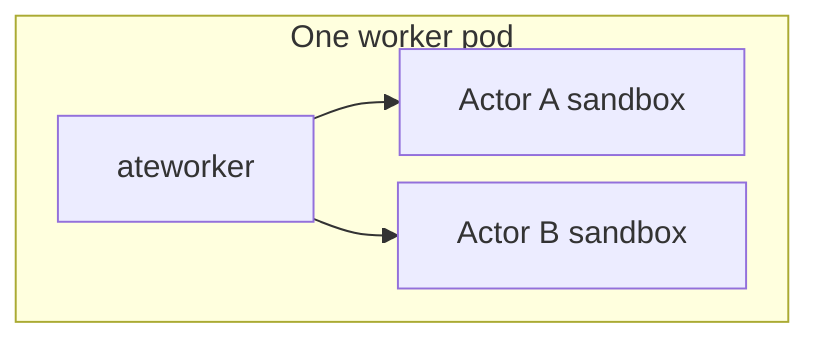

# Agent Substrate

**Agent Substrate 讓多個需要長期保留狀態的 workload，共用較少的 Kubernetes worker pods。** 它最適合工作一陣一陣到來的情況：閒置時可以讓出運算容量，下次收到請求再從已保存的狀態接續。

## Agent Substrate 是什麼？ {#what-is-agent-substrate}

[Agent Substrate](https://github.com/agent-substrate/substrate/blob/f5428049ac0b81458eb12e81fa5a6b65cd39a2ad/docs/concepts/architecture.md) 是 [Kubernetes](https://kubernetes.io/docs/concepts/overview/) 上的 [sandbox](glossary/sandbox.md) 平台；它不是 agent framework，也不是單一 sandbox runtime。*Actor* 是一個有名稱的 [workload](glossary/workload.md) 實例，例如 coding [agent](glossary/agent.md) 或 HTTP 服務。Kubernetes 預先準備 worker [pods](glossary/pod.md)，Substrate 則為每個要執行的 Actor 分配 worker 容量及獨立的 sandbox。同一個 worker 可以同時執行多個 Actor，但它們不共用 sandbox。

Worker pool 決定隔離方式：**[gVisor](https://gvisor.dev/docs/architecture_guide/intro/)**，或由 [Cloud Hypervisor](https://github.com/cloud-hypervisor/cloud-hypervisor) 提供虛擬機的 **[Kata Containers](https://github.com/kata-containers/kata-containers/blob/main/docs/design/architecture/README.md) [microVM](glossary/microvm.md)**。應用程式讓 Actor 休眠時，Substrate 會擷取 [snapshot](glossary/snapshot.md) 並釋放 Actor 占用的容量。下次收到請求時，Substrate 可以讓同一個 Actor 在相容的 worker 上恢復，不必回到原本的 worker。能接續多少狀態，取決於 snapshot 保存了什麼。本文以版本 `f5428049` 為準。

## 和其他專案的架構有什麼關鍵差異？ {#agent-substrate-comparison}

關鍵是**平台持續保留的是什麼**。Substrate 把 Actor 的身分與已保存的狀態，從 worker pod 的生命週期拆開。有 warm pool 不代表能還原原本的工作；能從 snapshot 還原 microVM，也不是 Substrate 獨有的功能。

| 問題 | Agent Substrate | [Kubernetes Agent Sandbox：Warm Pool（v1.0.12）](https://github.com/kubernetes-sigs/agent-sandbox/blob/v1.0.12/examples/warmpool-quickstart/README.md) | [E2B Runtime（47c9255）](https://github.com/e2b-dev/runtime/blob/47c92550945704a8b2ac4ab5f20f1c3096141d08/README.md) | [本機 Docker Sandboxes](https://docs.docker.com/ai/sandboxes/architecture/) |
| --- | --- | --- | --- | --- |
| 呼叫端操作什麼？ | 把有名稱的 Actor 排到現有的 Kubernetes worker。 | 透過 `SandboxClaim` 領用已備妥的 Sandbox。 | 每個 sandbox 是一台 Firecracker microVM。 | 每個本機 sandbox 有自己的 VM 和 Docker daemon。 |
| 預先準備或還原什麼？ | 預備 worker 容量，將 Actor 狀態還原到獨立的 gVisor 或 microVM sandbox。 | Pool 依範本預先建立 Sandbox 實例。 | 建立 sandbox 時從已啟動的 VM 範本還原；暫停的 sandbox 可從自己的 snapshot 接續。 | 每個 sandbox 有自己的本機 VM、Docker daemon 狀態和映像快取。 |

如果你在比較 warm pool，最接近的是 Kubernetes Agent Sandbox；如果你在比較暫停和還原，最接近的是 E2B，它也可在收到流量時喚醒 sandbox。Substrate 把兩個做法結合：將長期存在的 Actor 排到可重用的 Kubernetes worker，並提供兩種 runtime class。

## 什麼情況最適合用 Agent Substrate？ {#agent-substrate-when-to-choose}

**你已經在維運 Kubernetes，需要保留大量 agent session 或 [workspace](glossary/workspace.md)，但同一時間通常只有一部分在工作。** 例如，coding agent 做出修補檔後，可能要等幾個小時才有人審查。等待期間，harness 可以讓 Actor 休眠。等審查結果回來，新的請求可以還原檔案；如果有相容的記憶體 snapshot，還能接續原本的 processes。

如果你只需要一台開發機上的本機 sandbox、任務結束就能丟掉狀態，或 workloads 幾乎一直在忙，這套架構就沒有那麼合適。你得多維護一層排程和 snapshot，卻未必能省下多少運算容量。

省下閒置運算的代價是必須儲存、傳輸及還原 snapshot。評估時，應用實際 workload 測量從請求進入到收到第一個可用回應的時間，分別比較 Actor 已在執行、從 node 本機還原，以及從遠端還原。也要用突發流量塞滿 pool，觀察延遲和 `503` 比例。不要把 control plane 的測量數字當成端到端延遲：[官方 ResumePaused benchmark](https://github.com/agent-substrate/substrate/blob/f5428049ac0b81458eb12e81fa5a6b65cd39a2ad/docs/guides/benchmarking.md#resumepaused-benchmark) 刻意排除了 router 和真正的 sandbox 還原。

## 實作細節 {#agent-substrate-implementation}

### Worker pod 提供容量，Actor 才是隔離單位 {#agent-substrate-isolation}

[Warm pool](glossary/warm-pool.md) 是一組事先啟動、等候分配工作的 worker pods。一個 worker 可**同時**承載多個 Actor，但每個 Actor 都有自己的 sandbox。一個 Actor 可以包含多個 container；不要把互不信任的 workload 放進同一個 Actor 的不同 container。[官方安全模型](https://github.com/agent-substrate/substrate/blob/f5428049ac0b81458eb12e81fa5a6b65cd39a2ad/docs/security/security.md#defensible-multi-tenancy) 以 Actor 為隔離邊界，不以其中的個別 container 為邊界。

每個 `WorkerPool` 採用一種 [sandbox class](https://github.com/agent-substrate/substrate/blob/f5428049ac0b81458eb12e81fa5a6b65cd39a2ad/docs/reference/sandbox-classes.md#summary-of-differences)。同一個 cluster 可以用不同的 pool 提供兩種 class。兩者都接受 [OCI](glossary/open-container-initiative.md) [container image](glossary/container-image.md)，但映像格式不決定執行時的隔離邊界。一般的 Linux container 不能單獨當作 Actor sandbox。

| Class | 如何隔離 Actor | 選擇前要確認什麼 |
| --- | --- | --- |
| `gvisor` | 每個 Actor 都有自己的 gVisor `runsc` sandbox。Sentry 是負責實作 Linux [system calls](glossary/system-call.md) 的 [user-space kernel](glossary/user-space-kernel.md)，不會啟動獨立的 Linux [guest kernel](glossary/guest.md)。 | 可在一般 Linux node 上執行。要測試 workload 需要的 Linux 介面；資源限制套用在 Actor 層級，runtime 不會執行個別 container 的資源限制。 |
| `microvm` | 每個 Actor 各有一個 Linux guest；Cloud Hypervisor 提供 VM，Kata Containers 的 guest 元件在其中執行 workload。 | Node 必須提供 `/dev/kvm`，也要為 guest RAM 和 VM 本身的開銷預留容量。可以在 guest 內限制個別 container 的資源，但不會給每個 container 一台 VM。 |

### 誰負責排程、還原與轉送請求？ {#agent-substrate-request-path}

Kubernetes 和 Substrate 的排程分工不同。`atecontroller` 把 Kubernetes 的 `WorkerPool` 資源轉成 Deployment，由 Kubernetes 把這些 pods 排到 nodes；Substrate 的 [control plane](glossary/control-plane.md) `ate-api-server` 則把 **Actor 排到已經存在的 worker**。它把 `ActorTemplate`、Actor 和 Worker 的記錄放在 PostgreSQL，而不是把它們建成 Kubernetes objects。`ActorTemplate` 定義映像、資源和 snapshot 設定，Kubernetes 的 `SandboxConfig` 則提供該 class 可用的 runtime 版本。見[官方資源模型](https://github.com/agent-substrate/substrate/blob/f5428049ac0b81458eb12e81fa5a6b65cd39a2ad/docs/concepts/architecture.md#api-resource-models)。

1. **建立 Actor。** Substrate 先登記 Actor，不會先替它保留一個運作中的 sandbox。若建立時已有範本的 *golden snapshot*，通常會用它當起始狀態；沒有起始 snapshot，就從 `ActorTemplate` 的映像啟動。見 [golden snapshot 流程](https://github.com/agent-substrate/substrate/blob/f5428049ac0b81458eb12e81fa5a6b65cd39a2ad/docs/reference/api-guide.md#the-golden-snapshot)。
2. **喚醒並轉送。** 收到 HTTP 請求時，`atenet-router` 請 control plane 依 atespace 和名稱找出 Actor。*Atespace* 是 Substrate 用來分組資源和管理存取的範圍，不是 Kubernetes namespace。若 Actor 已休眠，control plane 會分配相容的 worker 容量，讓 node 上的 `atelet` 指示 pod 內的 `ateworker` 還原或啟動 sandbox。就緒後，router 透過 worker 上經驗證的 `atunnel` 連線轉送原請求。見[請求路徑與生命週期](https://github.com/agent-substrate/substrate/blob/f5428049ac0b81458eb12e81fa5a6b65cd39a2ad/docs/concepts/architecture.md#actor-lifecycle)。
3. **休眠並讓出容量。** 應用程式或 agent harness 呼叫 `SuspendActor`，讓 runtime 擷取 snapshot 並釋放 Actor 原本佔用的容量。Router 轉送完請求，不代表 Actor 會自動休眠。下次收到請求時，同一個 Actor 可以在不同的相容 worker 上還原。如果流量突然塞滿 pool，router 可以[暫留請求並重試](https://github.com/agent-substrate/substrate/blob/f5428049ac0b81458eb12e81fa5a6b65cd39a2ad/docs/concepts/request-parking.md#behavior)；如果還是騰不出容量，仍可能回傳 HTTP `503`。

### 休眠後，哪些狀態會保留？ {#agent-substrate-snapshots}

[Snapshot 設定](https://github.com/agent-substrate/substrate/blob/f5428049ac0b81458eb12e81fa5a6b65cd39a2ad/docs/concepts/architecture.md#state-management--persistence) 決定可以保留哪些狀態。範本的 `preferredFidelity` 是保存層級的上限，不保證每次都能從記憶體狀態接續。

| Snapshot 層級 | 保存的狀態 | 喚醒時會怎麼做 |
| --- | --- | --- |
| `VOLUMES` | 支援 snapshot 的 `DurableDir` volumes 裡的資料。 | 保留 volume 資料，但啟動新的 processes。 |
| `ROOTFS` | Volume 資料，加上 containers 可寫入的根檔案系統變更。 | 保留檔案變更，但啟動新的 processes。 |
| `MEMORY`（預設偏好） | Volume 資料、根檔案系統變更，以及正在執行的 process 狀態和記憶體。 | 可在 runtime 相容的 worker 上接續執行原本的 processes。 |

[官方 counter demo](https://github.com/agent-substrate/substrate/blob/f5428049ac0b81458eb12e81fa5a6b65cd39a2ad/demos/counter/README.md#how-to-use) 展示了接續 process 和從映像重新啟動的差別：用 `MEMORY` snapshot 還原後，記憶體裡的計數和兩個寫入檔案的計數都從 1 接著加到 2。但 snapshot 不能任意遷移：還原時必須沿用原本的 sandbox class。若沒有相容且有空間的 worker 可還原記憶體，已上傳至 object storage 的 snapshot 可以[降級為 `ROOTFS` 還原，啟動新的 processes](https://github.com/agent-substrate/substrate/blob/f5428049ac0b81458eb12e81fa5a6b65cd39a2ad/docs/reference/sandbox-classes.md#snapshots-volumes-rootfs-and-memory)。

預設的休眠操作只等待 **node 本機**寫完 checkpoint，接著在背景上傳到 object storage（Google Cloud Storage 或 S3）。若 node 在上傳完成前故障，最新的 checkpoint 可能遺失。同步休眠會等上傳完成；如果應用程式必須先確認狀態保存到 node 之外，再進行下一步，就應選同步模式。[官方 eviction 說明](https://github.com/agent-substrate/substrate/blob/f5428049ac0b81458eb12e81fa5a6b65cd39a2ad/docs/reference/api-guide.md#eviction) 解釋了為什麼 harness 必須處理 pod 被移除的情況，不能依賴平台自動擷取 checkpoint。

### 運算隔離不等於網路授權 {#agent-substrate-access}

依照[官方安全模型](https://github.com/agent-substrate/substrate/blob/f5428049ac0b81458eb12e81fa5a6b65cd39a2ad/docs/security/security.md#security-boundaries)，每個 Actor 有自己的網路環境。傳入請求必須經過驗證呼叫端身分的 router，不能由另一個 Actor 直接送達。對外連線預設拒絕，由 DNS relay 和 `atenet-egress` 執行存取規則。外層應用程式仍要負責決定**哪個使用者可以呼叫哪個 Actor**。

使用 [credential injection](glossary/credential-injection.md) 時（見[官方指南](https://github.com/agent-substrate/substrate/blob/f5428049ac0b81458eb12e81fa5a6b65cd39a2ad/docs/guides/egress-credential-injection.md#how-it-works)），Actor 只在請求標頭放入佔位值。如果規則允許這個請求且指定了該標頭，gateway 才會取得憑證或可辨識 Actor 身分的簽署 token，替換標頭後送往目標服務。若要替換 HTTPS 標頭，gateway 必須終止 TLS 連線，Actor 也必須信任 gateway 的憑證授權單位。Actor 不必持有憑證就能發出請求，所以代填這一步不會把機密寫進 Actor 的記憶體或 snapshot。但這無法保護應用程式自行放進 sandbox 的機密，或目標服務在回應中傳回的機密。規則放得太寬，仍可能允許不當操作。

平台仍必須信任 sandbox 之外的基礎設施，包括 worker 管理元件、gateways 和 snapshot 儲存系統。[官方狀態表](https://github.com/agent-substrate/substrate/blob/f5428049ac0b81458eb12e81fa5a6b65cd39a2ad/docs/security/security.md#defensible-multi-tenancy) 把縮減 worker 權限和保證清除資料列為進行中的工作。Atespace 不能取代獨立的 sandbox 或[網路政策](practice/data-and-access/network-policy.md)。

要比較 Substrate 和其他 sandbox 平台，請見 [Agent sandbox 架構總覽](agent-sandbox-architectures.md#agent-substrate)。
