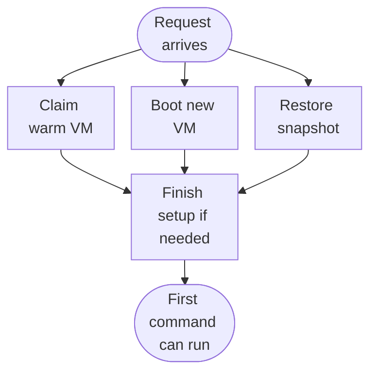

# Cold start

Cold start 是在沒有可立即使用的環境時，啟用 [sandbox](sandbox.md) 或其他執行環境所需的工作。它描述工作到達時會發生什麼事，而不是環境採用哪種啟動方式。它可能涉及 [cold boot](cold-boot.md)、從 [snapshot](snapshot.md) 還原，或啟動語言 [runtime](runtime.md)。

## 範例

測試執行程式收到請求時，[warm pool](warm-pool.md) 是空的。它還原已儲存的 Linux VM，接上專案的 workspace，再等待 sandbox 接受指令。即使 VM 沒有從頭啟動作業系統，這次請求仍會經歷 cold start。

## 量測到可以開始工作的時間

Cold start 的延遲是指等待環境可以開始執行實際工作的時間。對於用來執行指令的 sandbox，請從收到請求開始量測，直到 sandbox 可以執行第一道指令。也要記錄各個步驟，例如讀取映像檔、啟動或還原 VM，以及準備這次請求所需的資料。開機或還原得快，並不能說明整個請求等了多久。

開機和還原都可能是 cold start 的一部分。從 warm pool 取得運作中的 VM，能把開機或還原移到收到請求前，但 VM 仍可能需要設定，例如接上專案的 workspace。

比較需要設定的請求和取得已準備妥當的 sandbox 的請求。說明哪些檔案或映像檔已經快取，讓讀者知道量測涵蓋哪些步驟。不同環境準備方式的範例請參閱 [Agent sandbox 架構](../agent-sandbox-architectures.md#what-is-changing-in-2026)。

[返回詞彙表](index.md)
