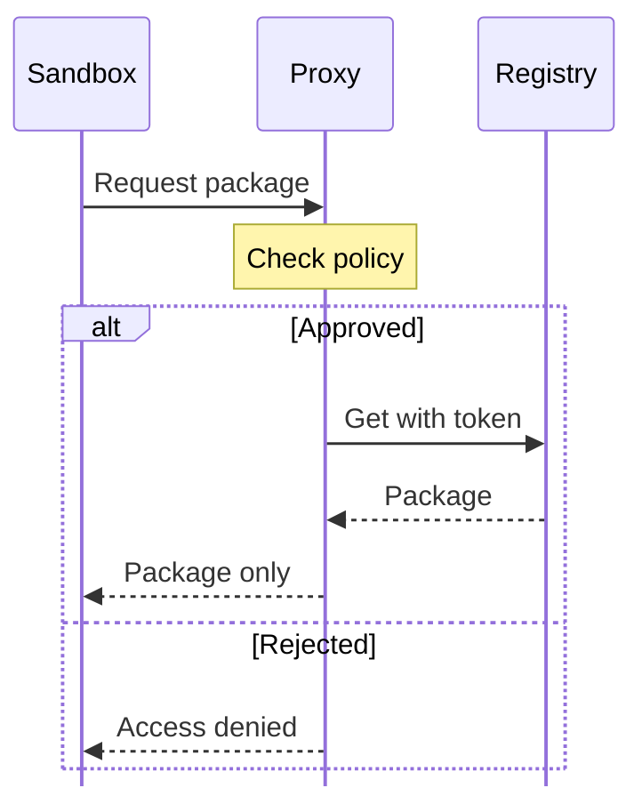

# Credential injection

Credential injection 是指代替 sandbox 中的程式，將 [credential](credential.md) 加入請求。Proxy 是轉送請求的服務，可以先檢查請求並加入 credential，再將請求傳給目的地服務。程式不會直接取得 credential。Proxy 和目的地服務都必須可信任，確保它們不會向程式透露 credential。

## 範例

在 sandbox 中執行的建置工作需要下載一個私有套件。建置工作向 proxy 要求該套件。Proxy 檢查目的地和套件，並確認請求是要下載。它使用該套件的唯讀 token，並將下載的資料而非 token 傳回建置工作。

## 在哪裡加入 credential

Proxy 先套用 [policy](policy.md)，再將 credential 加入要轉送的請求。例如，它可以將 bearer token 加到網頁請求的 [Authorization header](https://www.rfc-editor.org/rfc/rfc6750.html#section-2.1)，也就是目的地服務會讀取的欄位。將真正的 token 放進 workload 可以讀取的設定就不同了：workload 會取得 token 本身。

Token 只出現在 proxy 傳給 registry 的請求中。被拒絕的請求不會到達 registry。

[OpenShell v0.1.9](https://github.com/NVIDIA/OpenShell/blob/v0.1.9/docs/how-it-works/providers/overview.mdx#how-credential-injection-works) 記載了一種做法。程式碼收到的是預留值，proxy 可以在核准的 HTTP 請求中替換這些值。如果 tunnel 讓 proxy 看不到請求，就無法支援這種改寫。

## Proxy 必須保護哪些資訊

Proxy 必須只在核准的請求中把 credential 傳給指定的服務，並確保 credential 不會出現在 workload 可讀取的日誌中。目的地服務也必須可信任，不會在回覆中透露 credential。隱藏 token 並不會讓過於寬鬆的 [egress](egress.md) 規則變得安全：workload 仍可要求 proxy 執行 policy 允許的任何操作。

[返回詞彙表](index.md)
