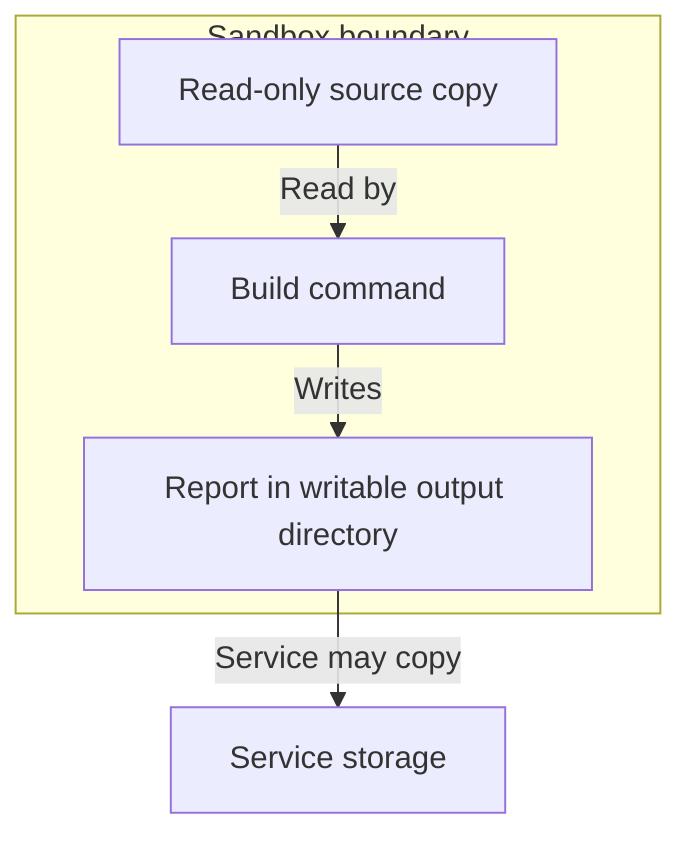

# Sandbox

Sandbox 是一種環境，會限制在其中執行的程式碼可以存取或變更什麼。它可以容納整套應用程式，也可以只執行一小段指令碼。保護程度取決於隔離程式碼的機制、強制執行的規則，以及開放存取的資源。

## 範例

服務在 sandbox 中執行建置命令，並提供唯讀的原始碼副本和可寫入的輸出目錄。命令可以產生建置報告，而不變更原始專案。服務可以選擇將報告複製到外部，而不讓建置工作直接存取服務的儲存空間。

## Sandbox 的組成

[isolation boundary](isolation-boundary.md) 把執行中的程式碼和其他程式碼或資源隔開。[policy](policy.md) 指定程式碼可以使用哪些檔案、網路目的地或 tool。[isolation unit](isolation-unit.md) 說明哪些工作共用同一個邊界實例。[control plane](control-plane.md) 可以啟動 sandbox 並設定規則。Runtime 和 tool handler 等其他元件則在實際發生存取時強制執行規則。

[virtual machine](virtual-machine.md) 和 [restricted interpreter](restricted-interpreter.md) 都可以用作 sandbox，但兩者能執行的程式碼類型不同。即使兩個 sandbox 採用相同的邊界，也可能授予不同的存取權限。比較時，除了採用的技術，還要列出哪些資源或資料可以跨越邊界。請參閱 [Sandbox isolation boundaries](../sandbox-isolation-boundaries.md)。

[返回詞彙表](index.md)
