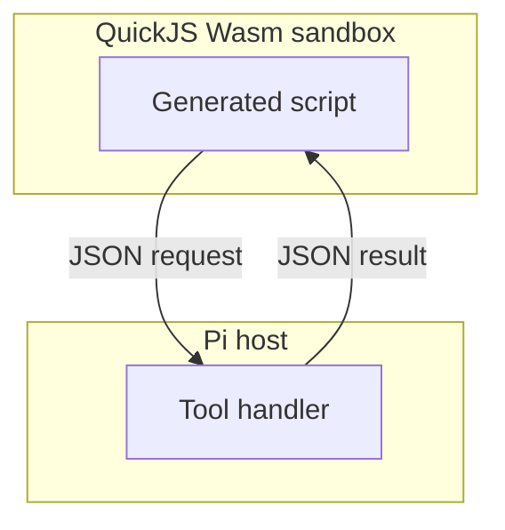

# Pi Codemode

**Pi Codemode 讓模型寫一小段程式來呼叫工具，只把需要的結果傳回模型。** 程式在受限的 [sandbox](glossary/sandbox.md) 裡執行，但它呼叫的工具在 sandbox 外執行。只要執行環境授予權限，工具仍能讀取、寫入或傳送資料。本文以 Pi v1.6.0 在 Node 和 Bun 上的 `CodemodeSandbox` 為例。

## Codemode 做什麼？ {#what-is-pi-codemode}

使用 [Code Mode](glossary/code-mode.md) 時，模型可以寫一段 [JavaScript](https://github.com/earendil-works/pi/blob/v1.6.0/packages/coding-agent/docs/codemode.md#scripts) 來協調 [tool](glossary/tool.md) 呼叫，不必每收到一個結果就讓模型再決定下一步。腳本可以並行處理互不依賴的呼叫、挑出特定欄位，再回傳簡短的結果。例如，工具傳回一筆完整的議題記錄時，腳本可以只回傳議題標題。這能減少送給模型的資料，不會改變工具能讀取哪些議題。如果只需要呼叫一次工具，不必協調或篩選結果，直接呼叫就比較簡單。

## 腳本在哪裡執行？ {#codemode-execution-boundary}

每次執行時，[`CodemodeSandbox`](https://github.com/earendil-works/pi/blob/v1.6.0/packages/codemode/README.md#how-it-works) 都會啟動一個 worker thread，並建立新的 QuickJS 實例。QuickJS 編譯成 [WebAssembly（Wasm）](glossary/webassembly.md)。Worker 讓腳本不占用 Pi 的主執行緒，**但 thread 本身不是權限邊界**。Wasm 實例有自己的記憶體，[host](glossary/host.md) 只開放少數匯入功能，包括通往已註冊 [host functions](glossary/host-function.md) 的橋接介面。腳本無法直接使用 Node.js API、檔案系統、網路、shell 或計時器。

Host 負責執行已註冊的工具。腳本不會直接取得 host 上的工具或資源。

## Host 要檢查什麼？ {#codemode-host-policy}

- **決定要開放哪些操作。** 只能讀取已授權議題的工具，能把存取範圍限制在這一個操作。若開放通用 shell 工具，腳本就能使用該 shell 的權限。在 [Pi 的整合方式](https://github.com/earendil-works/pi/blob/v1.6.0/packages/coding-agent/docs/codemode.md#call-tools)中，腳本能透過 `tools` 呼叫目前 session 可用的工具。只對模型隱藏工具宣告，並不會從腳本可用的工具清單中移除它。
- **驗證參數，並逐次檢查授權。** [Tool schema](https://github.com/earendil-works/pi/blob/v1.6.0/packages/codemode/README.md#declarations-for-the-model)描述輸入格式，但單獨使用 sandbox 函式庫時，它不會用 schema 驗證實際參數。如果你自行整合 Codemode，而 agent 的工具流程已有需要的檢查，就應沿用該流程。[直接呼叫 `tool.execute()`](https://github.com/earendil-works/pi/blob/v1.6.0/packages/codemode/README.md#using-with-pi-agent-core) 會略過 agent 在呼叫前後執行的 hooks。見[工具授權](practice/design/tool-authorization.md)，了解如何分別檢查呼叫者、操作與資源。
- **限制資源，但不要假設取消會回滾。** [Pi 的 Codemode 整合](https://github.com/earendil-works/pi/blob/v1.6.0/packages/coding-agent/docs/codemode.md#limits)把 QuickJS 的記憶體上限設為 256 MiB，也限制每個 Pi process 同時存活的 worker 數量。這個記憶體上限不限制 host 工具。Pi 支援每段腳本的執行期限，但預設不設定。取消會要求 worker 停止，並通知尚在執行的工具呼叫，不會撤銷已完成的操作。在 Bun 上，如果內建操作不檢查中斷，即使呼叫端收到取消結果，該操作仍可能繼續執行一段時間。

## 什麼時候需要另一層隔離？ {#when-to-use-pi-codemode}

要組合現有工具，或在結果送給模型前先縮小資料量，可以用 Codemode。要建置或測試不受信任的程式碼，應該把這些工作放到 [OS 層級的 sandbox](glossary/operating-system-process-sandbox.md) 或 [microVM](glossary/microvm.md)。若連 Pi 和所有 extensions 都要隔離，就讓整個 Pi process 在選定的環境中執行。這些邊界可以一起用：Codemode 可以組合工具呼叫，而工具再到獨立的 Linux sandbox 裡執行工作。

要比較隔離工具與隔離整個 Pi 的做法，請見[Pi 在哪裡執行？](agent-sandbox-architectures.md#where-pi-runs)。要比較其他腳本 runtime，請見 [Code Mode 架構比較](agent-sandbox-architectures.md#code-mode-isolating-tool-scripts-instead-of-shells)。
