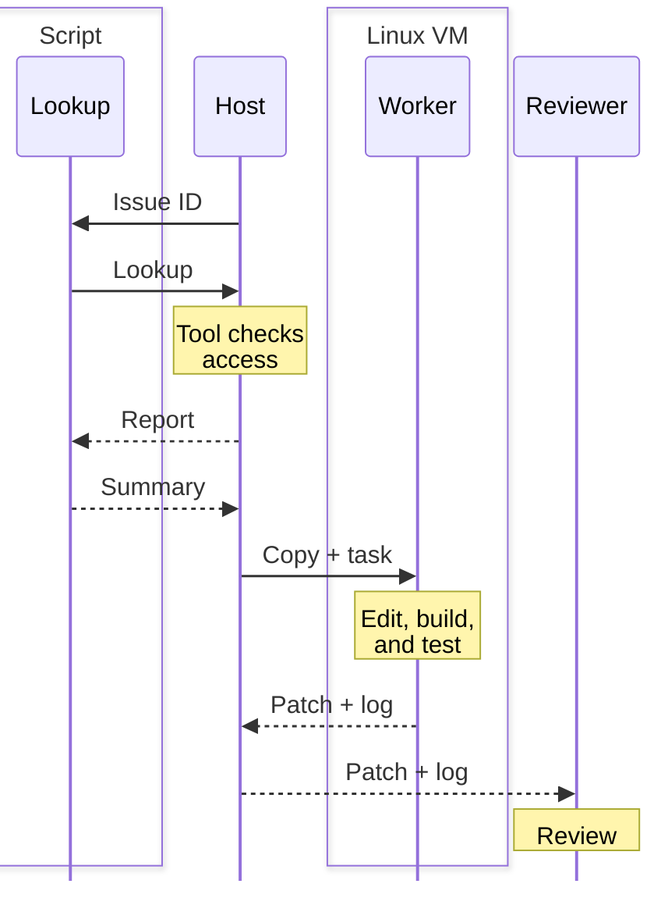

# 從議題到修補檔 {#from-issue-to-patch}

修補檔可以帶出 [sandbox](../../glossary/sandbox.md)，而不必讓裡面的程式碼有權發布它。在這個完整範例中，一份指令碼查詢一筆議題，一個獨立的 Linux worker 編輯並測試原始碼副本，最後由人工審查傳回的兩份文字檔。兩個程式都不能修改原始儲存庫。

這是虛構的服務，限制僅供示範，並非經過測試的部署。[設計比較](choosing-a-sandbox.md) 涵蓋其他使用情境。這裡會追蹤服務代管的一次執行。在這次執行中，Lamp 和 Cedar 是不同的 [tenants](../../glossary/tenant.md)：兩者共用同一項服務，但不得看到彼此的資料。

## 一筆議題，兩道邊界 {#one-issue-two-boundaries}

Lamp 專案的議題 `LAMP-17` 指出，把兩個品項數量相加時，會得到錯誤的總數。例如，兩個品項加上三個品項，總數應該是五個。一支小型 C 程式可以重現這個錯誤。指令碼需要一個查詢議題的 [tool](../../glossary/tool.md)；worker 則需要編譯器和可寫入的暫存目錄。兩者都不需要存取對方的資源。

[Host](../../glossary/host.md) 使用兩道 [isolation boundaries](../../glossary/isolation-boundary.md)，也就是強制限制程式碼可存取範圍的機制：查詢指令碼使用 [restricted interpreter](../../glossary/restricted-interpreter.md)，worker 則使用 Linux [virtual machine (VM)](../../glossary/virtual-machine.md)。Host 的 [control plane](../../glossary/control-plane.md) 管理這次執行，但不會攔截 worker 的檔案讀取操作。它會在 worker 啟動前設定 VM 可見的資源。



## 每個步驟會傳遞什麼？ {#what-moves-at-each-step}

1. **請求 → host。** 獲准提出請求的 Lamp 使用者提供 `LAMP-17` 和一個已核准的 Lamp 原始碼修訂版本。Control plane 會確認呼叫端的身分，並檢查其是否有啟動這次執行的 [authorization](../../glossary/authorization.md)。它把 Lamp、議題和修訂版本與這次執行繫結，不讓任一程式自行選擇。請求若遭拒絕，就不會啟動 worker。
2. **議題紀錄 → 指令碼 → host。** Host 把議題 ID 交給查詢指令碼。直譯器只開放 `get_issue`。Host 端的處理程式會依照這次執行的範圍[檢查呼叫](tool-authorization.md)，讀取本機的預備範例資料（fixture），並只傳回標題和回報內容。指令碼會傳回簡短的工作摘要。回報內容和摘要是資料，不是可以授予更多存取權的指令。
3. **工作和原始碼副本 → worker。** Control plane 啟動一台全新的 VM。Workspace 服務把工作摘要和已核准修訂版本的原始碼與測試複製到一次性的 [`/work` workspace](../data-and-access/workspaces-and-artifacts.md)。Worker 編輯副本，並利用已安裝的編譯器完成測試流程。Worker 沒有[對外的網路路由](../data-and-access/network-policy.md)，也沒有議題 tool，或存取議題儲存區、審查儲存區或儲存庫所需的 [credentials](../../glossary/credential.md)。
4. **兩份文字檔 → 審查。** 這次執行回報建置完成且通過測試後，worker 就會停止。VM 外部的收集元件只從停止使用的 workspace 接收 `change.patch` 和 `test.log`。它從 control plane 取得執行 ID 和基底修訂版本，不從 worker 取得。每次讀取時，審查儲存區都會[確認讀取者是獲授權的 Lamp 指定審查者](../data-and-access/multi-tenant-isolation.md)，並將接收的 [artifacts](../../glossary/artifact.md) 保留七天。這些檔案不可信任：測試記錄不能證明原本的測試確實執行過，也不得讓修補檔自動套用。
5. **結束執行 → 清理。** 無論執行成功、失敗、取消或逾時，control plane 都會切斷這次執行的存取權，並確認 runtime 和 workspace 服務已清除 VM 及其暫存資料。尚未確認清理的資源不會重新使用。[審查儲存區的副本會依其保留期限到期](../data-and-access/workspaces-and-artifacts.md#decide-what-leaves-work)；刪除 worker 並不會刪除這些副本。[資源限制](../operations/resource-limits.md) 說明執行何時停止，以及失敗時會傳回什麼。

## Lamp 的存取規則 {#lamp-access-rules}

下列權限只適用於這次執行，並不是 VM 或直譯器預設授予的權限。

| 角色 | 允許 | 未授予 |
| --- | --- | --- |
| 獲准提出請求的 Lamp 使用者 | 啟動已核准的執行，查看執行狀態和可安全揭露的原因代碼。 | 讀取審查用檔案，除非另有指定為審查者。 |
| 查詢指令碼 | 對 Lamp 的 `LAMP-17` 呼叫 `get_issue`；把工作摘要傳回 host。 | 使用 shell、直接存取檔案或網路、存取其他議題，或使用寫入工具。 |
| Linux worker | 讀取已安裝的工具與函式庫；在自己的暫用 workspace 中讀取、寫入、建置和測試。 | 存取原始的 checkout、host 檔案、Cedar 的 workspace、VM 外部的網路端點、議題 tool 和服務 credentials。 |
| 收集元件 | 從與這次執行繫結的 workspace 讀取兩份指定檔案；將通過驗證的文字寫入這次執行的審查紀錄。 | 套用修補檔、執行傳回的檔案，或接受由 worker 提供的目的地。 |
| Lamp 指定審查者 | 在保留期限屆滿前，讀取這次執行的修補檔和測試記錄。 | 透過這個工作流程發布，或讀取 Cedar 的 artifacts。僅有執行 ID 並不能取得任何存取權。 |

[Control plane 和 runtime](../operations/control-planes.md#who-owns-what) 各有不同的職責。VM 將 worker 限制在已開放的資源內，但只有 tool 處理程式和審查儲存區知道呼叫端能否讀取某筆議題或某份修補檔。這個工作流程中的所有元件都沒有發布權。發布者會是這次執行以外的獨立角色。

## 填寫你的決策紀錄 {#fill-in-your-decision-record}

複製這份紀錄，並套用到你自己的工作。Lamp 的 [isolation unit](../../glossary/isolation-unit.md) 是每個直譯器實例執行一份查詢指令碼、每台 VM 執行一次建置嘗試。用上表列出各角色可以做什麼，再依照 [lifecycle](../operations/sandbox-lifecycle.md) 指定由誰移除各份副本。如果不確定規則是否有效，請標示為尚未驗證，並記下驗證方法。

```text
Task, inputs, and intended outputs:
Who can submit code? What must stay out of reach?
Required boundary and isolation unit (what shares one instance):
Why this choice? Which alternative did it rule out, and why?

For each allowed access: actor → action and exact resource → enforcer/owner:
  Tool, action, and record scope:
  Files read, written, or exported:
  Network destinations and direction (or none):
  Credentials: who holds them, what they allow, when they expire:
  Output: who may read it and what they cannot do:
Forbidden access to check (including another tenant):

Operator and resource limits (including time and concurrency):
On denial, limit, failure, or cancellation: who stops it and what is returned?
Reuse: what can be shared, and what state must never carry over?
Cleanup: for each retained item, who deletes it, when, and how is it confirmed?
What has been verified? What would make you reconsider this design?
```

若要選擇適合的機制，請參閱[選擇 sandbox](choosing-a-sandbox.md)。若要深入了解各項權限和負責方，請從 [Tool authorization](tool-authorization.md) 開始，沿著連結閱讀存取規則與維運說明。
