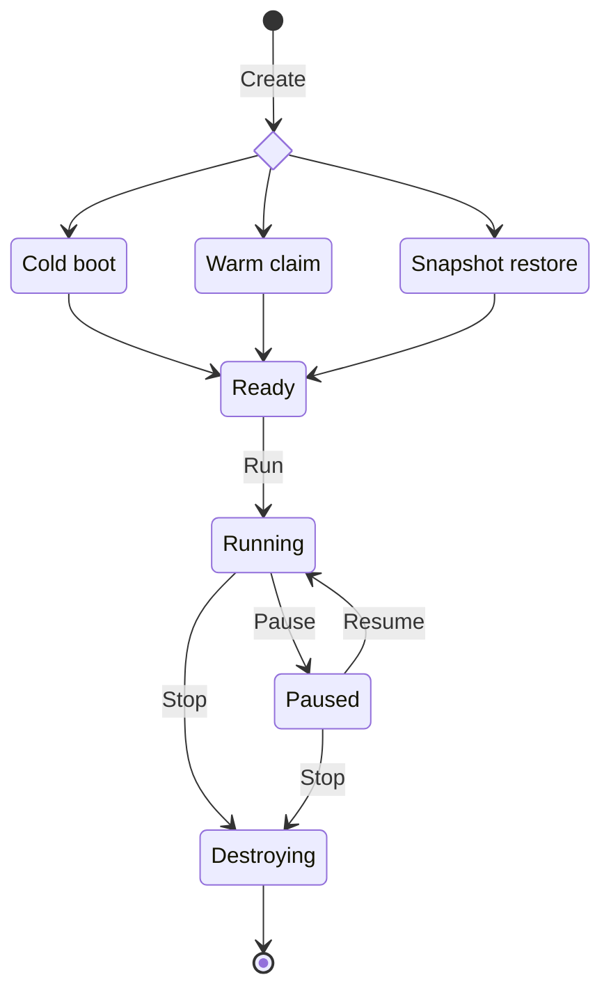

# Sandbox 生命週期 {#sandbox-lifecycle}

啟動 worker 和掛載專案檔案是兩個分開的步驟。在 [Lamp 操作範例](../design/from-issue-to-patch.md)中，每次嘗試都會啟動一台全新的 [virtual machine (VM)](../../glossary/virtual-machine.md)，並附上用完即丟的 [workspace](../../glossary/workspace.md)。服務只會重複使用乾淨的唯讀編譯器映像檔。即使是同一個 [tenant](../../glossary/tenant.md)，也不會重複使用 worker、磁碟或執行中的 process。

## 從建立到銷毀 {#from-create-to-destroy}

Lamp 採用 [cold boot](../../glossary/cold-boot.md)，也就是從頭啟動 Linux，不還原任何執行狀態。圖中也列出其他啟動方式，但這些方式並未開放給這次 Lamp 執行使用。無論以哪種方式啟動，都要通過同一項就緒檢查。暫停會保留目前的 [session](../../glossary/sandbox-session.md)；圖中的還原則是從乾淨的範本啟動新的 session。

如果啟動失敗，或 worker 已就緒但還沒開始執行就被取消，[control plane](../../glossary/control-plane.md) 也會要求清理。為了讓圖容易閱讀，這兩種路徑未列在圖中。

[Warm pool](../../glossary/warm-pool.md) 會預先啟動 worker，並在它們等待期間保留資源。包含記憶體的 [snapshot](../../glossary/snapshot.md) 可以略過開機，但仍會載入已儲存的狀態；僅包含磁碟的 snapshot 會還原檔案，但仍需開機。如果採用 warm pool 或 snapshot，請使用在加入私有資料之前就準備好的範本。不要將用過的 worker 放回乾淨的 warm pool。

## 哪些資料與資源會刪除？何時刪除？ {#what-gets-deleted-and-when}

| 資料或資源 | Lamp 執行中的負責方與處理規則 |
| --- | --- |
| 查詢用 sandbox 與工作摘要 | 查詢實例傳回摘要或失敗後，host 就會捨棄該實例。Control plane 在拆除環境時會捨棄為該次執行準備好的輸入。 |
| Worker 與記憶體 | Runtime 停止 VM 並釋放其資源，不會儲存作業的磁碟或記憶體 snapshot。 |
| 用完即丟的 `/work` 磁碟 | 不論匯出成功、匯出失敗，或該次嘗試沒有匯出，workspace 服務之後都會移除磁碟。這會刪除原始碼副本、工作摘要、修改內容、二進位檔與暫存檔。 |
| 乾淨的編譯器映像檔 | 平台團隊以唯讀方式保留映像檔，供後續的 VM 使用。任何 tenant 的資料都不會寫回映像檔。 |
| 已接收的修補檔與測試紀錄 | [審查儲存服務](../data-and-access/workspaces-and-artifacts.md#decide-what-leaves-work)會在接收後七天刪除它們。銷毀 worker 不會刪除這些檔案。 |
| 限制存取的診斷紀錄 | 服務維運人員可以依照[診斷資料保留規則](observability-and-debugging.md#keep-diagnostic-records-safe)查看狀態與原因代碼。紀錄不含暫存檔。 |

無論成功、失敗、取消或逾時，[control plane 都會追蹤清理進度](control-planes.md#who-owns-what)，直到 runtime 與 workspace 服務確認資源已移除，包括設定只完成一部分時留下的任何資源。如果無法確認移除，control plane 會記錄 `cleanup_pending` 並通知維運人員。在確認清理完成之前，這些資源不能使用，並且仍占用容量。新一次嘗試會取得新的 VM 與磁碟，不會沿用舊狀態。

下一篇：[資源限制](resource-limits.md)說明哪些情況會讓一次嘗試停止，以及服務如何處理各項限制。
