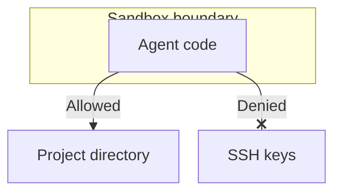
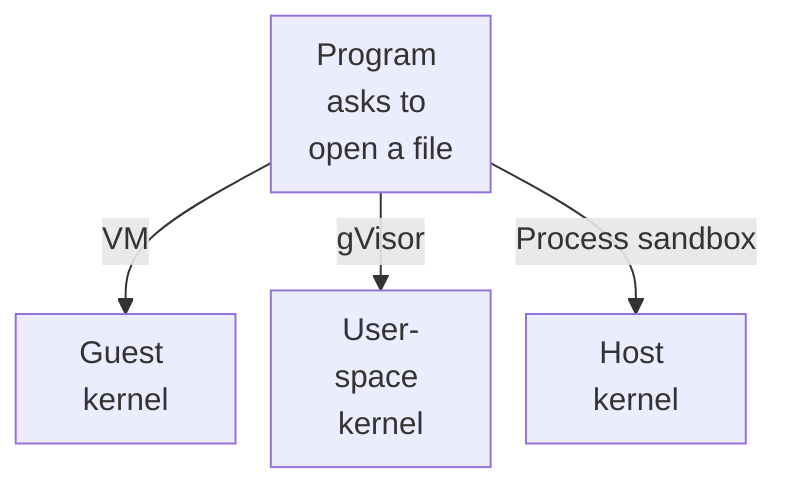
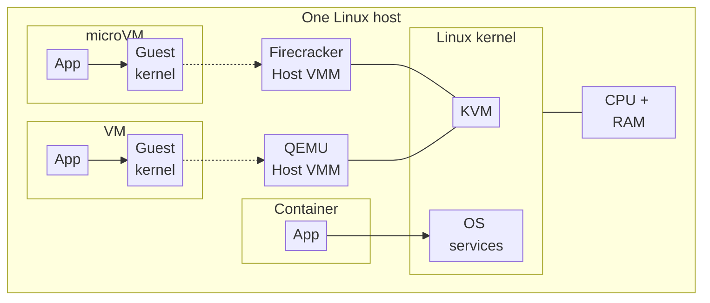

# Sandbox 的隔離邊界

[Sandbox](glossary/sandbox.md) 讓程式在存取受限的環境中執行。例如，協助開發的 [agent](glossary/agent.md) 可能需要讀取及編輯專案，但不需要讀取你的 SSH 金鑰。[Isolation boundary](glossary/isolation-boundary.md) 是讓程式無法觸及這些金鑰的機制。[Policy](glossary/policy.md) 是一組規則，指定程式可以使用哪些檔案、網路目的地和 [tool](glossary/tool.md)。規則必須由元件強制執行才有效。

專案開放給 sandbox 存取，SSH 金鑰則沒有。帶叉號的箭頭表示程式沒有這項存取權。

## 追蹤開啟檔案的請求 {#follow-a-request-to-open-a-file}

假設 agent 為虛構專案 [Lamp（英文）](../practice/design/from-issue-to-patch.md) 啟動測試執行程式。這個執行中的程式實例稱為 [process](glossary/process.md)。[Kernel](glossary/kernel.md) 是作業系統中管理記憶體、檔案和裝置等資源的部分。[System call](glossary/system-call.md) 是 process 向 kernel 發出的請求，用來執行自己無法完成的操作，例如開啟檔案。

1. 測試執行程式要求開啟原始碼檔案 `total.c`。函式庫可以代它發出 system call。
2. 實作作業系統介面的元件會在 process 可見的檔案中查找該路徑，並檢查它是否可以開啟該檔案。
3. 專案檔案可供存取，因此可以開啟。如果 [host](glossary/host.md) 的 SSH 金鑰不在可見範圍內，開啟金鑰的請求就會失敗。Policy 規定只開放專案，不開放金鑰；設定好的邊界會強制執行這條規則。單靠告訴 agent 不要碰金鑰，無法強制執行這項限制。

## 用於作業系統 workload 的 sandbox {#sandboxes-for-operating-system-workloads}

負責建置專案與執行測試的 agent，通常需要執行 [native binary](glossary/native-binary.md)，也就是為特定 CPU 和作業系統介面建置的程式。下列做法的差別在於由誰處理開啟檔案的請求，以及 workload 還會共用哪些資源。

圖中顯示由哪個元件處理程式的請求，不是後續所有操作。User-space kernel 仍可自行向 host kernel 發出請求。

### 1. 使用硬體輔助虛擬化的 VM {#1-hardware-backed-virtual-machines}

[Virtual machine (VM)](glossary/virtual-machine.md) 提供獨立的電腦環境，有自己的作業系統 kernel，稱為 [guest kernel](glossary/guest.md)。它負責處理測試執行程式的檔案請求。同一台 VM 裡的程式共用這個 kernel。[MicroVM](glossary/microvm.md) 著重降低額外開銷，通常會提供較少的裝置，但仍有自己的 guest kernel。無論哪一種 VM，只要 host 開放目錄，guest 就能存取。

**適用情況：** Agent 需要完整且有獨立 kernel 的 Linux [workspace](glossary/workspace.md)。確認 [isolation unit](glossary/isolation-unit.md)，也就是哪些 workload 共用同一個邊界實例。[閱讀硬體輔助虛擬化的 VM 說明（英文）](../isolation/native-programs/hardware-backed-virtual-machines.md)。

### 2. User-space kernel {#2-user-space-kernels}

[User-space kernel](glossary/user-space-kernel.md)（例如 [gVisor](https://gvisor.dev/docs/architecture_guide/intro/) 使用的 kernel）透過自己實作的 Linux 介面處理測試執行程式的請求。它可以自行向 host kernel 發出請求，底層資源仍由 host kernel 提供。這不會阻止程式存取 host 選擇開放的專案資料。

**適用情況：** 你想執行 Linux [container](glossary/container.md)，同時限制它們直接接觸 host kernel 的範圍。請用實際的 [workload](glossary/workload.md)（也就是你要執行的程式碼）測試，因為相容性和效能可能與直接在 Linux 上執行不同。[閱讀 user-space kernel 說明（英文）](../isolation/native-programs/user-space-kernels.md)。

### 3. 作業系統層級的 process sandbox {#3-operating-system-process-sandboxes}

在 [operating-system process sandbox](glossary/operating-system-process-sandbox.md) 中，測試執行程式仍和機器上的其他程式共用 host kernel。Kernel 可以限制 process 看得到哪些檔案，或篩選特定的 system call。隱藏檔案並不會移除程式先前已取得的檔案內容副本。

**適用情況：** 在本機執行的 agent 需要使用開發人員平常用的指令，但不應繼承對 host 不受限制的存取權。確認這些指令啟動的 process 也同樣受到限制。[閱讀作業系統層級的 process sandbox 說明（英文）](../isolation/native-programs/operating-system-process-sandboxes.md)。

### 比較 VM、container 和 microVM {#compare-a-vm-a-container-and-a-microvm}

**MicroVM 是 VM 的一種**。它通常提供較少的虛擬裝置，但如果採用相同的虛擬化後端，它和通用 VM 使用相同的硬體隔離機制。相較之下，原生 Linux container 的 process 直接在 host kernel 上執行。

這個範例在同一台 Linux host 上放置原生 container、[QEMU v9.2.0](https://github.com/qemu/qemu/blob/v9.2.0/docs/system/introduction.rst#L6-L50) VM 和 [Firecracker v1.11.0](https://github.com/firecracker-microvm/firecracker/blob/v1.11.0/docs/design.md#internal-architecture) microVM。QEMU 和 Firecracker 都是 [virtual machine monitor (VMM)](glossary/virtual-machine-monitor.md)，在 host 的 [user space](glossary/user-space.md) 執行。兩者都使用 host kernel 裡的 [KVM](glossary/kernel-based-virtual-machine.md)，在[支援 VT-x 的 Intel x86-64 CPU](https://www.intel.com/content/www/us/en/developer/articles/technical/intel-sdm.html) 上執行各自的 guest。

實線箭頭表示 system call。虛線箭頭表示由 guest 對應的 VMM 處理的裝置請求，不代表所有 I/O 路徑。不帶箭頭的線表示元件使用哪個下層元件，不是請求路徑。QEMU 和 Firecracker 都會開啟 `/dev/kvm` 來使用 [KVM API](https://docs.kernel.org/virt/kvm/api.html#general-description)，但 Firecracker 提供的虛擬裝置種類較少。

**圖片來源：** 依 [Agache 等人，*Firecracker: Lightweight Virtualization for Serverless Applications*，圖 1（NSDI 2020）](https://files.usenix.org/s3fs-public/cdn/nsdi20-paper-agache.pdf#page=4) 重繪及擴充，並參考 [Firecracker v1.11.0 的 host 整合說明](https://github.com/firecracker-microvm/firecracker/blob/v1.11.0/docs/design.md#host-integration)和 [QEMU v9.2.0 的系統模擬概觀](https://github.com/qemu/qemu/blob/v9.2.0/docs/system/introduction.rst#L6-L50)。

#### CPU 執行、記憶體與裝置 I/O {#cpu-execution-memory-and-device-io}

1. **CPU 執行。** 以測試執行程式開啟檔案的呼叫為例。在 x86-64 上，`SYSCALL` 會將 CPU 的 [privilege level](glossary/cpu-privilege-level.md) 從 ring 3（應用程式）切換到 ring 0（kernel）。在 container 中，host kernel 會在 process 的 mount [namespace](glossary/namespace.md) 中查找路徑；[seccomp](glossary/seccomp.md) 可以在查找前攔下呼叫。在任一種 VM 中，應用程式都會進入自己的 guest kernel。兩者都在 Intel 所稱的 **VMX non-root operation**（guest 模式）下執行。進入 guest 的 ring 0 本身不會觸發 [VM exit](glossary/vm-exit.md)；VM exit 是另一種 CPU 狀態轉換，會把控制權交還給 KVM。請參閱 [Intel 的 VMX 手冊圖 26-1](https://cdrdv2.intel.com/v1/dl/getContent/671506#page=4)。
2. **記憶體位址轉譯。** Page table 記錄記憶體位址的對應關係及存取權限。在 container 中，CPU 使用 host 上該 process 的 page table，將虛擬位址轉換成 host 的實體位址。兩種 VM 都有兩層對應：guest 的 page table 將 guest 虛擬位址對應到 guest 實體位址；[Extended Page Tables (EPT)](glossary/extended-page-tables.md) 再將 guest 實體位址對應到 host 實體位址。第一層由 guest kernel 控制，第二層由 KVM 控制。CPU 即使只是讀取 guest 的 page table，也會套用 EPT。請參閱 [Linux KVM 的記憶體文件](https://docs.kernel.org/virt/kvm/x86/mmu.html#translation)。
3. **裝置 I/O。** 如果 guest 需要讀取不在記憶體中的磁碟資料，其驅動程式會向虛擬磁碟發出請求。如果存取裝置觸發 VM exit，KVM 可以在 host kernel 中處理，也可以從 [`KVM_RUN`](https://docs.kernel.org/virt/kvm/api.html#kvm-run) 返回 host 端的 VMM。例如，存取裝置暫存器時，可能會以 [`KVM_EXIT_MMIO`](https://docs.kernel.org/virt/kvm/api.html#the-kvm-run-structure) 返回，請 VMM 處理對指定給裝置的記憶體位址的讀寫。不是每個虛擬磁碟請求都走這條路徑。虛擬磁碟可以使用 host 上的檔案作為後端，但 guest 不能任意開啟 host 的檔案。

| 比較項目 | 通用 VM | 原生 Linux container | microVM |
| --- | --- | --- | --- |
| 隔離與共用 | 使用硬體輔助隔離；同一台 VM 內的 process 共用其 guest kernel。 | [Namespace](glossary/namespace.md) 區隔各個 process 所看到的資源。[Control group](glossary/control-group.md) 可統計或限制資源用量。應用程式直接向其他 container 和 host process 共用的 kernel 發出請求。 | 硬體輔助隔離的方式與通用 VM 相同；同一台 microVM 內的 process 共用其 guest kernel。 |
| 作業系統與裝置支援 | 可以執行受支援的 guest 作業系統，不必與 host 相同。[QEMU v9.2.0](https://github.com/qemu/qemu/blob/v9.2.0/docs/system/introduction.rst#L39-L50) 等 VMM 提供多種虛擬裝置。 | 可以使用不同的 Linux 工具和函式庫，但必須與 host 的 Linux kernel 及 runtime 開放的介面相容。 | 確認支援哪些 guest 作業系統，以及提供哪些較有限的裝置。例如，[Firecracker v1.11.0](https://github.com/firecracker-microvm/firecracker/blob/v1.11.0/docs/design.md#machine-model) 提供虛擬儲存和網路裝置，但沒有圖形顯示裝置。 |
| 從頭啟動 | 先啟動 guest 作業系統，再啟動應用程式。 | 直接啟動 process，不必啟動 guest。下載和解開 image 仍可能增加等待時間。 | 同樣要啟動 guest 作業系統。較精簡的虛擬裝置配置和 guest 可以減少啟動時要做的工作。 |
| 額外記憶體用量 | Guest 作業系統和應用程式都需要記憶體，host 上的 VMM 也需要。 | 不必為每個 container 配置獨立的 guest 或 VMM。每個應用程式仍需要記憶體。 | Guest 和 VMM 同樣需要記憶體。較精簡的虛擬裝置配置和 guest 可減少額外用量。 |
| 適用情況 | 工作需要獨立的 kernel，還需要候選 microVM 不支援的 guest 作業系統或裝置。 | 工作需要已打包的 Linux 工具鏈，且可以接受共用 host kernel。 | 短時間的工作需要獨立 kernel，且支援的 guest 作業系統與裝置足以滿足需求。 |

先選邊界，再比較速度。減少虛擬裝置種類可以讓 guest 透過裝置觸及的程式碼變少，但不能保證隔離更強，也不能保證固定的啟動時間。即使 VM 各有獨立的 guest kernel，也可以共用實體硬體。無論哪種 VM 設計，都要確認每項工作是否有自己的 guest；三種方案都要確認開放了哪些檔案與網路服務。接著[量測同一個 workload（英文）](../practice/verification/measuring-a-sandbox.md)，將從頭啟動、從 [snapshot](glossary/snapshot.md) 還原及從 [warm pool](glossary/warm-pool.md) 分配環境分開量測。

## 用於產生之指令碼的 sandbox {#sandboxes-for-generated-scripts}

Agent 如果只要查詢問題單的標題並排序，可能只需要執行一段會用到一個 tool 的短指令碼。[Runtime](glossary/runtime.md) 負責執行程式碼，或為它設定執行環境。在這個例子中，程式語言或模組的 runtime 可以執行指令碼，而不必提供完整的 Linux 環境。

1. 指令碼向開放使用的 tool 查詢 `LAMP-17` 的標題。Runtime 限制指令碼可以呼叫哪些操作；指令碼不需要開啟問題單檔案，也不用自行發出網路請求。
2. Host 提供的 tool 負責查詢。它會檢查 [authorization](glossary/authorization.md)，也就是判斷呼叫端是否可以讀取指定的問題單。可以呼叫某個 tool，不代表可以讀取它能取得的所有資料。
3. 如果允許讀取，tool 就會傳回標題。指令碼可以在 runtime 內將傳回的標題排序。如果 tool 不檢查 authorization，就算 runtime 限制指令碼直接存取資源，仍無法阻止它透過 tool 讀取問題單資料。

### 4. WebAssembly {#4-webassembly}

[WebAssembly (Wasm)](glossary/webassembly.md) 是可攜的可執行模組格式。Wasm runtime 會檢查記憶體存取，並限制模組只能呼叫 host 提供的外部操作，例如用於查詢問題單的 [host function](glossary/host-function.md)。模組可以共用一個 host process，但預設不會共用彼此的記憶體。產生的程式碼本身可以是 Wasm 模組，也可以在編譯成 Wasm 的程式語言引擎中執行。

**適用情況：** Workload 或其程式語言引擎能在 Wasm 中執行，而且不需要一般的 Linux binary。記憶體檢查不會限制查詢問題單的 tool 本身可以讀取什麼。[閱讀 WebAssembly 說明（英文）](../isolation/generated-scripts/webassembly.md)。

### 5. Engine isolate {#5-engine-isolates}

[Engine isolate](glossary/engine-isolate.md) 是程式語言引擎中的獨立執行環境。每個 isolate 有自己的物件及由引擎管理的狀態，但仍可共用同一個 host process。平台可以讓指令碼使用問題單服務，而不開放一般作業系統介面。

**適用情況：** 指令碼需要引擎的語言功能及特定平台操作，但不需要 shell 或原生套件管理工具。如果服務不檢查每一筆請求，連上服務仍可能取得廣泛的存取權。[閱讀 engine isolate 說明（英文）](../isolation/generated-scripts/engine-isolates.md)。

### 6. Restricted interpreter {#6-restricted-interpreters}

[Restricted interpreter](glossary/restricted-interpreter.md) 只執行自己實作的語言功能，也只開放自己提供的內建項目與 tool。排序由直譯器執行，查詢問題單則交給 host 提供的 tool。直譯器可以在 host 應用程式的 process 中執行；限制語言功能本身，不會提供獨立的作業系統，也不會限制 host 提供的 tool 能造成的影響。

**適用情況：** 只靠一部分語言功能，就足以組合 tool 呼叫並處理結果。確認直譯器支援哪些功能與函式庫。[閱讀 restricted interpreter 說明（英文）](../isolation/generated-scripts/restricted-interpreters.md)。

## 區分打包、管理與隔離 {#keep-packaging-management-and-isolation-separate}

閱讀產品資料時，先問它改變的是哪一層：

| 層級 | 用途 |
| --- | --- |
| 打包 | [Container image](glossary/container-image.md) 提供測試執行程式、它需要的相依項目和初始設定。它不決定測試執行程式可以存取什麼。 |
| 執行 | [Container runtime](glossary/container-runtime.md) 設定測試執行程式的執行環境。[Apple `container`](https://github.com/apple/container/blob/main/docs/technical-overview.md) 在 VM 內執行 container；gVisor 則可執行相容的 image，並由 user-space kernel 處理 system call。 |
| 管理 | [Control plane](glossary/control-plane.md) 啟動、分配及清理環境。[Kubernetes Agent Sandbox](https://agent-sandbox.sigs.k8s.io/docs/) 提供這一管理層；隔離邊界由 runtime 設定。Control plane 可以選擇 workspace，但不會處理每一次開啟檔案的請求。 |

一個 agent 可以使用多個邊界。它可以透過受限的指令碼讀取問題單標題，再將測試工作交給 Linux VM。在這個設計中，指令碼的 sandbox 限制它能呼叫哪些 tool；查詢用的 tool 檢查可以傳回哪些資料；VM 則限制測試工作能存取什麼。

## 確認你是否理解 {#check-your-understanding}

1. 在 process sandbox、user-space kernel sandbox 及 VM 中，各由哪個元件處理開啟 `total.c` 的請求？請看[用於作業系統 workload 的 sandbox](#sandboxes-for-operating-system-workloads)。
2. 如果指令碼可以呼叫查詢問題單的 tool，由誰決定它能否取得 `LAMP-17` 的標題？請看[用於產生之指令碼的 sandbox](#sandboxes-for-generated-scripts)。
3. 就算測試執行程式有自己的 kernel，為什麼還是要確認開放了哪些 host 目錄？請看[使用硬體輔助虛擬化的 VM](#1-hardware-backed-virtual-machines)。

如需同時使用指令碼和 VM 邊界的完整範例，請看[從問題單到修補程式（英文）](../practice/design/from-issue-to-patch.md)；如需了解實際的實作方式，請看 [Agent sandbox 架構（英文）](../agent-sandbox-architectures.md)。
